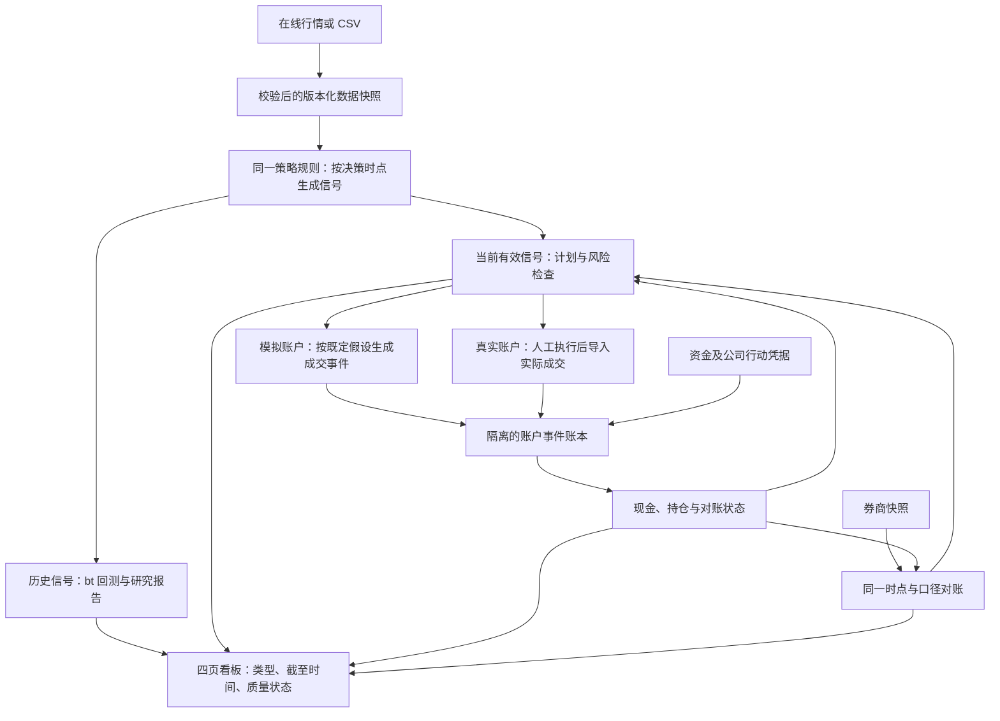

# agents.md 归档快照（历史）

2026-10-14。服务、源码、Goal状态等均按原批次阅读；当前入口为../agents.md和PROGRESS.md，不按历史描述重复开发。

# LyraX：实施规划与进度

**当前任务（2026-10-14）：用户授权完成LyraX v1.95编码，Goal active，正在实施。** 按[v1.95计划](lyraX-v1.95.md)S0–S7推进。S0回归已修；ETF工作区完整CLI/重跑/备份恢复与四页7浏览器检查通过；0595153核心37/原生9通过，最新相关40项通过。期权前缀变量价格/账本桥接已有小样本，报告中断恢复正在验证。期权计划/预留/生命周期、完整实验管理、S5/S6/S7仍未完成；不能把旧804当当前验收。详见[PROGRESS](PROGRESS.md)及[操作草案](V195-USAGE.md)。单Agent、模拟优先，不改GOAL、不提交/推送、不自动下单。下方blocked及服务状态均为历史；恢复按最新进度执行。

**2026-10-14最新用户方向：先跳过真实账号，使用模拟账号。** 本轮已执行隔离demo合成历史模拟：SPY保护Put/持股/现金三组；示例资金100000，策略期末100642.7416；标准账本13测试事件、重复导入0，当前6项实际浏览器/四页及刷新通过，源码c0a9未变。工作区reports/simulated-account/20261014-01，localhost:8501原服务45823运行；[模拟操作](V19-SIMULATION-USAGE.md)。真实账户接入暂缓，当前不是实际行情paper或自然前向记录，原blocked段落保留为改方向前历史。

**2026-10-14 Goal状态：blocked（受阻，非完成）。** 同一真实来源/使用权、券商资料及自然前向条件连续3个目标回合缺失，已调用update_goal并确认blocked。804项无跳过、53/11/12 CLI及当前四页工程证据保留；不重复运行。恢复需提供合格期权小样本/使用权、核验原价/行动、脱敏账单/快照和账户权限/费用/结算，并明确继续；自然周期按真实时间验证。阻塞审计reports/v19-validation/catalog-audit-20261014/external-blocker-audit.json。

**2026-10-14当前终态：** c0a9dcee源码804项无跳过、旧32/32/34及当前53/11/12 CLI/恢复通过，329输入一致，82379退出0；同源码普通wheel完整四页/重复导入/刷新7检查、空账户目录4检查通过，5测试事件及现金100386未变，87788退出0/8518已停。进度和交付已更新；真实期权数据/券商资料/自然周期仍缺，完整计划未宣称完成。证据catalog-audit-20261014/verification.json，所有此前运行中描述为历史。

**2026-10-14最新全量结果：** 原82379/c0a9dcee完整pytest为804 passed in 3118.10s，无跳过；旧32/32/34入口通过。当前核心CLI仍在运行，后续模型/资格/恢复及输入复核待终态，完整门禁尚未完成。证据reports/v19-validation/catalog-final-20261014/verification.json、pytest.log；不用旧802结果替代。

**2026-10-14恢复核对：** 原804全量验收82379仍运行（旧32/32/34入口通过），当前源码c0a9dcee、329冻结输入未变。目录6回归/空账户4浏览器/普通wheel升级已通过；相对7849仅5个目录及入口/验证文件变化，资金/行情/策略/引擎模块未变。权威差异证明：reports/v19-validation/catalog-audit-20261014/source-delta-verification.json。最终审计/交付和三个计划已明确标记7849为历史，未把新全量待终态写成通过。当前恢复执行的是python3；裸python不在PATH，未修改环境。

**2026-10-14当前目录版本验收：** c0a9dcee/804全量82379依赖、旧入口、收集已过，pytest超过35%；只读目录6相关与空账户浏览器4检查通过。当前wheel1a4563a3构建51726/安装34073退出0，88217独立安装/CLI无runtime/pip check已退出0并通过；使用既有哈希锁清洁前缀升级，不冒称新建环境。

**2026-10-14目录页面通过：** 当前c0a9dcee的6目录/CLI/UI回归及67696实际空账户中文目录/研究页/刷新4检查通过，账户/事件/计划/任务均0；54104服务已停。82379新全量门禁仍运行（catalog-final-20261014），旧7849/802只作为目录补齐前证据。

**2026-10-14目录审计缺口补齐中：** H0承诺产品目录此前未进页面/CLI，现补16方法、5核心/期权叠加/HX条件等级及数据/风险，CLI不建runtime/账户/计划，空账户可看目录。1实际副作用失败后修复，6相关回归通过39.24秒；当前c0a9dcee，新catalog-final-20261014全量已启动，旧7849/802属补齐前。不把静态目录作交易权限，不因此实现HX/B条件交易。

**2026-10-14当前交付审计（证据10-13）：** v1.9核心编码与本地工程验收通过，业务7849da9a；802无跳过、旧32/32/34及核心52/模型11/资格12、清洁Conda普通wheel、真实ETF复现、完整中文四页5/账单7/计划6浏览器和恢复同源。final-audit-20261013逐证明/327文件哈希核对通过。所有进程/临时服务已停止；主/期权/对冲计划状态、README、USAGE、支持矩阵、审计/交付已更新。真实期权/原价/券商凭据与F/OF自然观察仍缺，B/HX按条件，整个计划/Goal不标完成。当前以[PROGRESS](PROGRESS.md)及[V19-DELIVERY](V19-DELIVERY.md)为准，下方分批记录属历史。

**2026-10-13最后计划UI补证：** 当前7849重复账单1291完整渲染7浏览器检查通过，5事件/现金100386不变，9494服务已停。新计划样本5132及81025三角色实际UI/SQL绑定已通过；19365正在新普通wheel检查生成/重复/导出/在途取消/释放/刷新，89097服务8516活跃。802门禁输入未变，终态待。

**2026-10-13当前原生提交UI：** 51580当前7849原生17CLI/完整恢复通过；1291报告目录加强等待的浏览器副本在新普通wheel恢复测试账本检查两次上传/预检/提交及完整四页/刷新，9494临时服务8515活跃。主脚本/源码/测试/锁未改，不改变802验收输入；证明终态待。

**2026-10-13当前完整四页通过：** 7849新普通wheel等待stStatusWidget隐藏后的76941完整四页/刷新5检查通过，中文已目视清晰、金融事件0；online-final-20261013-second/browser-complete-verification.json和完整截图/正文保留，8843临时服务停止。当前补新原生17CLI/账单及计划操作，业务源码/测试/锁未改。

**2026-10-13中文完整页面核对：** 7849新普通wheel四页/刷新6414通过且截图中文已清晰，原63217服务已停；截图含Stop，进一步76941等待stStatusWidget隐藏后检查完整渲染，8843服务8514活跃。代码/锁/测试未改，新802门禁仍有效。

**2026-10-13新安装/在线证据通过：** 7849源码新v19-release-install普通wheel、独立-I导入、pip check/CLI help/QuantLib已通过（73958退出0）；真实ETF增量和两次研究完全复现（online-final-20261013-second）。当前6414实际浏览器检查新普通wheel四页/刷新及中文字体，63217服务8514仍活跃；旧802门禁92638已成功终止，不再轮询。

**2026-10-13当前7849补证：** 全量802/旧CLI32/32/34/核心52/模型11/资格12已通过；新Conda93201/78包依赖71010/wheel67328退出0，独立检查73958运行中。新真实ETF增量/两次研究/核对全部成功，2841行/10-12/ce6c快照、指标/CSV一致，金融事件0。待新普通wheel浏览器；临时浏览器已配置只读本机Windows中文字体，后续截图确认。

**2026-10-13新源码全量通过：** 92638退出0，7849源码802项无跳过通过（3024.93秒），旧V1/V15/V18为32/32/34CLI，核心52/模型11/资格12及完整恢复全通过，最终输入未变。当前补新源码普通wheel/安装/在线/UI证据：93201新Conda创建中，4619新wheel已成功（e0db437b…）；真实ETF增量82888通过、原2841行/10-12/ce6c快照保持，研究运行中。前次目录未准备就重定向失败已确认命令未执行，再按依赖重试，不修改用户其他环境。

**2026-10-13新最终门禁：** 修复后的7849源码旧V1入口32CLI/12历史信号归档、生命周期/daily及完整恢复通过（37d2b7c522f9480984ef70b5bca4c8b3）。新增92638门禁，目录full-final-20261013-second，前置旧V1/V15/V18后全量/核心/模型/资格CLI，实际收集数待。当前冻结源码/测试/配置/脚本/锁；旧801/c9证据保留为历史，不冒充新版本。

**2026-10-13默认signals兼容修复：** 旧V1路径修复后58772发现execute局部history导入遮蔽策略history，独立1失败已复现；已改intent_history/group_history并补六个月双策略/12归档/重复/零金融事件回归，28项CLI/对冲测试无跳过通过。当前业务指纹7849da9a；旧801/c9安装/在线/UI属于修复前。43714重跑旧V1，check_v19已加入旧V1/v1.5/v1.8入口前置门槛，新最终验收待，不隐藏新缺陷。

**2026-10-13旧入口实际缺陷修复：** 全量801/核心52/模型11/资格12已通过；额外V1入口10060因resolve大写Lyra只读失败。仅3旧脚本verify_offline/v15/v18新增同目录小写可写别名选择，主业务c9不变；58772正在重跑V1。801原清单在运行时不变，随后这3脚本变化须逐入口新验，不隐藏初次失败或沿用旧清单作为它们的新结果。

**2026-10-13全量终态：** 73772退出0，801项无跳过通过（3199.09秒）；同c9源码核心52、模型11/恢复、资格关联12/恢复CLI全通过，327输入最终哈希不变。full-final-20261013/verification.json为LOCAL_AUTOMATED_CHECKS_PASSED。清洁wheel、真实ETF复现及三批浏览器证据一致；继续旧入口兼容和P5/O6/H5逐项审计，外部条件仍缺、不宣称完整Goal结束。

**2026-10-13全量继续：** 73772原进程超过71%、终态待；门禁清单输入文件逐SHA256及主源码c9额外核对一致。实际计划/账单/四页浏览器均已结束、临时服务已停；只保留全量进程。最终审计索引已修正旧50回归及文档状态，不把旧源码/历史计数当当前结果。

**2026-10-13计划UI通过：** 当前c9普通wheel浏览器6检查已通过，绑定3角色SQL revision1、重复生成同READY、JSON/复盘导出、同步预留、在途取消阻断、确认后取消释放。预留9776.5463→0，金融事件1/hash不变，88206退出0、8513服务停止。初始样本缺绑定及React Aria操作超时已保留，未改门禁/源码。全量73772已超过62%、终态仍待。

**2026-10-13计划UI剩余验证：** 73772全量仍运行。新增v5合成计划样本两次因未绑定execution超时、无新计划；首次点击绑定的假定成功已改FAILED并保留。React Aria文本框点击不可靠展开选项，8671正在使用Open按钮+逐角色SQL断言检查；清洁wheel8513服务68986仍运行。绑定后重跑计划生成/导出/人工在途取消，当前不得计为通过。源码/测试/配置/锁/脚本未变。

**2026-10-13交付证据收口：** README已按当前c9接口修正过时的始终BLOCKED描述；[V19-DELIVERY](V19-DELIVERY.md)汇总清洁wheel、真实ETF复现、四页/重复账单和实际17CLI证据及未完成项，明确仍进行中。全量73772已超过53%，尚无最终结论；文档链接检查通过，源码/测试/配置/脚本/锁未变。

**2026-10-13原生账单/UI验收：** 当前c9源码17条原生指派异常恢复CLI及完整恢复通过；普通wheel看板在恢复测试账本两次上传/预检/提交、四页/刷新7实际浏览器检查通过，5事件hash及现金100386不变。证据native-final-20261013/verification.json、restored/browser-verification.json。全量73772仍运行；测试账单不代表实际用户凭据。

**2026-10-13同源码安装/在线/UI：** c9源码普通wheel在新v19-final-install清洁安装/独立导入及锁检查通过；真实Yahoo ETF2841行截至10-12、两次bt研究全部指标/CSV一致、重复增量同快照，金融事件0；普通wheel应用真实浏览器四页/刷新5检查通过。证据reports/v19-validation/clean-final-20261013及online-final-20261013（含browser-verification.json）。全量73772仍运行，未完成P5/O6/H5；账单/计划写操作另验。

**2026-10-13清洁安装验证：** 73772全量测试超过26%、最终结果待；新增Conda81559正在创建v19-final-install，普通wheel91579退出0，132个Python文件指纹与主源码c9一致，安装待创建终态。首次默认渠道ToS失败已保留，按README显式conda-forge重试；未改全局配置。

**2026-10-13发布及全量门禁：** 原93251退出0、50项无跳过通过（4409.87秒）；7文件已发布，当前主源码c9ece734与隔离验证源码一致。全量验收73772依赖检查/收集通过，实际801项、pytest正在执行，目录reports/v19-validation/full-final-20261013。模型接口/USAGE已同步；运行中冻结源码/测试/配置/锁/脚本，最终结果待终态。不沿用旧计数宣称完成。

**2026-10-13验收复核：** 原回归93251已从37推进38项，仍存活、无最终汇总；主源码b5a34f72保持不变。[最终验收追踪](V19-FINAL-AUDIT.md)已列P/O/H与条件批次证据缺口，[模型Delta接口](V19-MODEL-GREEK.md)已记录隔离实现的完整契约，均不冒充验收通过。

**2026-10-13模型Greek当前任务：** 原b5a34f72源码50项回归句柄93251仍在运行，52条核心CLI已通过。隔离c9ece734源码54相关、2项有符号模型Delta、11公开CLI/完整恢复均通过；READY正向/完整备份1项也已通过（432.60秒，2335退出0）。当前未发布到src；原50终态后发布5个hedging文件（model_greek/greek_evidence/service/option_sizing/stage_assessment）和2个options文件（forward/activation），核对同指纹。check_v19全量入口已补输入哈希/无跳过门槛及Linux测试临时目录，完整运行待合入；[PROGRESS](PROGRESS.md)已收敛为63行恢复摘要，883行原文在[历史进度](PROGRESS-HISTORY-20261013.md)。真实资料/自然前向及最终统一验收仍待，Goal active、单Agent。

**2026-10-13最新恢复入口：** 期权schema2前向月末冻结与paper/real激活门禁已实现；隔离冻结时钟paper正向、READY及完整备份恢复、伪造来源资格拒绝均有专项证据。最新b5a34f72…源码使重跑冻结任务也重验原始链采集清单、所选报价和来源资格；伪造清单或资格并重哈希的归档不再被缓存返回。此前缺口独立复现1失败，修后3项专项通过；同源码过期月末CLI拒绝通过（forward-gate-cli-20261013-fourth）。旧正向包1519文件复核SUCCESS为本次修复前源码；完整新源码回归/浏览器、真实资料/自然前向周期仍待。详情docs/PROGRESS.md来源关联节；Goal active、单Agent继续。

**2026-10-12最新恢复入口：** 逐笔供应商Greek凭据归档/只读CLI、已有持仓及Beta目标候选Delta资格、非demo新增OPEN阶段及冻结审计复核已实现。最新3cd38757…源码36项相关无跳过回归、12条公开CLI及完整备份/恢复通过，见docs/PROGRESS.md来源关联节；全部实际资格示例为隔离工程fixture，真实期权资料和前向周期仍缺。模型Greek未获独立资格、实际前向期权信号及最终P5/O6/H5全量/浏览器验收待做；V2不启动、Goal active、单Agent继续。

**2026-10-12最新恢复入口：** 来源/证券身份/券商期权权限和OPEN/CLOSE分操作门禁已接入，96154444…源码112项相关回归无跳过、公开10CLI/完整备份恢复、A8机械8模板重评通过；证明均按类型区分合成测试与实际资格，见docs/PROGRESS.md顶部。随后补父决定工具身份/版本映射及来源登记畸形校验；最新3e927e79…源码20项相关回归无跳过通过，需最终全量P5/O6/H5。Greek来源/模型资格、实际期权前向资料与自然周期仍待；V2不启动、Goal active、单Agent继续。

**2026-10-12最新恢复入口：** 显式股票单位草案/全组单位基准/原数量守恒/历史切片及单次关闭义务已实现；aad6016b源码44+33=77无跳过回归通过，公开40CLI/完整恢复为末次损坏基准诊断修复前独立指纹。现在应用多个期权标的共享现金/复合合约键和自然生命周期，actual LEAN多标的测试15395及新A8机械生命周期37090运行，见PROGRESS；C#已变化，旧A8证据暂不代表当前资格，完成新证据前不授予新资格。源码冻结，随后多标的公开CLI/备份、来源/行动/权限关联及统一P5/O6/H5；真实条件独立受阻，Goal active、完整v1.9未完成、单Agent继续。

**2026-10-12最新恢复入口：** 组内期权OPEN/CLOSE迟到流程及共享缓存审计13项无跳过通过（101.50秒）；此前0ff83329源码40回归/20CLI已验。最新b6106a7f源码第三轮20CLI也已通过；同源码最终40相关回归也已通过（338.33秒），全部句柄已结束，见PROGRESS恢复摘要及实际终态日志。下一项股票报价变化/剩余修订，然后单位行动、原生异常恢复、多期权标的/资格及统一P5/O6/H5。完整v1.9未完成，Goal active；单Agent继续。

**2026-10-12期权CLOSE当前任务：** OPEN61相关回归无跳过和11CLI已验（2b2d96af历史指纹）。组内迟到完整OPEN/CLOSE往返1项通过；独立恢复账本复现原退出时间重哈希仍可被接受，已补review/阶段压力时间与金融前缀核对。第三轮往返和第二轮公开CLI正在验证，保持源码冻结。资金账单误填及CLI缺预检哈希均按原门禁拒绝，详情PROGRESS；完整v1.9未完成，Goal active。

**2026-10-12期权迟到OPEN当前任务：** 公开11条CLI已通过，指纹2b2d96af…，报告bound-option-late-cli-20261012-third/verification.json；demo序号3、SPY100、权益99993，缺状态时钟拒绝、重跑无重复。相关回归第三轮仍在运行（NTFS完整备份较慢），保持源码冻结；此前53通过后/tmp耗尽的失败日志保留。下一项组内期权CLOSE双时钟、异常恢复，随后价格/单位行动修订、多期权标的/资格及最终P5/O6/H5。单Agent，Goal active，v1.9未完成。

**2026-10-12股票退出CLI已验：** 18条公开CLI与64相关回归、重复退出/重哈希2项、跨父窗口退出/完整恢复1项为同源码通过。报告hedge-stock-close-cli-20261012/verification.json；demo最终序号4、SPY100、现金/权益19994.4/29994.4，没有实际账户写入。下一项原生期权迟到风险及中间异常恢复，价格/单位行动重规划、多期权标的/资格及统一最终验收仍待；Goal active。

**2026-10-12股票原生退出批次：** 草案显式exit/独立CLOSE身份、原OPEN依赖/结算、当前风险激活前缀、共享模拟/refresh和原日历独立校验已实现。64相关回归/完整备份恢复（192.37秒）、重复退出/重哈希2项（9.88秒）及跨原父窗口退出/恢复1项（58.64秒）通过。公开CLI整链正在验证；报价变化重规划/单位行动及其他持续管理仍待，不能宣称v1.9完成。详见PROGRESS，单Agent继续。

**2026-10-12最新已验批次：** 日历与原冻结成交收盘一致性已修，独立失败复现后最新f77969dac4…源码29相关回归无跳过（123.57秒）、6迟到CLI通过，详见PROGRESS。先前98/8及代理篮子CLI属于27b0f164历史指纹。全部验证进程结束；下一项实现原生股票反向CLOSE草案/组依赖/显式激活，再推进其余期权/生命周期及最终验收。Goal active，v1.9未完成。

**2026-10-12代理篮子验证：** SPY60/IEF50 + GLD Put两期2/3包的实际LEAN独立测试1项（38.52秒）及公开CLI1项通过；股票盈亏173.130400、期权增量45.00，报告proxy-basket-compare-cli-20261012/comparison/report.md。源码27b0f164…与98/8回归一致。仅合成账务/公平比较，多个期权标的仍未支持。正在增加迟到日历收盘一致性回归。

**2026-10-12最新回归：** 股票阶段/监测/daily/备份98相关回归无跳过通过（245.97秒）；与代理比较8报告回归为同一源码。6迟到CLI按其先前独立指纹保存。下一项验证SPY/IEF股票篮子与不同GLD代理Put的共同资金/控制基准，尚在运行；v1.9未完成，单Agent继续。

**2026-10-12研究比较修复：** 代理long_put+显式股票篮子的无对冲控制保留原篮子，不额外买入代理股票。实际LEAN三组及报告8项回归无跳过通过（141.32秒），proxy-basket-control-final-check.log；包括自然末期、完整备份及UI。单期权标的限制保留，多期权标的及最终P5/O6/H5仍待。

**2026-10-12当前修复批次：** 旧schema1实际工作区经公开v19-init升级后，原风险缺少option_positions只在独立重建为空时兼容；归档不改写。实际迟到CLI发现并修复零现金纯卖出被负买入预算阻断。股票14专项回归通过（100.89秒），6实际CLI通过，verification位于hedge-stock-late-cli-20261012-eighth；模拟审计独立核对冻结剩余数量/费用，监测对损坏显示BLOCKED。现继续相关回归及代理期权/原股票篮子公平比较修复，均待最终源码统一验收；v1.9未完成。

**2026-10-12迟到股票阶段批次：** 明确绑定原冻结执行状态及实际处理知识截止，未来股票/Beta/Greek不得进入风险；普通风险和未激活计划不放宽。原子阶段模拟审计/财务回滚、缓存及备份已实现；最终114相关回归通过，实际迟到CLI尚在验证。仅独立stock重放，不宣称期权/全部旧月度计划已支持；其余生命周期/资格及P5/O6/H5仍待，详见PROGRESS。

**2026-10-12独立股票对冲批次：** hedge-stock-draft/hedge-stock-activate已实现独立用途、原价/CAS/阶段/资金及股份检查、原生预留、部分事实、重跑和备份。无虚构月度Signal；基础refresh/review/daily/UI已适配。零现金纯卖出预算缺陷已修复；最终90相关回归、9实际CLI通过，补充下一交易日模拟正向1项通过，重跑不新增财务。股票关闭/持续管理及其他生命周期/最终验收仍待，详见PROGRESS；Goal active，v1.9未完成。

**2026-10-11自然比较批次：** 自然到期monthly-compare三组同资本/数据/终止日已经实现；真实LEAN午夜状态与账本日终口径缺陷修复，实际时间保留。7报告+13自然/路径回归无跳过、1实际CLI通过，报告见PROGRESS。全为synthetic账务验证；独立股票草案正在实现，v1.9未完成。

**2026-10-11最新生成/审计批次：** Goal已恢复active。hedge-native-plans复用原生期权draft并生成依赖组，股票仍为既有草案引用；独立财务/压力重算及父候选根数量校验已修复两处重哈希漏洞。最终54相关回归、7实际CLI通过，先前61/2native/4CLI属生成前源码，详见PROGRESS。自然到期同资本比较正在实现；完整v1.9及最终验收仍未完成。

**2026-10-11最新原生阶段门禁批次：** 组内option激活/OPEN/退出冻结/CLOSE及基础simulate强制本次阶段请求；daily/CLI贯通，允许本阶段解除其父自身pending，其他事故/在途仍阻断。阶段证据/备份引用检查及只读账本事务计数器修复已实现；最终60相关回归含native格式成功激活/完整恢复通过。此前20原生激活/daily回归为备份修改前证据，非最终源码全量。此前get_goal返回usageLimited（历史用量受限，现已恢复active），不是用户暂停或完成；全部句柄已终止，恢复动作详见PROGRESS。原阶段计划生成、归档加固、剩余生命周期/多标的/最终P5/O6/H5仍待。

**2026-10-11最新阶段压力批次：** hedge-stage-check按当前组/账本/资源和显式报价检查全部部分成交数量端点，复用既有QuantLib情景；未到账卖出款不提供购买力，卖出费按账本从应收净额扣除。现金/担保/其他计划股份/报价数量/有限情景阈值及未来报价门禁已验证；57相关回归、6阶段服务验证（5重叠）和4实际CLI/source通过，见PROGRESS。CHECKED不授权交易，尚待接原生计划/激活/daily及完整权限/行动资格、原P5/O6/H5；Goal active，coding未完成。

**2026-10-11最新执行组修订批次：** hedge-group-revise保留实际成交/旧计划切片，只替换确切未成交数量引用；期权原持仓/新剩余分别退出，晚到旧成交及修订前生效的新事实仍检查。当前头版本用于监测/父关闭，历史版本永久保留；不新增财务/预留/订单或授予阶段资格。最终95相关回归、2项连续期权修订补充验证及9实际CLI/source通过，见PROGRESS。逐阶段完整资格/原生计划、候选变更/单位行动重规划和P5/O6/H5最终验收仍待；Goal active，coding未完成。

**2026-10-11最新异常核实批次：** options.incidents/option-incident-review已接标准凭据实际财务异常、恢复事实/冲销更正/同序号时点对账、人工凭据SHA256不可变归档及备份恢复；最终余额恢复不自动消除原异常。共享监测对所有账户阻断未核实财务事件与当前异常，无父计划也不能绕过；核实不改账/释放预留/授权交易。最终87相关回归、2真实LEAN机械daily恢复回归及10实际CLI/source通过，见PROGRESS。提前指派/净交割异常的原生恢复样例、组修订/逐阶段完整资格、多期权主标的/自然比较和原P5/O6/H5仍待；Goal active，coding未完成。

**2026-10-11最新股票计划/期权估值批次：** 本次显式期权报价经来源/单位/可用时间/价差及股票收盘时点校验后加入权益；原股票数量仍用股票原价，不重复扣保费或乘数。create/revise/simulate、月度绑定/daily、CLI及计划页上传入口已接，修订幂等键包含期权输入/时点，旧估值不默认继承。迟到模拟区分成交状态与处理知识截止，不能用成交后的交易所价格；备份分类/引用已修复。最终78相关回归、2真实LEAN机械daily恢复回归、5实际CLI/source及READY备份恢复通过，见PROGRESS。中间异常核实恢复、组修订/逐阶段资格及原P5/O6/H5仍待，Goal active，coding未完成。

**2026-10-11最新预测覆盖/逐凭据批次：** 基础计划/模拟成交前预测持仓不能侵占活跃实际或在途保护切片，显式退出引用仍保留实际未分配期权。标准期权凭据批次及待核实解决追加不可变逐序号财务快照/前缀哈希，中间异常不被最终恢复掩盖；重跑和备份重算财务字段/校验哈希，运行状态只读展示，旧审计明确LEGACY_UNVERIFIED。最终78相关回归+2解决/恢复回归、3实际daily CLI/source通过，见PROGRESS。无报价时估值/压力资格NOT_EVALUATED，当前预留/待核实状态不冒充历史PIT。实际期权估值贯通基础计划、异常凭据核实恢复工作流、执行组修订/逐阶段资格及P5/O6/H5仍待；Goal active，coding未完成。

**2026-10-11最新统一监测批次：** 父/组/严格分配的共享hedge-status已接daily前后、原计划/模拟/期权激活OPEN门禁及四页只读视图/待办，绑定/日常事务先发布锁后SQLite。最终19原生/监测/UI回归+7绑定回归、4实际CLI/source通过，见PROGRESS；中途磁盘耗尽及NTFS rename失败如实保留，新增有限原子发布重试，最终原生在Linux /tmp。逐凭据中间风险/预测覆盖、组修订/逐阶段资格及P5/O6/H5仍待，Goal active，coding未完成。

**2026-10-11最新严格父分配批次：** schema2完整保护集合绑定确切父版本/候选/证券/合约与目标张数；关闭后历史/实际风险保留、禁止同ID静默换父版本及升级后降级，读取/重跑/备份核验已实现。最终55相关回归无跳过、9实际CLI/source核对通过，见PROGRESS。下一项统一daily/四页接父/组/分配及逐凭据风险；组修订/逐阶段资格和原P5/O6/H5仍待，Goal active，coding未完成。

**2026-10-11最新执行组批次：** 原stock/option计划的不可变父版本绑定、候选数量/方向/条款桥接、实际开平及结算前缀进度、每次成交历史依赖复核、父关闭联动及备份已实现；最终57相关回归无跳过、11实际CLI/source核对通过，见PROGRESS。组不新增预留/不授予执行资格；严格保护父版本、组修订/逐阶段风险压力与daily仍待，coding Goal active，未宣称完成。

**2026-10-11最新父关闭批次：** 追加独立不可变关闭凭据与 hedge-intent-close，CAS/实际到期/在途组阻断、关闭后禁止修订、原决定/账本/预留保留及备份校验已实现；44相关回归无跳过、补充1精确创建重跑、7实际CLI/source核对通过，见PROGRESS。下一项 ExecutionGroup/严格保护父版本与 daily 生命周期集成；其他H4/原P5/O6/H5仍待，coding Goal active，未宣称完成。

**2026-10-11最新多腿批次：** 十条自然末期样例覆盖A8指定到期路径，官方14原生凭据逐条前缀风险快照及方向门禁已实现；11项相关回归无跳过/10实际CLI/source核对通过，见PROGRESS。实际样例均CHECKED，临时空头/缺权益阻断用独立样例验证，不虚构原生观察。下一项父关闭/执行组/严格保护父版本与daily生命周期集成；提前指派/异常恢复/H4/原P5/O6/H5仍待，coding Goal active。

**当前Goal：完成v1.9的coding工作（active）。2026-10-11最新自然桥接：** 月度末期官方自然到期、Put行权、备兑Call/现金担保Put指派及下一交易日清理/结算已阶段实现；14项自然/旧A8/变化路径实际引擎回归无跳过及4CLI通过，源码再次匹配，见PROGRESS。合成模型而非真实或自然前向；多腿/提前指派及异常恢复、daily/父执行、多期权主标的/H4/原P5/O6/H5尚待，不宣称coding完成。

**2026-10-11最新H3报告批次：** 同资本/同数据/同窗口的变化路径策略、股票篮子、现金三组比较已实现；成交日价差及股票/期权净盈亏分解、47日引擎/账本核对、5项相关回归及实际CLI通过，源码再次匹配，见PROGRESS。合成工程报告位于reports/v19-implementation/monthly-variable-compare-cli-20261011/comparison/report.md，不是实际策略业绩。下一项官方自然生命周期账户桥接；父执行/H4/原P5/O6/H5及真实外部条件仍待，Goal active。

**2026-10-11最新H3机械批次：** LEAN月度回放扩展完整变化原价/期权bid-ask、每周期多张数与多股票篮子，10项新路径/全部旧A8实际引擎测试无跳过通过；固定离线样例+实际CLI及47日引擎/账本核对通过，源码再次匹配，见PROGRESS。单一期权主标的/合成机械路径，不是历史业绩；自然生命周期、统一比较报告、父执行/H4/原P5/O6/H5仍待，Goal active。

**2026-10-11最新压力批次：** hedge-stress统一股票/已有期权/条件候选情景已实现，复用QuantLib、冻结权益及原费用，不重复计保费或入金收益；43项相关回归无跳过/4实际CLI及源码核对通过，见docs/PROGRESS.md。全部scenario_only、无账本/预留写入；下一项H3官方LEAN变化原价、多股票多张数/自然生命周期账户桥接，父执行及H4/原P5/O6/H5仍待，Goal active。

**2026-10-11最新H2批次：** 保护Put/Collar/代理Put只读整张候选、持股/在途扣除、筹资后Beta与费用、原链父备份恢复已阶段交付；44项相关回归无跳过及7实际CLI通过，源码再次匹配，见docs/PROGRESS.md。全部合成研究、executable=false，无新财务预留；统一压力/H3多资产变化原价多张数及生命周期、父关闭/执行组、H4与原P5/O6/H5最终验收仍待。Goal active，不宣称v1.9完成。

更新日期：2026-10-11（Asia/Shanghai；v1.9核心工程进行中）。需求依据：[GOAL.md](../GOAL.md)。

**2026-10-11最新H0父研究决定：** Spec/风险/候选/身份/基础策略绑定、不可变修订链和跨版本范围检查已实现；纽约交易日生效门禁已补，20项相关回归（21.91秒）和当前源码7CLI通过。关闭/执行组与严格分配父版本、H2期权/H3–H5及统一验收继续，详见PROGRESS。

**2026-10-11最新H0持久保护引用：** SQLite不可变版本链/原子CAS、跨版本重复保护检查、部分成交切片及完整恢复已实现；33项相关回归（33.88秒）、7条实际CLI通过，当前源码匹配。正式HedgeIntent/Spec/ExecutionGroup、来源资格、H2期权/H3–H5与统一验收继续，详见PROGRESS。

**2026-10-11最新H0证券登记：** 不可变证券版本/登记时间、代码窗口/稳定ID冲突及coverage显式绑定、完整备份核验已实现；27项相关回归（35.56秒）及7条实际CLI通过，当前源码匹配。登记仅声明身份，来源/行动资格、父意图/持久分配、H2期权/H3–H5与统一验收继续，详见PROGRESS。

**2026-10-11最新H0账本覆盖：** 新增只读hedge-coverage，按账户前缀/注册条款及明确人工在途事实计算，部分成交分离且不重复预留；36项相关回归（31.42秒）和3条实际CLI通过，当前源码匹配。证券身份映射尚未注册/核资格，父意图与持久分配、H2期权/H3–H5和统一验收继续，详见PROGRESS。

**2026-10-11最新H0保护分配计算：** 同父Collar单次保护、跨意图防重复、实际/在途分离、确切条款/交割物及时点门禁已实现；37项相关回归（29.37秒）及当前源码3条实际CLI通过。纯计算尚未接统一账本/持久计划，H0事实适配、H2期权/H3–H5及最终验收继续，详见PROGRESS。

**2026-10-11最新H0/H2股票候选：** 冻结目标、筹资后整数数量及只读hedge-preview已实现；29项前批回归、预算修正后16项相关回归及3条实际CLI已通过（不同源码分批，不替代最终全量）。现金预算/费用/Beta归档绑定、禁止隐式卖空已覆盖；保护分配接入、H2期权/H3–H5及统一验收继续，见PROGRESS。

**2026-10-11最新H1归档/历史前缀：** 已接显式期权账本前缀、中价/Greek一致估值、原账本hash、不可变风险归档及完整恢复；修复备份漏复制hedging目录。当前25项相关回归无跳过通过（49.66秒）、8条实际CLI检查通过、源码匹配。H0完整契约/H2–H5、官方月度生命周期适配及最终统一验收仍待，详见PROGRESS。

**2026-10-11最新H1风险基础：** 新增只读hedge-exposure、共同窗口OLS/市值Beta、显式Greek单位及当时所知账本门禁。当前31项相关回归无跳过通过（50.94秒）及3条实际CLI检查通过，源码指纹匹配；仅合成重述风险示例。H0完整契约/H1归档及历史期权前缀、H2–H5、官方月度生命周期适配与统一验收仍待，见PROGRESS。

**2026-10-11最新生命周期凭据批次：** 已接日常显式凭据/待核实解决、原子审计恢复及ID一致性守卫；最新54项无跳过通过（53.21秒），9条实际CLI检查通过、源码指纹匹配。原冻结开平仓daily兼容7项也无跳过通过（131.23秒），官方引擎自然生命周期账户桥接/H及最终验收继续，详见PROGRESS。

**2026-10-11最新daily成交批次：** 已接demo显式冻结OPEN/CLOSE顺序推进、两个提交边界恢复、临时失败恢复审计及备份关联。最新34项相关回归无跳过通过（164.22秒）；六条实际CLI核验已通过（两组时点阻断/正确成交/重复），源码指纹一致、事件不重复。完整官方生命周期任务、H和统一最终验收仍待，详见PROGRESS。

**2026-10-11最新账户估值批次：** 已接期权中价/负债估值、独立schema2来源核验、daily期权对账/报告、报价引用备份及中文看板。当前源码36项相关回归无跳过通过、6CLI检查通过（4成功/2预期股票数据阻断），手算权益9993、重跑无重复事件，证据见PROGRESS。A8追加五模板退出已终态通过；完整官方生命周期/daily执行及H、最终P5/O6/H5仍待，真实期权来源/券商/自然前向未新增。

**2026-10-11最新退出/报价批次：** 三模板10项退出/完整恢复回归已通过；补充A8五模板退出正在运行。冻结模拟已分开成交价格时点与处理知识截止，实时决策仍严格PIT；17项相关报价/选约/月度回归通过，最新实际延迟平仓3CLI已通过且源码hash一致；开仓/完整恢复1项回归已通过（123.60秒），A8补充回归等待终态。旧21CLI留作修正前证据，不替代最新统一验收；下一项继续官方生命周期/daily→H→P5/O6/H5。

**2026-10-11退出执行集成：** 已编码冻结/CLOSE/取消入口、资源指纹、备份引用及看板待办；首轮冻结意图误计账务异常造成自阻断已修复，开仓任务ID关联同步修正。最新21项资金/期权守卫/四页组件回归无跳过通过、38.21秒；三模板21条实际CLI已通过、源码指纹一致；取消/资源CAS/完整恢复回归及A8剩余五模板补充回归仍等待终态，不据此宣称退出闭环或v1.9验收完成。详见docs/PROGRESS.md；下一项仍O3/O4→H→统一最终验收。

**2026-10-11计划复核R2.1：** [对冲审查](V19-HEDGING-REVIEW.md)发现10项设计缺口，已补入H计划：固定100/单张机械适配不足、时点和筹资后敞口、风险退出/交割失败、资源并发、已成交保护分配、统计口径、静态跨月及公平对照。验收规格从16扩为28组；这是文档修正，未新增对冲代码/业务测试通过证据。下一开发仍按O3/O4→H0/H1→H2及H3引擎适配→H4→P5/O6/H5；单Agent、原范围保留、不改GOAL或自动交易。

**2026-10-11用户新增：股票组合对冲R2。** 已完成官方资料调研并加入v1.9：[调研](V19-HEDGING-RESEARCH.md)、[H0–H5计划](V19-HEDGING-PLAN.md)。首批为风险快照、保护Put/Collar/代理Put、减仓/反向产品对照和统一任务；HX股票卖空/期货/配对/动态等按条件扩展。H尚未编码；收尾O3/O4退出生命周期后接H，原P/O范围不减少，最终P5/O6/H5统一验收。本轮只改规划/进度文档；继续单Agent、不改GOAL、不自动交易。

**当前任务：继续完成LyraX v1.9，尚未最终验收。** 已新增证券/来源/行动关联、分操作风险降级及期权权限凭据登记/审阅，最新96154444源码10公开CLI/完整恢复通过、测试账户序号0；74相关为上一小修前源码。最新扩大回归session76427正在工作区临时目录运行，源代码冻结；此前36通过后/tmp满已明确记录及仅清理终止目录。A8当前持久机械凭据reports/v19-implementation/multi-native-engine-evidence-20261012/verification.json，8模板PASSED。下一项Greek资格及必要退出缺Beta全链路，然后P5/O6/H5最终同源码验收。docs/PROGRESS.md权威恢复；真实期权资料/券商/自然前向不可合成替代，单Agent、不改GOAL、不自动交易。

**2026-10-11最新批次：** A8八模板合成demo激活及开仓模拟已扩展；18项激活通过，8组模拟资金/持仓通过。备兑/保护/collar不重复买入账户已有100股。最后备份恢复测试因/tmp耗尽失败，已清理本任务可重建临时目录，恢复测试已通过（1项115.72秒），24条激活CLI已通过，32条模拟CLI已全部通过（证据详见PROGRESS）。最终全量、账户退出/生命周期/日常任务与真实来源/前向独立待完成，详见PROGRESS顶部。

**生命周期状态修复：** 正常关联平仓/行权/指派/到期现独立派生lifecycle，不使开仓FILLED倒退；20项独立资金/历史/冲销/人工回归通过。成熟引擎4项回归、生命周期7CLI及A8模拟32CLI均已通过，详见PROGRESS顶部。完整事前退出和日常生命周期入口仍未完成。

**退出检查最新批次：** exit-review按7日工程窗口/显式风险减仓检查剩余持仓、同步报价、短腿依赖及本计划条件担保释放；30项相关回归/最新源码2CLI已通过。仍只读DRAFT，不记账、不提前释放担保或自动滚仓。下一步冻结退出与成熟引擎后续事实任务，详见PROGRESS顶部。

历史阶段（仅CSP，已由上方A8扩展）：仅demo合成历史CSP可经plan-activate建立READY预留；月度信号/当前报价/引擎资格/资金/对账/账户序号门禁及原子证据归档保留。部分成交、在途订单过期、历史查询、重复意图阻断及完整备份恢复已验证。修复备份期权引用分类后25项无跳过通过（69.17秒），最新3条CLI归档通过，详见docs/PROGRESS.md。真实/前向及其他模板仍阻断；不自动成交或下单。

历史阶段（CSP模拟入口）：plan-simulate只将schema2归档的实际LEAN收盘OPEN事件导入已激活demo CSP。当前报价/引擎源码/单位/数量/费用/对账门禁、稳定任务与原子导入，T+1应收和实际担保独立核对；20项无跳过回归、最新4条CLI及完整恢复通过。修正测试夏令时结束后结算时刻断言，详见docs/PROGRESS.md。该入口不表示完整日常/生命周期/自然前向验收，不产生券商订单；自动日常模拟任务仍待贯通。

最新资金规则：激活后入出金关闭未提交部分，有在途订单只保留其实际剩余占用，部分成交担保/事实保留。冲销或改变张数/风险不重启同一旧信号；人工审计按历史账本序号过滤。15项无跳过回归（含模拟/完整恢复）及7条CLI通过，入金增加100不形成盈利，详见docs/PROGRESS.md。继续其他模板官方生命周期、完整模拟/日常任务及最终验收。

历史阶段（A8账户扩展前）：27例完整回归通过（77.96秒），新增collar Call指派/Put行权及熊Put部分指派后恢复。A8八模板工程资格均通过但不授予READY/来源资格；当前激活/模拟仍仅demo CSP。新源码9项激活/模拟/资金关闭/完整恢复回归通过（188.19秒），10条CLI归档及交割顺序/中间股票现金额外核验通过。未建用户账户DB、不下券商订单，详见docs/PROGRESS.md。下一项全部模板激活/模拟资源及完整日常任务，不以27例替代最终验收。

剩余核心：月度计划/模拟退出生命周期/日常任务资源闭环、新增H0–H5组合对冲核心、最终统一源码全量/CLI/实际浏览器及P5/O6/H5交付。来源资格/真实期权、券商条件、自然前向周期单独待输入，不以合成替代；单Agent、不改GOAL、不自动下单。历史314/315全量及52CLI均按源码保留，不冒充最新最终验收。

**当前状态：M0–M3完成，V1工程验收通过（2026-10-09）。** Python3.11.15独立Conda，26包基础显式锁/77包wheel SHA256锁清洁重装；最终180项测试无跳过、32条离线CLI、真实Yahoo行情/bt两策略复现、四页浏览器及备份恢复全部通过。V1验收基线见docs/ACCEPTANCE.md和docs/DELIVERY.md；用户追加的真实行情更新至2026-10-08（2835行）及研究看板进展见第8节最新记录。系统名称已按用户要求更新为LyraX，名称验证见第8节。真实账户凭据、实际月末前向周期与长期调度未以模拟替代；V2未启动。

**v1.5交付基线：P0–P5工程验收完成。** 六类只做多模板、中文工作台、统一bt多策略、因子PIT、版本绑定/daily、任务发布恢复及v3完整备份已交付；清洁环境231项无跳过、新41条/旧32条CLI和实际浏览器通过。交付：[docs/V15-DELIVERY.md](V15-DELIVERY.md)，操作：[docs/V15-USAGE.md](V15-USAGE.md)。真实价值/质量因子、核验执行原价及真实账户凭据独立受阻，套利/自动交易未启动。实际进度见docs/PROGRESS.md。

**历史复核（v1.8实施前）：D01/D02已在v1.8修复。** 当时日常任务未贯通独立信号/执行价格，并发因子导入可能漏更新；复现及231项旧基线见[设计审计](V15-DESIGN-AUDIT.md)。修复证据见[v1.8交付](V18-DELIVERY.md)，与v1.9待修的R01/R02分开。

**已交付基线：LyraX v1.8核心工程交付完成。** P0–P5已实现并验收；最终257测试、新34/旧32CLI、清洁Conda1.8.0及浏览器通过；真实行情增量和分段/成本研究成功。源码1437f4c6…，记录docs/PROGRESS.md、docs/V18-DELIVERY.md。实际工作区v4只绑定signal，accounts/events/plans为0；execution/valuation原价资格、真实基本面和券商资料仍受阻；调度模板未安装，V2未启动。此为v1.9实施前基线，不按下面历史规划重复开发。

**此前v1.8规划（历史）：** 用户要求检查改进点及可扩展功能，本轮只编写计划：[docs/lyraX-v1.8.md](lyraX-v1.8.md)。核心顺序为P0契约/基线 → P1数据用途及并发发布修复 → P2可还原研究归档 → P3分段/成本验证与协议 → P4执行复盘/诊断/本地待办 → P5验收。D01/D02仍未修复，实际版本仍为1.5.0；新增策略、券商只读接入、外部通知和V2列条件扩展。本轮保留业务/配置/测试/锁/GOAL；检查证据reports/v18-planning/。收到实施要求后的第一项为D01/D02正式回归和数据用途/锁顺序/v4迁移契约。

阅读顺序：第 3 节看模块与配置，第 4 节看计算和操作约定，第 5 节看开发批次与优先顺序，第 6–7 节看验收，第 8 节区分历史开发记录与本轮检查。新的细化应收敛实现选择，不以增加框架、策略或服务扩大 V1。

## 1. 目标理解与交付边界

交付一个可在个人电脑 Linux / WSL 上运行的个人量化投资系统。历史研究与日常跟踪共享数据契约和策略规则：历史信号进入 bt 回测；当前有效信号结合账户生成计划，随后进入模拟成交或人工执行、成交导入、对账和看板。验收依据是数据、时间、资金和记录正确，操作可复现，而不是收益达到某个目标。

- V1：单市场、单账户、单币种，日线数据、月度调仓、只做多、无杠杆，中文界面和文档。
- 默认工程演示：美股 ETF，SPY / IEF / GLD，USD；市场时区与页面展示时区分别处理。
- 真实账户从零现金、零持仓开始，只由实际资金事件、成交及有凭据的公司行动更新。
- 离线测试、历史回测、模拟账户与真实账户明确标识并隔离存储；模拟资金不写入真实账本。
- 示例资金、权重、费用和风险参数均由配置提供，不代表用户的实际资金或投资偏好。
- V2 自动交易、Qlib、机器学习、多市场和多币种暂不纳入开发任务。

## 2. 已检查的仓库状态

以下是本次读取时的状态，后续恢复任务时需重新核对 Git：

| 项目 | 实际结果 |
|---|---|
| 工作目录 | `/mnt/c/quant/project/lyra`（本机WSL物理显示大小写不同，写入使用小写） |
| 当前分支 | `main` |
| 提交历史 | 尚无提交 |
| 项目文件 | 已有目标、计划、README、源码、测试、配置、templates、examples、scripts 和 docs；当前均未提交 |
| README / 项目配置 | 已有 `pyproject.toml`、演示及真实配置模板，以及区分已验证/待验证入口的 README |
| 应用代码、测试和依赖锁文件 | 业务/CLI/UI及180项测试已验；conda-linux-64.lock与requirements-linux-py311.lock实际清洁重装通过 |
| 最后变更 | 完整V1集成、bt费用/时序修复、对账阻断、零量资格、状态摘要、界面原因/费用与交付文档；GOAL保持原样，未提交Git |

本轮只读检查包含：读取 GOAL、规划、进度、验收及已有报告指针；核对配置文件、`git status --short`、`git branch --show-current` 和 `git log -1 --format='%h %s'`。最后一条确认尚无提交，并非应用运行故障。

当前独立Conda主前缀及第三清洁前缀已安装/导入，180项全量无跳过、32条离线CLI与完整bt演示通过。真实Yahoo与固定快照复现、四页实际提交/刷新/对账/重启和README恢复均成功。旧失败按批次保留，不作为当前状态；没有修改GOAL、用户其他环境或全局权限，没有Git提交/推送。

## 3. 技术路线与模块职责

遵循 GOAL.md 的默认选型，通过适配层连接成熟库，不重写回测引擎或通用绩效指标。

| 部分 | 规划选型与职责 |
|---|---|
| 运行环境 | Python 3.11.15；独立 Conda 前缀，Linux x86_64 / WSL 已验证 |
| 数据计算 | pandas、NumPy |
| 回测与绩效 | bt 作为唯一主回测框架，优先复用 bt / ffn 的指标和图表 |
| 看板 | Streamlit，调用共享业务接口 |
| 行情存储 | Parquet，保存来源、价格口径、公司行动和版本信息 |
| 账户与运行记录 | SQLite，事务、唯一约束、可追溯事件与快照 |
| 配置与依赖 | `configs/`、`pyproject.toml` 和锁文件；只锁定实际验证过的版本 |
| 验证与调度 | pytest；系统定时任务调用统一 CLI，无常驻调度服务 |
| 在线行情 | Yahoo Finance / yfinance 1.7.0 已实际下载并回测；供应商拆股调整 Close 不直接用于真实份额 |
| 离线数据 | 标准 CSV + 小型固定测试样本，无需密钥 |

在线数据源在 M0 核对访问条件、使用限制、原始价格和公司行动语义，M1 以实际下载和报告验证。若候选源不可用，记录错误并评估替代源；不静默切换来源或价格口径，不自动购买服务。开源代码许可证与行情使用权限分别记录。

目录职责如下，实际实现与验收映射见docs/ACCEPTANCE.md：

| 路径 | 责任与主要产物 |
|---|---|
| `src/personal_quant/data/` | 在线/CSV 适配、交易日历、规范化、校验、增量缓存和内容哈希 |
| `src/personal_quant/strategies/` | 固定权重与趋势策略，生成带版本和时间的目标权重 |
| `src/personal_quant/research/` | bt 适配、信号与成交时序、可复现回测和报告 |
| `src/personal_quant/portfolio/` | 账户事件、现金持仓计算、收益口径、风险检查和对账 |
| `src/personal_quant/execution/` | 计划、模拟跟踪、成交/资金 CSV 导入和幂等控制 |
| `src/personal_quant/ui/` | 账户总览、策略研究、调仓计划、运行状态 |
| `configs/` | 演示市场、策略、费用、资金、风险和数据参数 |
| `tests/` | 小样本、独立预期值、关键行为与回归测试 |
| `docs/` | 操作说明、阶段进度、决策、依赖许可证与限制 |
| `reports/<run_id>/` | 本地产生的报告与运行清单，具体格式在 M1 确定 |

### 3.1 完整链路及唯一写入责任

bt 维护研究回测内部的组合状态；真实/模拟账户各自只由其事件账本派生现金和持仓。CLI、看板、模拟器和导入器调用共享业务接口，不各自维护一套余额。看板读取已经发布的结果，不因页面刷新重新生成成交或运行回测。

### 3.2 模块间最小契约

以下是实现前需要冻结的字段组，不要求引入额外服务或复杂协议框架。

| 产物 | 最低字段与衔接规则 |
|---|---|
| 数据快照 | schema_version、snapshot_id、内容哈希、标的/币种、价格口径、日期范围、可用时点、采集时间、质量结果；区分行情真实来源与合成样本 |
| 策略信号 | signal_id、snapshot_id、策略/配置版本、决策时点、实际生成时间、适用交易日、有效期、目标权重、原因、状态；历史重建与前向生成分开标记 |
| 账户快照 | account_id、账户模式、账本序号、估值时点、结算现金、应收应付、预留、持仓、价格快照、对账状态；快照可从事件重建 |
| 调仓计划 | plan_id、意图 ID、修订号、signal_id、账户依据版本、状态、有效期、逐项交易及依赖、参考价格/时间、费用、检查结果；权重不直接等同于可成交数量 |
| 成交与账务事件 | account_id、event_id、外部来源/ID、事件类型、数量、价格、金额、费用、币种、生效时间、记录时间、结算日期、关联计划/原事件；事件是事实记录 |
| 对账结果 | reconciliation_id、账户/账本版本、快照来源、核对时点、现金口径、数量及金额差异、状态与解决依据；不能以忽略差异代替解决 |
| 运行与报告 | run_id、任务幂等键、输入/输出清单、源码/依赖/配置版本、开始结束时间、状态及失败原因；报告引用确切的信号、快照或账本版本 |

### 3.3 配置、环境及最小可用范围

配置采用带 schema_version 的TOML，启动时统一校验并保存解析快照与哈希。示例、用户本地配置和密钥分别管理；实际CLI通过全局--config显式选文件，默认读取当前工作目录configs/demo.toml，不自动合并local或环境变量中的投资参数。最终值可在信号/计划/研究清单核对，见docs/CONFIGURATION.md。real 模板的资金、费用、交易单位及风险条件不继承 demo 值，未填写的必填项保持缺失。未知键、非有限数值、非法权重、币种混用及缺少必填项直接报错，不静默修正用户参数。

以下数值已写入固定工程演示配置并验证；不作为真实账户默认值或投资建议。

| 配置组 | 演示约定 | 真实使用要求 |
|---|---|---|
| 身份与路径 | demo、paper、real 三种运行环境；各自独立数据库、导入目录与报告目录 | 每个环境仅一个账户；真实写入须显式指定 real 与 account_id，不从页面或上次命令隐式继承 |
| 市场与资产 | 美国 ETF、USD、SPY/IEF/GLD；市场日历与交易所时区显式绑定 | 用户选择市场、标的和币种后校验支持范围 |
| 资金 | 研究初始资金与演示模拟入金分别设为 10,000 USD，来源标签不同 | 真实配置不提供“初始资金”写账入口，资金只通过实际事件导入 |
| 策略 | 固定等权基准、126 日趋势过滤，月末决策 | active_strategy 必填才能生成真实计划；策略变更从下个合格决策日生效 |
| 成本 | 佣金 2 bps、滑点 5 bps、每笔固定费用 0；1 bp = 0.01%；研究现金利息为 0 | 根据账户条件配置预计费用；实际账本依据实际费用，不用估计值覆盖账单 |
| 数量与风险 | 真实单位模拟默认 1 份交易单位、单标的目标/预计持仓上限 60%、最低现金缓冲为权益的 1% | 交易单位、缓冲、仓位上限均需用户明确，未配置则只允许研究 |
| 结算与窗口 | 模拟成交后 1 个交易日结算，目标意图窗口 5 个交易日，日计划只对指定交易日有效 | 以实际账户规则和结算凭据为准；演示结算假设不可作为券商事实 |
| 数据与重试 | 下载超时 20 秒，最多 3 次尝试，重试前等待 1、2 秒；参数可调 | 认证/参数错误不盲目重试；限流尊重服务端等待时间，超出任务期限则记录失败 |
| 其他必填值 | demo 配置为发布延迟30分钟、执行价偏离5%、价格跳变检查25%、对账基线7天；它们属于工程假设，各自验证边界 | 关键值缺失时列出具体字段并阻断计划，不能用演示阈值替用户作风险选择 |

- 只对明确选择“等权”的配置生成规范化等权值；显式输入的权重不自动归一化。目标可以保留现金，费用和现金缓冲导致的实际权重偏离应展示。
- 日线研究、CSV 账本和看板可在缺少真实账户配置时运行；缺少任一实际条件只阻断依赖它的环节。
- V1 采用标准 CSV 接口，暂不承诺自动识别每家券商的原始账单。提供字段映射说明及小型测试账单，缺少结算或公司行动字段时明确要求补齐。
- 只引入必要的 Parquet、交易日历和配置解析依赖，精确版本随主依赖一起锁定；不为本轮计划预设未经验证的兼容性结论。

## 4. 开发前约定的关键口径

### 4.1 数据与时间

- 至少记录标的、市场、币种、交易日期、市场时区、原始 OHLCV、复权价格、分红/拆股、来源和实际获取时间；公司行动缺失与确认无行动必须区分。
- 数据版本由规范化内容、来源和价格口径生成哈希；每次变化的获取时间放在采集记录中，不参与行情内容身份。相同下载结果不新增业务记录；历史修订保留可追溯版本，已有回测仍能定位原始输入。
- 区分行情所属时点、可用时点和实际采集时点。历史回测的可用时点如由收盘时间及发布延迟推定，应明确标记为假设，不冒充历史实时采集证据。
- 交易日历决定月末与下一交易日，展示统一转为 Asia/Shanghai。非交易日、停牌、缺失价格不补成可成交行情。
- 缺失、重复、非正价格、价格关系异常、币种混用和过期数据产生结构化检查结果。缺少公司行动解释的大幅跳变需提示或阻断相关流程。
- 增量更新回看少量重叠日期并去重；发生分红、拆股或历史修订时，重验受影响区间，不能只追加最后一天。
- 新鲜度以“市场日历上最近一个已完整收盘、且超过配置发布延迟的交易日”为基准，覆盖周末、节假日、夏令时和提前收市；盘中未完成日线不得视为完整日线。
- 下载适配器显式设置复权、公司行动、缺失行、修复、时区及日期边界参数，不能依赖库默认值。零成交量记录保留并在信号回看/参考价/成交日检查中阻断，不能认定已确认停牌或向前填充成可成交价格。若采用 yfinance，拟显式使用 `auto_adjust=False`、`actions=True`、`keepna=True`、`repair=False`，再核验实际字段语义；这些参数并不能直接证明 Close 是未调整成交价。
- 复权历史可能随后续公司行动或供应商修订改变。前向信号冻结其当时快照；历史研究注明“按当前下载版本重建”。只修改未来原始数据且保持既有快照不变时，过去信号必须不变；供应商修订历史数据则形成新研究版本，不能覆盖旧信号。
- 不完整数据可以作为诊断产物保留，但不能发布为可交易快照。账户估值缺价时显示最近估值的时间及不完整状态，不把缺失持仓价值记为零。

### 4.2 两个策略的初始规则

本规则在观察回测结果前确定。后续规则或参数变更应增加版本，并记录变更原因。

| 策略 | 决策规则 | 研究中的目标安排；实际执行见 4.5 |
|---|---|---|
| 基准：固定权重 | 每月最后一个交易日收盘后，输出配置中的固定权重；示例三只 ETF 等权 | 下一交易日收盘按目标权重再平衡 |
| 候选：月度趋势过滤 | 对每只 ETF，比较月末复权收盘价与截至该日最近 126 个有效交易日收盘价的简单平均值；严格高于均线时保留其基准权重，否则权重为 0 | 被过滤部分保留现金，不放大其他标的仓位 |

- 126 日是初始工程参数，不代表最优参数；禁止根据最终评估区间反复挑选窗口。
- 回看窗口内需要交易日历所要求的完整数据。任一必要标的数据不足或异常，返回明确状态，暂停生成可执行计划。
- 策略输入为决策时点可用数据、配置、账户状态；输出为目标权重、决策时间、适用交易时点、策略版本及原因。
- 策略模块不执行交易。历史回测与持续跟踪调用同一规则，未来数据不得进入历史信号计算。
- 基准和候选使用共同的预热窗口及有效评估区间。开发/检查区间与最终评估区间在配置中按时间分开。
- 月中首次启动或新增入金默认等待下一个合格月末决策，不隐式增加调仓频率；评估起点、首次信号与首次成交日分别展示，预热区间不计入绩效。
- 真实账户需要显式配置启用的策略及风险参数；研究中同时比较的两个策略不能同时争用一个账户，也不能根据最终回测收益自动选择并启用“赢家”。
- 区分“有效信号但全部持有现金”“数据不足”“非调仓日”“信号过期”。当前没有有效信号时显示该状态，不从最近一份历史报告提取权重生成真实计划。

### 4.3 回测、成交与费用

- 月末收盘后生成信号，下一交易日收盘模拟成交；到该次成交前的价格变动归属于旧持仓。
- 在 bt 的适配层明确处理信号延迟及费用接口；以手算样例验证引擎行为，不依赖默认行为的猜测。
- 佣金与滑点配置化，分别展示实际扣减和合计成本。若滑点采用等价成本扣减而非修改成交价，必须在报告中说明，且不能再重复扣减。
- 研究回测采用明确标注的复权价格抽象组合口径；分红已包含于该口径时不额外记现金分红，抽象份额不等同于真实证券份额。
- 调仓计划及证券份额模拟使用经验证的实际价格口径。如果数据源的 Close 仍含拆股调整，须先确认转换规则，不能直接当成历史真实成交单价。
- 策略与基准统一区间、初始资金、价格口径、佣金、滑点、现金收益假设和成交时点。研究初始资金不写入真实账户。
- 每次回测保存 run_id、输入内容哈希、策略版本、代码提交及工作区状态、全部参数、运行时间和成交假设；无提交时使用源码内容指纹。
- 重跑允许产生新的运行记录，但同一输入应产生一致的信号、交易、净值和指标。报告保留足够精度供核对。
- 月末和成交日期由交易日历生成，再显式向 bt 提供延迟后的目标权重表；测试首行、末行和截断到月末的数据，不直接将框架默认的月度触发等同于本项目约定。
- 抽象复权回测使用可分割的虚拟份额，成本以成交金额比例及明确的每笔固定费用表示；不把真实“每证券份额收费”直接套在任意复权份额上。扣费后的资金约束必须成立，不能因目标权重合计为 1 而出现负现金。
- 研究回测在预定收盘按目标权重估算虚拟份额，属于理想化的权重再平衡；模拟计划在事前参考价上确定真实单位数量，随后按成交假设扣费。两者策略信号应一致，数量、净值可因整手、现金缓冲、价格变化、结算、分红到账及实际税费产生差异，报告需解释这些差异。
- 研究报告明确展示现金收益假设（演示默认 0）、估值区间及年化约定。优先复用 ffn 指标；累计收益依据归一化净值，年化收益注明实际观察天数，日收益波动率的年化因子默认 252 并配置化。少于一年的观察注明短样本年化，样本不足或初始权益无效时显示原因。
- 单次换手定义为“买卖成交金额绝对值之和 ÷（2 × 调仓前权益）”，期间换手为逐次累加，并同时列出买入、卖出成交金额；明确这包含首次建仓。费用按实际成交记录汇总，不能用目标权重变化替代实际成交额。

### 4.4 账户、计划与对账

- 真实账本以实际成交和资金/公司行动凭据为依据。目标权重、建议交易、实际成交、实际持仓分别保存；参考价不能替代实际成交价。
- 入金、出金、现金分红、费用、买卖和拆股分为独立事件。账户资金使用明确精度及舍入规则，适配回测库时再转换计算类型。
- 初始空账户的累计净投入为“入金减出金”；投资盈亏为“当前权益减累计净投入”。工资结余与奖金按入金记录。累计入金、累计出金、累计净投入分别显示，净投入为零或负数时不以其为分母计算收益率。
- 策略曲线采用排除外部资金流的收益口径；个人资金回报单独考虑 XIRR，并展示无解、现金流不充分或无法确定唯一结果的原因。
- 拆股调整数量和单位成本；现金分红按有凭据的到账事件入账。行情中的公司行动不能自动重复写入真实账本。
- 导入使用账户、来源、外部事件 ID 及规范化内容做幂等校验，文件哈希作为补充。无外部 ID 时标准模板要求提供稳定 event_id；不能仅以日期、价格、数量相同来去重，否则会丢失两笔合法同价成交。相同 ID 内容冲突须报错，批次写入失败应回滚。
- 每个调仓意图按账户、策略版本、决策时点和配置版本确定稳定标识；保存数据版本、账户快照和风险检查。相同任务重跑返回已有计划。
- 输入修订或外部账户变化导致重新规划时，显式建立新修订并替代旧计划的未执行部分；入出金的特殊处理见 4.5。本计划自己的预留、已关联部分成交和结算属于正常状态推进，不应使自身剩余数量自动失效。先检查未完成计划及资金/持仓占用，防止多个计划重复使用资源。
- 数量计算考虑实际参考价、交易单位、向下取整、费用和现金预留。卖出资金何时可用由配置与账户条件确定，不默认尚未成交或未结算的资金可用于买入。
- 风险检查涵盖非负权重、总权重不超过 1、单标的上限、资金、数据完整/新鲜度、重复计划及未解决对账差异。失败时保存原因，禁止标记为可执行。
- 模拟账户使用隔离的账本、明确的下一交易日收盘成交和费用假设；缺价不成交，不开发复杂撮合引擎。尚未到达成交时点的计划保持待执行。
- 对账逐项比较现金、标的数量及指定估值时点的权益；数量/金额容差配置化。未解决差异阻断新可执行计划，研究与历史记录仍可查看。
- 数量规划和价格检查遍历“目标标的 ∪ 当前非零持仓”，目标中消失的持仓以目标权重 0 处理，必须产生卖出建议或明确阻断原因。新鲜行情与拆股后的持仓单位必须一致。
- 事件保留生效时间与记录时间；迟到、撤销或更正账单通过关联原事件的冲销/更正事件处理，重建受影响快照与报告版本，不直接覆盖已入账历史。
- 成交费用若已在成交事件中入账，同一笔券商费用行只能关联核对；分红总额、预扣税和净到账不能混记。无法确定是否重复的费用或税项进入待核实状态。

### 4.5 计划从生成到关闭

分开保存 execution_status（计划执行进度）与 check_status（当前检查结论）。检查不通过不等于实际成交被撤销，也不等于已占用资源可以释放；BLOCKED 用于任务/检查结果，不覆盖 PARTIAL 等执行事实。

| 状态 | 含义及后续动作 |
|---|---|
| DRAFT | 新计划尚未完成检查；检查失败时仍为草案并记录阻断原因，不新增可执行预留 |
| READY | 检查通过且在有效期内，给出逐项数量并预留可用资源；它表示建议可供人工执行，不表示已向券商下单 |
| PARTIAL | 只依据已导入且已关联的成交推进完成数量；剩余数量扣除已成交部分，继续核对资源及有效期 |
| FILLED | 本修订的全部建议数量已有对应成交；计划完成不代表账户对账通过，对账状态另行记录 |
| CANCELLED / EXPIRED / SUPERSEDED | 关闭尚未执行部分、保留已成交记录；确认无在途人工订单后释放相应预留，不能据此宣称券商订单已撤销 |

- 默认按“月末目标意图 → 一份或多份带依赖的日执行计划”组织。目标意图有效窗口配置化，演示暂定从首个适用交易日开始共 5 个交易日；具体日计划默认仅在指定交易日有效，过期不自动沿用旧参考价格。
- 计划修订以“建立新版本、替代旧版本未执行部分、转移适用预留”为一次事务。只允许一个当前有效修订；曾经 READY 的计划即使检查失败或过期，仍保留尚未确认结束的人工订单占用。用户记录已自行下单但尚未回报时，阻断会重复使用相同现金/持仓的新建议，不提供任何券商订单接口。
- 月中入金默认等待下个合格月末。若有效窗口内发生新的外部入金或出金，关闭旧意图尚未提交执行的部分，保留在途及已成交记录，待下个月末重新决策；不能以“重算旧计划”为由将新增资金立即投入。分红和交易结算属于内部事件，按现有意图重新检查即可。
- 若买入依赖卖出款，先卖出并等待成交/结算证据，再在目标意图有效窗口内以新参考价重算剩余买入、建立可追溯修订并复核风险；不能预先把待卖金额当成购买力。窗口结束仍未完成则明确关闭剩余意图，不补做历史成交。
- 执行窗口只用于完成本次月度调整，不能变成每日追踪目标权重。已完成的交易方向不因普通价格波动重新开启；未完成方向若因重新估值而反转，则停止该方向并记录偏离，等待下次月度决策。因交易单位和费用产生的尾差记录为已解释偏离，不无限生成修订。
- 真实下单前需用户核对当时价格及可用资金。日线参考价只支持带截至时间的建议，不能保证实际成交价格；允许录入新的实际报价以重算计划，修改形成新修订。
- 简单模拟在指定交易日收盘价格到达后，对该日计划的可执行批次做一次原子试算：数量不超过事前计划、现金及持仓不为负、费用和成交价格完整。失败则该批次不记模拟成交，保留原因；不按事后价格偷偷改写原始计划或转移成交日期。
- 若计划形成后到执行前发生拆股等单位变化，先处理公司行动，再重新核对计划数量和参考价格；未完成修订时暂停该批次，不能把拆股前数量套用到拆股后价格。
- V1 不开发订单簿撮合或券商订单管理，但必须能导入真实的部分成交、计划外成交、偏离建议的成交及晚到的实际成交。真实事实不因计划过期或取消而消失；异常需记账或保存为待核实凭据，并阻断后续计划。
- 导入不能自动按相近日期/价格把成交误配到计划；优先用明确 plan_id/外部关联标识，无明确关系则标记未关联，并要求核对后才更新计划完成数量。
- 无交易需求时返回明确 NO_ACTION 结果，不制造空订单；真实空账户返回无可投资资金，仍可查看研究结果。

### 4.6 结算、估值及公司行动的闭环

- 区分结算现金、应收、应付和预留。证券持仓按成交生效，未结算交易进入应收/应付；结算只在现金与应收应付之间转换。权益为“结算现金 + 应收 − 应付 + 持仓市值”，预留仅限制购买力，不再次扣减权益。
- 可买资金扣除已承诺支付和未执行计划预留，避免已成交部分既算应付又保留同一份预留。实际结算日和购买力约束来自用户账户配置/账单；字段未知时采用保守状态，不能默认已结算。模拟结算延迟是明确的配置假设，不冒充券商规则。
- 分红区分除息资格、应收确认和实际到账。模拟若在除息日计应收，到支付日只做应收转现金，不能再次确认收益；支付日未知时不把应收当成可投资现金。
- 真实账户只有取得相应凭据才能确认应收或到账；缺少除息/到账等资料时标注估值或期间回报不完整，不自行虚构事件。现金账本仍可与实际账单核对。
- 公司行动统一通过规范化事件处理。V1 覆盖现金分红、拆股及有凭据的税费；合并、分拆、实物转入转出等未支持事件须保留原始凭据并暂停相关计划，不强行转换成买卖。退市或长期停牌也不能以价格补齐掩盖。
- 拆股导致不足交易单位的零碎持仓时，账本保留精确数量，不能按下单单位截掉资产；无法交易的尾数明确显示并等待有凭据的处理。券商现金替代等暂未支持的处理进入待核实事件，不能伪装成用户入金。
- 对账必须比较同一账户、币种、时点及现金口径。现金/数量通过但权益不同，应区分报价时间差和真实账务差异；解决记录引用补充凭据或更正事件，新账本版本必须重新检查。
- XIRR 现金流从投资者视角记入金为负、出金为正，加期末权益作为终值；账户内分红和买卖不再作为外部资金流。复用经过验证的算法/库；日内外部资金流缺乏可靠估值时，不宣称精确的账户时间加权收益。

### 4.7 任务、恢复和看板操作

- 日常任务顺序：获取并校验已完成日线 → 按账单更新账本/推进已有模拟计划 → 估值与对账 → 在合格决策日生成信号 → 生成计划及检查 → 发布报告。真实账户对账依据包含有效的券商快照基线及其后的完整事件，检查基线新鲜度；无法确认状态时计划保持阻断。模拟账户检查自身账本恒等式和重放一致性，验收另用人工预期快照，不要求模拟账户提供真实券商账单。
- 系统调度按市场交易日及发布延迟判断是否运行，不用固定北京时间推定美股收盘；同一任务设置业务日期/账户/配置的幂等键，记录 SUCCESS、NO_ACTION、BLOCKED、FAILED 等状态。
- 重启后从持久化阶段状态恢复。错过信号/计划生成时点时记录漏跑，不能事后生成计划再假装当时已经存在。若模拟计划在执行前已经冻结，则可在迟到行情到达后按既定假设补算模拟成交，分别记录假设成交时点、行情可用时点和实际处理时间，标记为延迟模拟处理；真实成交只按实际凭据导入。
- 最小并发保护为单写者约束、SQLite 事务与唯一索引、提交前账户版本复核；定时任务和手动按钮重叠时不能重复预留或写账。不引入队列服务。
- Parquet/报告先写临时产物并校验，再发布完整清单；SQLite 仅引用已完成版本。中断遗留产物不得成为“最新成功结果”，重新运行可安全恢复或清理。
- 看板所有写操作通过明确的提交动作调用幂等业务接口；会话内状态只保存界面选择，数据库负责持久化。页面刷新、切页、多标签页及服务重启不得自动重复导入。
- 标签同时表示行情来源和用途，例如“真实行情 / 历史回测”“合成样本 / 模拟账户”，并独立显示行情截至时间、账户事件截止时间及报告生成时间，不能用一个“真实”标签混淆来源与账户性质。

### 4.8 从目标权重到可执行数量

V1 使用固定、可解释的预算分配规则，不引入组合优化器。相同数据、配置和账户事件序列必须得到相同数量与排序。

1. 使用完整、同一口径的价格计算账户权益 E；权益非正或估值不完整时不生成买入计划。对每个目标与现有持仓，目标份额为“目标权重 × E ÷ 参考价”，再按交易单位向下取整。
2. 目标份额与当前实际份额比较，得到买卖缺口。已关联成交已包含在当前持仓，不再重复减一次；其他未完成计划占用须单独扣除。卖出数量不得超过未被占用的实际份额。
3. 本批买入预算为“已结算现金 − 已承诺应付 − 其他有效预留 − 现金缓冲”，计算结果小于零时按零可买预算处理并保留不足原因；重新验证本计划时复用其已有预留，不能把自己的预留再扣一次。未结算卖出款不进入预算，依赖它的买入列为等待结算的目标缺口。
4. 预算足以支付原始缺口及费用时采用原始数量。否则先保留所有候选买入的预计费用，再按剩余预算对买入缺口金额同比缩减、按交易单位向下取整，重新计算实际候选数量的费用；剩余预算非正则不生成该买入批次，不能使用负缩放比例。零数量不产生订单或固定费用。
5. 如果舍入、费用或预计持仓上限检查仍不通过，按稳定规则减少本批买入数量：先减少超限标的，再按未满足目标金额从小到大、相同时按规范化标的 ID 排序，每次减少一交易单位直到合规或全部为零。已有持仓超限若无法通过本批交易消除，应记录阻断原因，不能靠减少其他买入假装已合规。不为了花完零钱再次向某个标的追加仓位。
6. 输出目标权重、预计执行后权重、舍入/费用/结算造成的差距及剩余现金；重新验证后才预留资源并发布。无可买整单位时返回明确原因，不能产生零股订单或负现金。

手算验收例（专用测试配置，覆盖演示默认值）：现金 1,000、无持仓，两标的等权，价格分别为 100 和 50，交易单位均为 1，每笔佣金 1、滑点 0、最低现金缓冲 20。原始缺口为 5 份和 10 份；扣除缓冲及 2 元费用后可分配 978，同比缩减后取整得到 4 份和 9 份。成交金额为 850、费用 2；结算后现金 148、同价权益 998。剩余现金留存，并解释实际权重偏离目标。

以上规则用于证券单位计划；bt 的复权虚拟份额回测仍按 4.3 的抽象口径运行。目标权重和风险规则复用，不能强求两类份额数值一致。

### 4.9 CSV、精度与导入步骤

交付 UTF-8 模板、字段说明和至少一份有效/无效样例；日期时间使用带时区的 ISO 8601，交易日及结算日字段按市场日历解释。金额与数量按十进制定点口径解析，拒绝 NaN/Inf；SQLite 不用浮点字段作为资金事实来源，显示舍入不改变底层账务。

| 模板 | 必要内容 | 使用边界 |
|---|---|---|
| 行情 CSV | symbol、market、currency、session_date、OHLCV、价格口径、来源及可用时间依据；复权价和公司行动支持关联文件 | 不把空值解释为无分红/无拆股，缺失关键口径不得用于计划 |
| 成交 CSV | account_id、event_id、source、成交时间、symbol、side、quantity、price、currency、费用及可选 plan_id；结算日期或明确的未结算状态 | 数量/价格为正，买卖方向单列；实际成交可偏离计划，但须保留差异 |
| 资金 CSV | account_id、event_id、source、event_type、金额、币种、生效时间、关联凭据及可选原事件 ID | 入金、出金、独立费用分别编码；金额方向由事件类型确定，禁止正负号再翻转一次 |
| 公司行动 CSV | event_id、symbol、行动类型、资格/生效日期、分红金额或拆股比例、支付日/到账证据、税费及关联事件 ID | 缺支付日可记录应收但不能制造现金；税费、净额和总额的关系必须可核对 |
| 对账快照 CSV | account_id、as_of、currency、现金口径与金额、持仓数量、可选价格/权益及其时点、来源凭据 | 快照只用于比较，不能直接覆盖账本或作为起始持仓导入 |

导入流程固定为“解析与预检 → 展示新增/重复/冲突行和现金持仓变化 → 明确提交 → 事务入账 → 重建快照并对账”。预检不产生账务或计划预留；提交时再核对账户版本和内容哈希，若两者变化则重新预检，不能沿用旧预览。

计划生成的风控限制不用于拒绝已经发生的真实事实。格式有效、身份确定的超计划成交照实记账并标记异常；若证据不足或涉及不支持的事件，保存原始凭据和待核实状态，不猜测余额。批次失败不部分入账，失败日志独立保留；冲销/更正后已有报表保留原版并发布新版本。

### 4.10 入账、计划与恢复的一致性

对 SQLite 内的业务变化采用共享事务，不让 CLI、UI 或模拟器分别拼接“先入账、再更新计划”的流程。交易预检和文件解析可以在事务外完成；提交前再次核对账本序号、计划修订及预检哈希。

| 操作 | 同一提交必须保证的结果 | 中断后的恢复要求 |
|---|---|---|
| 导入成交 | 成交事件、导入批次、关联计划的已成交/剩余数量、资金及持仓预留同步更新 | 已提交事件不能再次成交；未提交批次没有半笔余额或资源占用 |
| 导入资金/公司行动或更正 | 事实入账，并将受影响的未完成计划标记为需重验；外部资金流按 4.5 关闭未提交部分 | 即使报告尚未重建，旧计划也不能继续显示为可执行；人工在途资源继续保留 |
| 创建/修订/关闭计划 | 有效修订、资源转移及状态转换一起提交 | 任一时刻最多一个有效修订，现金和可卖数量不会被重复预留 |
| 发布报告 | 在事务外生成并校验完整文件，再更新已发布版本引用 | 账务已提交但报告发布失败只重建报告，不能重放成交 |

- 买入预留和卖出数量预留均需保存；相同份额不能同时用于两个在途卖出建议。预留不改变账户权益，成交后改为对应应付或实际持仓变化，不能继续重复占用。
- 同一账本序号内多笔同时间事件使用稳定的顺序及明确引用；拆股前后的成交、分红资格与更正不能仅按 CSV 行位置猜测。缺少必要顺序依据时保留待核实状态。
- 计划保存创建时的费用、交易单位、结算及执行假设快照。配置修改不悄悄重写旧计划；必须建立新修订并重新检查，真实成交仍按实际凭据记账。
- 完成计划的历史状态不因后来入金或新行情被改成未完成；晚到、更正或超量成交形成可追溯差异。关联成交累计数量超出建议时如实展示，不能将实际数量截成建议数量。
- 异常超卖或现金不足的真实事实不能被删掉来保持账本好看；确认身份和口径后照实记录异常并阻断后续计划。拒绝模拟产生这种结果与导入既有真实事实分别处理。

### 4.11 独立对账及真实账户启用条件

- 对账输入必须独立于被核对的账本。模拟验收用人工预先确定的现金/持仓快照；把本系统快照再导回本系统只能算内部一致性检查，不能作为账单对账通过的证据。
- 真实账户使用券商或有凭据的人工整理快照，记录来源、as_of、结算/交易日现金口径及凭据哈希。持仓和现金均显式提供；缺持仓表不能解释为零持仓，缺现金不能默认为零。
- 对账在快照的时点重建状态，不把后来的事件一起比较。迟到、更正事件使受影响的对账版本需要重验，旧通过记录保留但不继续作为当前通行依据。
- 已通过的基线之后，已关联成交、结算和凭据完整的内部事件可以按规则推进，不要求每一笔成交后人为创建一份券商快照。必须同时满足基线未过期、后续导入覆盖可确认、没有未关联/待核实事件；无法确认覆盖范围时重新取得快照，不能仅凭“序号连续”推断券商没有漏单。
- 真实执行资格分成四项：账户费用/交易单位/风险/结算已明确、行情与价格单位已核验、当前前向信号有效、独立对账合格。任一缺失只展示研究和诊断，不生成 READY 计划；工程演示不要求用户先提供真实资金或账单。

### 4.12 数据用途资格与回测边界

数据源实际下载成功、可用于研究、可用于证券单位规划分别判定。在线研究报告成功只能证明相应研究链路通过，不自动证明同源数据适合真实数量计算。

| 用途 | 最低资格 | 缺条件时的动作 |
|---|---|---|
| 历史研究 | 复权定义及公司行动覆盖可解释、共同交易日完整、版本冻结 | 返回不完整或受限报告；未完成的执行日不补成交 |
| 前向信号 | 实际取得时点不晚于信号实际生成时点、已完整收盘、回看完整 | 保存漏跑/延迟记录；不能用事后下载的历史数据伪装过去实时信号 |
| 真实数量与模拟证券份额 | 参考价格和当前持仓具有相同证券单位，拆股/报价时点已核验 | 研究仍可运行，数量规划阻断；可通过核验后的标准 CSV 补足，不静默替换价格 |
| 账户估值 | 全部非零持仓有同口径价格，记录逐标的价格时点与陈旧状态 | 显示最近完整估值或不完整状态，不把缺价资产记为零 |

- 公司行动契约至少明确行动身份、除息/生效日期、比例/金额、是否已包含于价格，以及已知的支付日期和凭据来源。证券份额模拟需能确定分红资格；支付日缺失时只允许已核验的应收，不能假设立即到账。不能通过忽略公司行动让模拟账户看似完整。
- 保存覆盖范围与验证状态，包括行情起止、公司行动覆盖和日历版本。固定合成日历只能证明测试逻辑，不能替代真实交易日、提前收市和夏令时验证。
- 第一次绩效记录包含配置评估起点的初始净值；首次交易费用进入收益，不能将扣费后的第一条净值当作初始资金。框架的内部初始化行与 126 日预热不计入观察区间；年化、回撤和换手使用同一明确区间。
- 若月末后没有区间内的下一交易日，只记录信号、不成交；遇到缺价保持原持仓并标注运行不可完整比较，不静默缩短一方区间。最终评估的策略/基准状态必须一致或明确判为不可比。
- 以当前下载复权历史重建的研究不声称具有历史时点的数据版本保证。未来原始记录扰动测试、历史价格修订测试、真实前向快照归档分别记录，不能用其中一种替代另一种证据。

### 4.13 前向信号归档与月度意图

历史研究可以重建过去信号；日常跟踪必须留下当时实际生成的证据。共享 `SignalArchive` 已保存至 SQLite `strategy_signals`，CLI、计划和看板引用已保存信号及 archive_id；`signals.json` 只是便于查看的导出，不能作为交易依据。当前归档逻辑通过离线固定时钟验证，尚无实际在线前向运行证据。

- 归档包含数据快照、可用时点依据、实际生成时间、决策交易日、首次允许执行时点、截止时点、策略/配置/源码版本及数据身份。相同输入返回已有信号；供应商修订或参数变化另存版本，既有记录不可覆盖。
- “决策日收盘”是规则的观察时点，实际信号只能在数据完整且已取得后生成。前向计划必须在拟执行时点前存在；错过该时点记录漏跑，不能以事后下载回填为过去的 READY 计划。窗口内是否允许下一日修订，沿用 4.5 的月度意图规则并记录新的实际生成时间。
- 同一账户、同一决策月份只存在一个活动目标意图；修改费用或配置不绕过这个限制。修订继承原策略决策、原交易方向和已成交事实，费用、价格或结算变化不能重新开启已完成的买卖方向。策略切换从下一合格决策日生效。
- 分别显示“非决策日”“等待发布”“数据不足”“历史重建”“前向有效”“过期”。数据源未经实际验证时，只能验归档机制及固定时钟样例，不能声称真实前向跟踪已完成。

### 4.14 日常任务的可恢复工作单

统一 `daily` CLI 已实现并通过固定样本及中断恢复测试，作为薄封装调用共享服务，不另写回测、账本或撮合逻辑。支持正常日/月末、经独立预检的可选账单提交、模拟行动、独立快照与报告；实际在线调度仍未验收。阶段时钟区分真实开始时间、当前实际生成时间及 demo 固定时钟，不把任务开始时刻误用为后来生成计划的时刻。

| 步骤 | 输入与落盘结果 | 失败或重复时的动作 |
|---|---|---|
| 1. 确定业务时间 | 显式环境/账户、实际开始时间、最新已完整发布的市场交易日 | 非交易日可更新状态；不将北京时间日期直接当美股业务日期 |
| 2. 更新数据 | 有限重试 → 校验 → 不可变快照及采集记录 | 不完整新数据保留诊断，不提升为交易输入；旧成功快照可查看但须重验新鲜度 |
| 3. 更新账户事实 | 真实导入已提交凭据；模拟按资格/生效顺序处理公司行动及此前冻结的成交，再推进结算 | 来源不能确定事件先后时阻断相关处理；真实模式不会制造成交或推定分红到账 |
| 4. 重建及核对 | 当前现金/持仓、逐标的估值状态、独立对账基线及导入覆盖 | 事实可继续保存；缺价、覆盖未知或差异未解决时不进入可执行计划 |
| 5. 信号与计划 | 合格月末归档信号；其他日仅检查既有意图和必要修订 | 无操作和等待结算是预期状态；超过日计划/意图期限不自动补单 |
| 6. 发布与总结 | 完整报告版本、任务摘要、阶段状态及耗时 | 报告失败只重建报告；重跑不重新记账、成交或占用资源 |

业务身份与输入版本分开：同一月份的意图身份稳定，数据/账户变化形成可追溯修订；任务重试记录新的 attempt_id，不制造新的业务事实。每一步保存输入哈希、输出 ID、提交完成状态及失败原因。恢复时复用仍有效的已提交结果，输入变化则重新检查下游，不能只凭“上次成功”跳过。

全任务不长期占用一个数据库事务，也不在事务内等待网络。单个写入按 4.10 原子提交；调度入口采用进程锁防止完整日任务重叠，共享服务仍须靠事务、唯一约束和版本校验处理 CLI/UI 同时写入。锁包含持有进程与开始时间；不能仅因超时自动释放一个仍存活的写入者。

### 4.15 数据异常、容差与修订的处理表

下列阈值、容差及处理策略统一配置并记录到运行清单。只有测试专用配置可给固定工程值，真实配置不得隐式继承。

| 情形 | 处理要求 | 独立验收 |
|---|---|---|
| 重复日期或历史重叠下载 | 同身份同内容去重；同身份冲突保留来源及新版本，不默默选择最后一行 | 重叠下载不新增事实；修改历史一行后旧快照仍可复现 |
| 缺价、停牌或未完成日线 | 不向前填充成可成交价格；分别记录缺失、已知停牌和等待发布 | 目标与非零持仓所需价格任一缺失，数量规划被阻断 |
| 大幅跳变或公司行动不全 | 按配置阈值检查原价/复权价与行动记录，无法解释时隔离执行用途 | 已核验拆股可通过；同幅度无行动证据需提示或阻断，不能删异常行来获得完整序列 |
| 切换来源/价格单位 | 显式创建数据序列或转换适配，不把不同来源历史直接拼成一个旧版本 | 切换操作不会覆盖旧研究输入，也不直接改变真实持仓 |
| 对账容差 | 分别配置现金、数量及估值金额容差；容差用于比较，不修改事实或清零尾数 | 容差内外边界均验证；不同容差生成不同对账规则版本 |
| 历史事件/行动修订 | 原事实、补充凭据和修订关系保留；重新派生受影响快照及对账 | 旧报告可读取，新版本明确变化，不覆盖旧记录或重复确认分红 |

### 4.16 行情完成状态与缓存可用性

以下约定已用构造下载响应及固定时钟验证，实际在线接入仍未通过。

- 交易日结束、发布延迟结束、实际取得完整行情是三个条件。盘中取得的未完成日线不能仅因系统时钟已过收盘而升级为完整数据；必须重新获取并校验对应日线，再发布新的合格快照。
- 仅取得未完成日线时返回“等待发布”；请求失败返回“获取失败”；市场应有完整日线而来源缺行则返回“数据缺失”。等待不会生成可执行计划，也不能将旧成功任务展示成此次获取成功。
- 内容相同的重复获取可复用行情内容版本，但另存实际采集时间和完成状态证据。历史修订另立版本，已冻结的信号、计划及旧报告引用保持不变。
- 看板分别显示最近应完成的交易日、实际行情截至日、最近获取尝试、最近成功获取及价格用途资格。下载任务成功不直接等于回看完整、行情新鲜或可计算真实数量。
- 验收用独立时钟样例：收盘前返回部分当日日线，收盘后不重新下载时仍不能执行；再次取得完整日线后才通过。周末、提前收市、失败回退与历史修订另列边界；真实市场日历需独立核验。

### 4.17 完整备份、升级及恢复

SQLite 备份只能证明数据库可恢复。共享backup-bundle/verify-backup/restore已实现并通过固定样例，校验数据快照、账本、信号、计划和报告引用；真实环境与原始券商资料仍待用户输入，不要求引入远程备份服务。

1. 通过现有共享写入边界获得一致备份视图；备份期间暂停会改变引用的写操作，行情下载或报告计算不得持有长数据库事务。采用 SQLite 一致性备份接口，不直接复制正在写入的数据库文件。
2. 备份包包含数据库、有效配置及历史配置快照、数据库所引用的不可变行情与报告文件、格式/数据库版本、必要依赖及源码指纹、逐文件哈希和相对路径清单。密钥不打包；原始凭据若被业务引用，则随本地私有备份保留或明确记录缺失。
3. 先在临时目录验证数据库完整性、引用闭合和文件哈希，再发布备份清单。最新成功备份指针只指向已完成包；中断包保留失败原因，不能用于常规恢复。
4. 恢复仅写入新的空目录。先校验环境身份、版本和所有文件，再重建派生状态；不覆盖原账户、不把 demo 恢复成 real。遇到未知高版本拒绝写入，升级前另留一致备份，升级中断不得留下半套结构。
5. 独立演练核对现金、应收应付、持仓、事件数量、预留、当前计划及信号引用；重复导入旧账单和重跑已完成任务不新增事实。另验缺文件、损坏哈希、失败升级及恢复目录非空的拒绝路径。

完整恢复证据必须给出新目录和核对结果。只恢复数据库、只读旧报告或只通过迁移单元测试，均不能勾选整个恢复验收。

## 5. 分阶段实施计划

### M0：环境与最小技术验证

**相关文件：** README、项目配置及锁文件、`configs/`、`docs/DECISIONS.md`、依赖说明。

1. 重读 GOAL.md、本文档和已存在的进度文件，检查 Git，保留用户改动。
2. 核对 bt、ffn、Streamlit、Parquet 支持库和数据适配器的官方文档、兼容性、来源及许可证。
3. 选择 Python 版本，建立隔离环境，安装并导入主要依赖，记录实际版本和安装命令。
4. 优先用小型样例验证 bt 的信号延迟、首次/末次调仓、虚拟份额、费用扣减及不透支；尝试候选在线数据源，检查复权、交易日历及公司行动字段。任何关键语义无法实现时先调整适配方案并记录，不带着未决口径铺开 UI。
5. 冻结 3.2 中的最小契约、策略规则、价格/费用/现金收益假设，以及真实/模拟账户的资金可用规则、计划有效窗口和更正流程，建立简短进度及决策记录。

**完成证据：** 环境安装与导入成功；主数据源方案及离线备用路径明确。在线失败记录异常类型和已尝试办法，继续推进不受影响工作，不将 M1 在线验收提前勾选。

### M1：研究流程闭环

**相关文件：** `data/`、`strategies/`、`research/`、CLI、研究配置、测试样本及测试。

1. 定义统一数据契约，实现 CSV 导入、校验、Parquet 缓存、去重、版本标识和有上限的下载重试。
2. 完成实际在线下载，取得示例 ETF 的足够历史数据；记录来源、截至时间、获取时间和字段检查。
3. 实现固定权重及 126 日均线过滤策略；在计算入口按决策时点截断可用数据。
4. 接入 bt，验证下一交易日成交、旧持仓收益归属、费用及滑点扣减；输出调仓、持仓、交易和净值。覆盖回测输入截断、首末日、全现金及持仓完全轮换。
5. 生成中文研究报告：策略与基准曲线、累计/年化收益及观察区间、回撤、波动率、成本、换手、交易明细和运行清单。
6. 打通离线演示与在线研究两条 CLI 路径；用固定数据重跑比对结果，记录实际命令和报告位置。冻结一个包含 126 日预热及至少三个完整调仓月的小型验收数据集，供 M2 继续使用。

**完成证据：** 两个策略在一致条件下可运行并复现；关键时点及费用测试通过；至少一条真实行情到报告的流程实际成功。在线受阻时标记“M1 离线部分完成，在线验收阻塞”。

**阶段复盘：** 根据已实现功能、实际耗时及阻塞评估 M2/M3 剩余工作，不填未经统计的 token 或费用。

### M2：账户、模拟跟踪与看板

**相关文件：** `portfolio/`、`execution/`、`ui/`、CLI、账户配置、CSV 模板和回归测试。

1. 建立 SQLite 账户、事件、计划、成交、现金持仓快照、导入批次、对账和任务表；添加必要唯一约束及数据库版本管理。先确定账户状态只有一个事实来源，验证快照重建。
2. 完成入出金、成交、结算、费用及公司行动导入，先用人工可核对的小样本验证现金、应收应付和持仓；再处理迟到、更正及重复导入。
3. 完成账户快照导入、同口径对账和差异解决；随后实现增量更新、信号跟踪、计划状态及风险检查，确保计划生成已经有可信账户输入。
4. 使用同一策略接口完成隔离的模拟跟踪；验证待成交、部分实际成交导入、旧持仓退出、卖出后结算、数量重算、过期和重跑。加入研究与模拟的对照样例，只要求共同条件下相符，额外约束的差异可解释。
5. 打通 CLI 和 4.13–4.14 的归档/日常入口后建立四个中文页面，统一调用已经验证的业务接口，覆盖重复提交、空账户、未完成计划、过期行情、任务失败及未解决对账差异。
6. 沿用 M1 固定数据集重放至少三个调仓月的验收：测试入金及初始对账 → 月末信号 → 调仓计划 → 测试成交/结算 → 分红和拆股 → 后续轮换及出金 → 账户核对和报告。每个关键节点重复运行并中途重启，验证状态可恢复且不重复记账。这是固定样本重放，无需等待三个自然月，不冒充真实前向跟踪记录。

**完成证据：** 完整示例可重复执行；人工计算与账本一致；研究与实际账户不混用；异常在 UI 可见且能阻止错误计划；四个页面可用。

### M3：安装、回归与交付

**相关文件：** README、锁文件、测试、`docs/`、示例配置和报告。

1. 在全新隔离环境按锁定依赖安装，并实际执行 README 中的离线演示、在线研究、账户导入和看板启动命令。
2. 运行关键行为及相关回归测试，检查四个页面的主要操作、空状态、错误状态和数据标签；验证任务重叠、页面重复提交及产物发布中断后的恢复。
3. 编写配置说明、CSV 字段说明、Linux/WSL 调度示例和故障恢复步骤；定时任务失败要返回非零退出码并保留原因。
4. 演练 SQLite 一致性备份、数据库结构升级及恢复，同时保留配置、行情版本和报告清单；升级前备份，未知/更高 schema_version 拒绝写入，失败不留下半升级状态。恢复后核对账户及重跑幂等性。
5. 配置 Git 忽略规则，排除密钥、大批行情、真实账单、账户数据库和运行生成物，仅保留合适的小型测试样本。
6. 对照 GOAL.md 完成标准逐项附证据，记录已知限制和 V2 待办，给出最终交付说明。

**完成证据：** 所有完成标准均有实际证据；外部条件仍阻塞的项目保留未完成状态。交付说明包含功能、运行方式、验证结果、报告位置、限制及下一步输入。

### 开发批次与依赖顺序

以下是后续单 Agent 的实际工作单；每次只推进一个有明确产物和检查结果的批次。在线来源的阻塞单独保留，不能阻碍基于固定样本的后续开发，也不能因此勾选线上验收。

| 批次 | 前置条件 | 主要产物 | 结束条件 |
|---|---|---|---|
| M0-A 环境 | 用户要求开始开发 | 项目声明、隔离环境、锁文件、依赖来源与许可证 | 指定 Python 可安装并导入 bt/ffn、数据及 UI 主依赖 |
| M0-B 关键假设 | M0-A | 配置校验、数据/信号/账户契约、bt 最小验证、决策记录 | 次日成交与扣费手算相符；价格字段无法确认时明确隔离研究/执行用途 |
| M1-A 离线数据 | M0-B | CSV 模板、固定样本、规范化数据快照与校验 | 重复导入不重复，缺价及版本修订可见 |
| M1-B 研究 | M1-A | 两个策略、bt 适配、交易/持仓明细及运行清单 | 时点、费用、公平比较及重跑一致性测试通过 |
| M1-C 真实来源 | M0-B，可随研究流程验证 | 真实下载记录、缓存和在线研究报告 | 实际行情到报告成功；失败保留阻塞和原始错误 |
| M2-A 账本 | M1-A 的数据契约 | 标准账单导入、结算/公司行动事件、快照重建及对账 | 资金小样本、更正与重复导入逐项对得上 |
| M2-B 计划 | M1-B、M2-A | 风控、数量分配、修订、资源预留和人工状态记录 | 不透支、不重复计划、部分成交和外部资金变化处理正确 |
| M2-C 模拟 | M2-B | 三个调仓月重放、迟到处理、账户/研究对照报告 | 从入金到对账闭环，重启和重复执行不改变既有正确结果 |
| M2-D 看板 | CLI 和 M2-C 稳定 | 四个页面、明确提交操作和错误恢复指引 | 空状态、有效结果、失败状态、重复提交均检查过 |
| M3-A 交付 | 上述本地功能具备 | 清洁安装、备份恢复、README、验收记录 | 所有本地检查通过，外部未完成项明确；线上证据缺失则 V1 保持未完成 |

表中的前置条件是阶段验收条件。外部依赖阻塞时，可继续不依赖该库的 CSV、账本、计划纯计算和文档工作；依赖库运行的适配和页面即使已有代码，也标为“实现待验证”，不能越过相应验收门槛。主 bt 时点/费用语义未验证前不扩大策略或界面功能。

每批次在 `docs/PROGRESS.md` 记录任务 ID、涉及文件、实际命令、退出状态、结果位置和下一步。修改数据、资金、交易计算时重跑对应回归；不以代码行数、目录齐全或单次演示成功作为完成依据。

首个可展示成果定为 M1-B 的离线研究报告，首个真实数据成果为 M1-C 的在线报告；M2-D 之前先通过 CLI 完成业务链路，减少界面与资金逻辑交叉调试。最终评估区间首次正式出报告前，冻结策略参数、区间和数据版本；随后为提高收益而改规则必须开启新的研究版本，不能继续宣称原评估独立。

### 下一轮开发的收敛顺序

先按现有产物补证据，不重新创建已有模块。本轮已按当前源码复验账户、daily、升级及完整恢复，具体覆盖见第8节；未审计全部外部接口，缺证据不解释为已确认缺陷。以下工作单替代历史记录中的旧“下一步”，Goal已授权继续开发。依赖无法安装时，只推进不依赖它的工作。

| 顺序 | 明确任务及相关文件 | 结束条件 |
|---|---|---|
| 1. 对齐状态（本轮完成） | `agents.md`、`docs/PROGRESS.md`、`docs/ACCEPTANCE.md`、README、落盘验证清单 | 147项/32条CLI与当前源码绑定，bt/在线/UI仍未通过；后续变动再更新 |
| 2. 核对现有账户与日常入口（已测范围完成） | `portfolio/`、`execution/`、归档、CLI、相关测试及落盘清单 | 当前回归覆盖三个月独立预期、部分成交/拆股、覆盖及恢复。仅对变动或缺证据部分补测 |
| 3. 数据资格及漏跑摘要（离线范围完成） | `data/`、配置、daily任务记录 | 完整包恢复、未完成日线、配置化跳变/行动单位及漏跑摘要已测；真实源/行动覆盖转入步骤5验收，不回填历史计划或成交 |
| 4. 验研究核心 | 环境、锁文件、`research/`、`tests/test_backtest.py` | 主依赖实际导入；bt 手算验证次日成交、首笔费用、末尾信号、不透支，再产出两策略冻结报告；缺依赖跳过不能代替通过 |
| 5. 验真实来源及前向证据 | `data/`、在线配置、归档和研究报告 | 实际下载及增量成功，核验交易日历、复权/行动字段；真实行情到双策略报告成功，记录实际前向生成证据，执行价格单位资格单独判定 |
| 6. 验页面 | `ui/`、共享 CLI 和操作记录 | 四页主操作、空状态、异常、重复提交及重启有记录；页面标签和展示值与对应报告/账本版本一致 |
| 7. 清洁复现与交付 | README、锁文件、完整备份、`docs/ACCEPTANCE.md` | 在新隔离环境与空运行目录执行全部公开步骤；不依赖临时科学库路径；逐项对齐 GOAL，仅证据齐全才完成 V1 |

步骤 4–5 的外部条件恢复后优先推进，不必等步骤 2–3 全部结束；步骤 6–7 的最终验收依赖研究及账户证据齐全。固定样本验证与真实在线验证各自保留，不以增加策略或界面美化替代未通过关口。外部环境不变时不重复同一安装/访问失败；恢复条件明确为允许安装主依赖、获取真实行情并启动本地看板的环境，或用户提供可核验的相应离线安装包。

每轮结束明确下一项可执行任务及结束条件；若余项均依赖外部条件，交付当前成果、列出具体缺失条件和原始错误，不增设可选模块维持开发。工期在 M1 实际通过后按剩余关口估算；未取得用量仍记录“未获取”。

正常演示必须包含实际非零成交；候选策略恰好全现金的样本不能单独证明交易闭环。费用、分红、拆股与重启不要求等待市场自然发生，使用明确标记的固定样本即可；真实在线源和真实市场日历仍需另验。

## 6. 必须通过的独立验证

测试预期值来自人工计算、明确时序或独立输入扰动，不能只调用被测实现再验证自身输出。

| 行为 | 独立样例与预期 |
|---|---|
| 入金不算盈利 | 入金 1,000，以 100 买入 5 份且费用为 0；价格不变时再入金 500，权益为 1,500，净投入为 1,500，投资盈亏为 0 |
| 费用确实扣除 | 初始现金 1,000，以 100 买入 5 份，佣金 1、等价滑点成本 0.5；现金为 498.5、同价权益为 998.5；另验卖出成本 |
| 分红不重复 | 10 份、每份分红 1、到账 10；重复导入后现金仍只增加 10。复权回测中不得再叠加这笔现金收益 |
| 拆股不凭空增值 | 10 份、每份 100，按 2:1 拆股后为 20 份、每份 50，现金及总权益不因拆股增加；事件重跑不再次翻倍 |
| 禁止未来数据影响 | 修改决策日之后的行情或增加未来记录，先前信号、计划依据和成交前持仓不变 |
| 可用时点正确 | 决策前尚未发布的数据即使日期相同也不能参与信号；历史可用性假设与实际获取时间分别验证 |
| 下一交易日成交 | 月末后下一交易日出现价格跳变，跳变收益归旧持仓，月末生成的买入不得提前享有该收益 |
| 幂等与事务 | 相同/重叠行情更新、任务重跑、重复账单均不重复业务记录；外部 ID 冲突可见，导入失败不留下半批账务 |
| 风险阻断 | 分别构造缺失、过期、资金不足、超仓位上限、未完成计划冲突和对账差异，均无法生成可执行计划 |
| 手算账户 | 入金、买入、卖出、费用、分红、拆股、出金的短序列逐步核对现金、数量及权益 |
| 公平比较与复现 | 基准与候选共享有效区间、初始投入和成本设置；同输入重跑交易、净值和指标一致 |
| XIRR 的边界 | 检查有明确解的现金流、缺少正负现金流、无有效解及多解风险场景，不能返回误导性收益率 |
| 旧持仓退出 | 当前持有 SPY，目标只有 IEF；计划必须包含 SPY 卖出，若 SPY 缺价则阻断，不得漏算持仓与费用 |
| 预留不减少权益 | 现金 1,000、预留 400，权益仍为 1,000，可用资金降为 600；取消未执行计划后正确释放预留 |
| 结算不重复增资 | 5 份、每份 100 的证券以同价卖出且无费用，先形成应收 500，结算后转为现金 500，权益全程为 500，不得翻倍或将其计作入金 |
| 分红应收转现金 | 除息前 10 份、每份 100，除息后价格 99、每份应收分红 1，含应收权益仍为 1,000；到账后现金增加 10、应收清零，不能再增加总权益 |
| 部分成交与晚到成交 | 买入建议 10 份，导入 4 份后只剩 6 份；重复导入不变。计划过期后收到合法的另外 2 份实际成交，事实仍被记录并重新核对 |
| 相同内容的不同成交 | 两笔同日同价同量但 event_id 不同的合法成交均记账；同 ID 同内容重跑只计一次，同 ID 不同内容报冲突 |
| 买入资金与跳空 | 计划日参考价足够买入，但执行日涨价后数量加费用超过可用资金，模拟批次阻断且不产生负现金；已有应付与预留不能漏计或重复扣减 |
| 计划依据变化 | 计划自身的 4 份成交只扣减剩余数量；额外出金或计划外成交导致可用资金变化，后续执行必须重新检查，不沿用旧数量 |
| 周末、夏令时与漏跑 | 按交易日历验证周末不误判陈旧、提前收市及夏令时不使用未收盘数据；已冻结模拟计划允许迟到行情补算并保留处理时间，事后新建计划不能回填历史成交 |
| 冻结数据与修订 | 相同内容不同获取时间具有相同行情内容身份；新快照修订历史价格后旧报告仍可复现，未完成月份不误触发月末调仓 |
| 研究与模拟衔接 | 构造无费用/公司行动、可分割份额、调仓日事前参考价等于成交价且资金及时可用的样例，非调仓日允许涨跌，归一化净值应在容差内一致；加入整手与结算约束后差异须有明细解释 |
| 更正、并发和中断 | 冲销更正后可重建现金持仓；两个相同任务只能提交一次业务变化；账务提交前后、文件发布前后分别中断，重启不重复写账或展示半成品 |
| XIRR 外部资金流 | 同一账户的买卖与留存分红不新增外部现金流；入金/出金符号正确，期末权益只作为终值加入一次 |
| 预算分配与尾差 | 4.8 的 1,000 元样例应给出 4 份和 9 份、费用 2、结算后现金 148、权益 998；候选标的输入顺序改变不能改变分配结果 |
| 执行状态与检查分离 | 已成交 4/10 份的计划随后数据过期，执行状态仍为 PARTIAL、检查状态为阻断；未确认结束的人工订单占用不得被释放 |
| 月中现金流 | 已存在未完成月度意图时追加实际入金，新增现金被记录，但未提交部分关闭，不自动买入；分红到账则按内部事件处理 |
| 月度频率不漂移 | 本月计划完成后价格变动，窗口剩余日期不因权重偏离重新下达反向建议；下一合格月末才重新决策 |
| 导入预览失效 | 导入预检后账户发生变化，提交必须重新校验，不能依照旧预览直接写入；错账户、错币种、非有限金额在写账前报错 |
| 真实环境隔离 | demo 的资金、计划和成交不能导入 real；真实空账户的资产/投入为零，XIRR 显示原因，研究运行不会为其创建初始资金 |
| 首笔成本和末尾信号 | 初始资金 1,000、平价买入且成本 1，结束权益为 999、累计收益为 -0.1%；评估末日月末信号没有区间内执行日时，新增成交为零 |
| 入账后的中断恢复 | 在成交提交边界前后分别模拟中断，重启后事件只记一次、剩余数量及预留与事实一致；报告失败仅重建报告 |
| 独立对账与基线推进 | 人工期望与账本匹配时通过；改错现金或数量必然失败。本系统自身快照只记为自检；基线后的完整已关联事件可推进，有待核实事件则阻断 |
| 卖出资源和冻结假设 | 两个请求不能同时占用同一持仓；配置改费率不改变已有计划。已完成计划后来入金仍保持完成，新修订保留原假设和关联关系 |
| 数据用途资格 | 复权口径明确但证券单位未经核验的数据可进入研究、不能产生真实份额建议；混合或陈旧估值须标明逐标的截至时间 |
| 前向归档与迟到 | 信号生成前尚未取得的数据不能作为前向依据；旧信号文件不会被供应商修订覆盖；错过执行时点不回填 READY 计划 |
| 意图、方向及拆股 | 同月份改费率不另开意图；买入 10 份已成交 4 份后 2:1 拆股，剩余为 12 当前单位；拆股本身不使已完成方向重开 |
| 日常任务与发布恢复 | 非月末重复运行只更新数据/报告；相同月末任务不重复业务事实；模拟行动/成交提交后报告中断，重启只重建缺失产物 |
| 数据异常及容差 | 明确拆股能解释的跳变与无行动依据的跳变分别处理；现金/数量容差内外用预设边界值验证，不能靠舍入账本消除差异 |
| 数据库结构升级 | 升级前后现金、数量、事件身份和预留相符；中断升级可恢复，未知高版本数据库不可写入 |
| 未完成日线缓存 | 收盘前缓存的部分行情不能随时间推移用于执行；重新取得完整版本后才恢复资格，旧快照与信号不被覆盖 |
| 完整目录恢复 | 恢复到空目录后现金、持仓、事件、预留及引用一致；缺文件/哈希损坏明确失败，重导和任务重跑不增加事实 |

验证分四层：纯计算的手算样例、数据/数据库适配集成、固定样本完整 CLI 重放、真实在线来源与看板操作。正常测试不依赖实时网络；在线验收单独记录实际访问时间、下载范围、内容哈希及报告 ID，不能用网络跳过的测试结果代替成功证据。

对资金、数量、去重使用精确预期值；回测浮点指标使用预先声明的容差。固定样本应同时包含上涨/下跌/全现金、跨月、休市、分红、拆股、缺价、重复和异常账单；异常输入应在独立副本中注入，不污染正常样本。

修改数据口径、资金计算或交易逻辑后必须运行相应回归；文案和简单样式只做必要检查。在线真实验证、自动化测试与人工看板检查分开记录。

## 7. 运行入口与最终验收证据

CLI 具体命令名在实现时确定，本文不将尚不存在的入口写成已可运行命令。至少覆盖：

- 获取行情、导入行情 CSV、校验与增量更新。
- 运行回测、生成研究报告、运行固定样本离线演示。
- 生成信号、生成/查询调仓计划、按明确假设推进模拟账户。
- 导入实际成交、资金流水及公司行动，导入快照并对账。
- 查看任务状态、生成账户报告、启动本地看板。

最终 README 应分别给出“离线演示”“在线真实行情研究”“真实空账户与实际账单导入”“本地看板”的操作步骤，并附实际执行结果。

### 7.1 用户的日常操作

| 场景 | 操作顺序 | 成功时看到什么 |
|---|---|---|
| 首次体验 | 选择 demo → 固定样本完整演示 → 打开报告与看板 | 两策略曲线、明确标记的测试账本、计划与对账结果，无密钥要求 |
| 在线研究 | 选择研究配置 → 获取行情并校验 → 回测 → 查看报告 | 真实行情来源、截至日、复权口径、运行版本和基准对比 |
| 建立真实空账户 | 填写账户/市场/费用/风险配置 → 查看零余额 → 导入实际入金及对账快照 | 只有实际入金形成资金；若未到月末则显示等待日期 |
| 月度人工调仓 | 更新账单与行情 → 对账 → 查看新信号和计划 → 自行下单并记录在途状态 → 导入成交/结算 | 建议与实际逐项比较、剩余数量、费用及差异原因 |
| 未交易的日常查看 | 更新行情 → 查看资产估值及任务结果 | 原账本保持不变，估值日期更新；没有月度信号就不产生交易建议 |
| 差异处理 | 运行状态查看原因 → 导入缺失凭据或更正事件 → 重新对账 → 重新检查未完成计划 | 差异解决有记录，历史结果可追溯，不能直接手改余额使其“对上” |

### 7.2 四页看板及异常恢复

| 页面 | 必须能完成的操作 | 必须解释的状态 |
|---|---|---|
| 账户总览 | 查看资产、入出金、持仓和流水；预览/提交导入；查看同一时点对账 | 空账户、估值不完整、未结算资金、投入与投资盈亏的区别 |
| 策略研究 | 选择已保存运行，比较两策略曲线/回撤/成本/换手，查看参数和交易明细 | 预热不足、区间不一致、运行失败及短样本年化 |
| 调仓计划 | 查看目标/预计/实际数量，查看检查及修订，导出计划，记录自行下单/取消/关联成交 | 无操作、等待结算、部分成交、数据阻断、过期及未确认在途状态 |
| 运行状态 | 查看数据截至日、任务、失败原因及对账差异，按原因重试相应操作 | 区分任务成功、预期等待、风控阻断和系统失败；不能只显示最后一个成功结果 |

系统错误返回稳定错误码、简短中文原因、受影响环节及下一步。非调仓日和正常等待结算属于预期状态；CSV/配置错误提示字段和行号；数据过期提示更新数据；对账差异要求补充凭据；网络失败仅允许有限重试。正常等待不标为程序故障，实际失败必须返回非零 CLI 退出码，终端结果与任务记录一致。

### 7.3 交付证据与恢复演练

- 每个研究运行至少包含运行清单、净值/回撤序列、信号、交易、持仓、费用和指标；账户报告附账本截止序号及对账结果。可保留 CSV/JSON 明细，中文摘要采用 Markdown 或 HTML，无需额外图表框架。
- 更新已有 `docs/ACCEPTANCE.md` 汇总每项 GOAL 验收的状态、实际命令、环境/版本、源码/配置哈希、退出结果及产物位置；状态统一为“未执行 / 部分通过 / 通过 / 失败 / 外部阻塞”。整项通过必须覆盖全部子条件；仅有测试代码而未运行时仍为未执行。
- 验收证据与其输入版本绑定。修改资金、数据或交易逻辑后，受影响旧证据标为待复验，补测后再恢复状态；没有变化且已有完整证据的项目不重复执行。关键测试因缺依赖跳过，不算通过。真实行情、bt 引擎、固定账户重放、UI 操作四类证据分别保存。
- 清洁安装使用新的隔离环境和新的空数据目录，按 README 操作；不得依赖开发目录残留的数据库、下载缓存或隐式环境变量。离线演示应可在无网络条件下完成，在线流程另验。
- 备份包含一致的 SQLite 数据、配置版本、行情/报告清单及它们引用的必要文件；恢复到另一个本地目录，核对现金、持仓、事件数量和内容哈希，再重跑一个已完成任务验证无重复写入。演练不覆盖原账户目录。
- 最终交付仅依据第 7 节下表及 `docs/ACCEPTANCE.md`，恢复演练或线上验收未通过时保留未完成标记。V1 验收后停止可选扩展，新增策略与自动交易另立任务。

### 7.4 GOAL 验收映射

| GOAL.md验收项 | 当前状态与证据 |
|---|---|
| 环境安装与启动 | 通过，第三Conda清洁重装26基础/77锁包、导入/激活/CLI/实际UI |
| 在线实际接入 | 通过，Yahoo1536行、增量及历史修订版本；真实价格研究资格明确 |
| 离线无密钥 | 通过，32CLI及含实际bt的完整demo |
| 两策略复现 | 通过，固定真实快照两份实际文件/指标/决策一致 |
| 费用/分红/资金/时点 | 通过，bt/账本/行动手算、XIRR、统一交易约定 |
| 计划可追溯 | 通过，稳定ID/归档/风险/修订/结算与浏览器 |
| 成交/资金幂等 | 通过，预检/版本/事务/冲突、重复提交新增0 |
| 样例账户对账 | 通过，独立手算账单与多节点、实际浏览器差异/解决 |
| 四页可使用 | 通过，实际Chromium、AppTest、提交刷新/异常/重启 |
| 关键行为 | 通过，最终180 passed / 0 skipped，含零量和状态重复查询 |
| README命令 | 通过，安装/离线/在线/UI/日常/备份/恢复实际执行 |
| 已知限制 | 已记录，真实原价/行动/账户输入、长期前向/平台及V2边界 |
| 身份区分 | 通过，分库/凭据约束/页面标签，模拟不当作真实 |

完整子条件、版本和实际证据见docs/ACCEPTANCE.md；没有用测试数量或架构图代替逐项验收。GOAL第11节通过即停止V1可选扩展；真实使用条件由用户随后提供，不伪造已有投资记录。

### 7.5 验收证据的交接规则

每项证据统一记录：验收项 ID、状态、执行时间/环境、实际命令、退出码、源码/配置/输入版本、预期与实际摘要、产物位置及缺失条件。沿用已有清单和 `docs/ACCEPTANCE.md`，不再创建第二份完成判定。

- “代码已实现”“固定样本通过”“真实集成通过”“整项验收通过”分别表述。新的代码指纹不能自动继承旧批次通过状态；纯文案修改无需重跑资金测试。
- 对数值证据注明独立预期来源。对在线流程记录实际获取范围和数据版本；对看板记录四页各一次正常操作和对应异常恢复，启动进程成功不代表页面功能通过。
- 空真实账户是有效验收场景。V1 开发不以获得用户真实金额、持仓或完整投资周期为前提；以标记清楚的样例账单验证功能，最终说明尚未验证的实际券商映射。
- 依赖锁定、清洁安装和所有 README 入口是交付关口。全量回归中的关键模块跳过、在线证据缺失或任何必要页面未验，V1 保持未完成；收益结果不影响软件正确性验收。

## 8. 进度与恢复规则

### lyraX v1.5 实施交付（2026-10-09）

- 用户已授权完成v1.5，R1复核后按P0–P5实施；六模板和策略规格、版本化信号、统一bt多成员、PIT因子、后台attempt/恢复、月末绑定/NO_ACTION/daily、四页中文工作台和v3完整备份均已完成。
- 新清洁Conda前缀`.conda/v15-clean`、项目1.5.0、pip check通过；最终pytest 231 passed / 0 skipped。最终源码新增41条CLI、较早源码830511334e9b6551e4696b56c46d5cd7172c0ecd100de60742ea5e934cc0811d旧32条CLI、最终旧真实数值基线一致、六策略真实缓存复现、因子/账户/v3恢复通过。最终源码770fa17584ce2ecf9d0da3728e8e7052c2b5cc3d12cf81928f9dda7be123a8c1。
- 实际Chromium编辑、冻结、后台提交/成功、重复提交/刷新和四页切换通过；实时研究目录7版本/6attempt，账户/事件/计划/归档信号/绑定均0。看板保留http://localhost:8501/?view=research（句柄49344，恢复先实查）。六策略报告b4246c0f40f74d01bf204e527e0253d6，浏览器动量63日研究9df4049ade874fb286f613d6fe20963a；真实价格截至2026-10-08，本轮复用已实际验证缓存，不宣称重新下载。
- 原研究目录完整升级备份reports/manual-online/reports/v15-migrations/60e5d8e505b14868974bad64405c24f8；来源缓存误识别、旧进程模块缓存、daily旧篮子/因子时点/报告发布和受阻切换问题均修复并复验。
- 精确证据、命令和限制见docs/V15-DELIVERY.md；docs/V15-USAGE.md说明表单、CLI、因子和升级重启。模型分项/API实际费用未获取，GOAL未改，未提交或推送Git。
- 下一项为用户查看工作台。真实价值/质量来源未提供合格样本，真实数量/账户仍需原价/行动和资金/账单及费用/风险条件；不自动注入资金或下单，不扩展套利/机器学习/V2。

### lyraX v1.5 R1链路复核（2026-10-09）

- 用户要求复核计划、识别可能的bug并改进；本轮仍只改文档。主计划[docs/lyraX-v1.5.md](lyraX-v1.5.md)，逐项记录[docs/lyraX-v1.5-REVIEW.md](lyraX-v1.5-REVIEW.md)。
- 静态对照发现12项设计缺口，已补约定：同模板多版本身份、研究/执行两类价格、缺失与现金状态、配置/信号兼容、财报双时钟、月末绑定并发、NO_ACTION及漏跑归属、权重/费用政策、attempt历史、文件/数据库/备份恢复、批次依赖、资格验收。
- 这些是扩展风险及设计修订，不是宣称复现并修复了12个V1运行故障。新代码和业务验证尚未开始，真实基本面/原价资格继续明确列阻塞。
- P0先冻结完整契约及临时库迁移；P2隔离研究持久化；P3升级实际账户目录。追加恢复/数据衔接验证后，粗估从7–13调整为9–17开发日，P0后重估。
- 本轮实际检查：PASS_R1_DESIGN_REVIEW；6份文档、34个本地链接、12项复核覆盖及独立权重算术通过，77个业务/配置/测试/锁/GOAL基线文件哈希未变。
- 用户随后已明确要求完成v1.5实施；复核结束后立即开始P0，并按P0–P5持续推进。

### lyraX v1.5 设计（用户追加规划，2026-10-09）

- 用户要求设计上轮策略能力扩展，计划名称为“lyraX v1.5”；本轮仅编写设计，无业务代码修改。
- 计划见[docs/lyraX-v1.5.md](lyraX-v1.5.md)：统一模板/规格、固定/趋势兼容、新增动量/均值回归/波动率倒数/多因子、中文工作台、同条件比较、版本绑定、数据资格与迁移恢复。
- 当前范围假设延续日线/月度/只做多。关于套利范围已发出可选澄清，截至文档编写未收到选择；采用策略工作台方案，并完整记录套利/市场中性的数据、账本及执行扩展条件，不把它们计为v1.5已支持。
- 因子CSV与时点/修订样例属于核心工程；真实价值/质量研究须另验来源、历史可用性和篮子，缺数据明确受阻。动态全市场、做空/衍生品和自动交易不混入只做多交付结论。
- 批次P0–P5：契约兼容→策略→研究/因子→版本跟踪→页面→验收，均未开始。先验证fixed/trend原冻结输入结果，再接新策略；月度意图及旧计划预留继续有效。
- 本轮检查：实际读取配置/策略/归档/回测/计划/UI入口；文档脚本返回PASS_DOCUMENT_REVIEW，5份文档、18个本地链接通过，77个源码/配置/测试/GOAL等基线文件哈希未变。文档变更不运行资金回归，历史180项不算v1.5验收。
- 下一具体动作：用户要求实施后执行P0，冻结契约和旧配置映射；本轮规划任务到此交付。主要模型及精确token/API费用未获取，不编造统计。

### 系统更名为 LyraX（用户追加执行，2026-10-09）

- 界面标题、浏览器标题、CLI帮助、新生成研究/账户报告及当前说明文档统一使用LyraX。
- 保留既有`lyra`命令、Conda前缀、工作目录、Python模块及持久化来源ID，已有启动命令可继续使用；GOAL原文及历史报告不改写。
- 相关UI回归：3 passed（12.11s）。实际Chromium确认LyraX标题、最新研究报告、两张曲线及刷新正常；账户/事件/计划/归档仍均0。
- 用原真实快照生成新报告，run_id f48e6d855a7b4e5384593f4a0aa16d25；净值、交易、决策、指标及配置与更名前相同（信号生成时间更新），旧报告文件哈希复核通过。源码指纹b177a362b30e58ff54326bb45bd5b65fd3381456d8655ad4a723147ba2fe2f9c。
- 证据：reports/branding/20261009/verification.json、ui-regression.log、browser-verification.json及截图。看板健康接口实测200，继续使用http://localhost:8501/?view=research。仅名称修改及报告再生成，未把历史180项全量测试称为本轮验证。

### 最新真实行情研究更新（用户追加执行，2026-10-09）

- 用户授权更新真实行情并查看研究看板；没有启动长期调度、实际账户或V2。
- 根据XNYS日历与30分钟发布延迟，最近完整交易日为2026-10-08。实际Yahoo更新成功：2023-01-03至2026-10-08，SPY/IEF/GLD各945交易日、共2835行；逐标的交易日覆盖完整、零量为0、质量检查通过。旧快照保留，记录供应商复权修订刷新。
- 仅在reports/manual-online/configs/research-current.toml把评估终点延长到2026-10-08，起点仍2024-07-01；126日规则、权重、研究资金/费用不变，没有搜索参数。demo_deposit未提供，研究目录账户/事实/计划/信号归档均0。
- `lyra fetch --start 2023-01-01 --end 2026-10-09`与`lyra --config configs/research-current.toml research`实际退出0。两策略共同571个交易日，报告run_id 04c6a6adb095476d960d2a16db34b6a0，实测文件SHA256及行情覆盖通过。
- UI新增view=research入口、按生成时间默认最新报告；研究页隐藏不适用的固定账户时钟。3项相关UI回归通过（11.75s），实际Chromium确认真实来源/截至时间、最新报告、两张曲线、指标/交易表和刷新不写事实。当前源码指纹77021caf75320433049d12068a75711366704188187f2bed41420f4a7b8cb731；180项全量属于下方V1基线，不重复称为此UI版本全量。
- 研究看板正在运行：http://localhost:8501/?view=research，本轮服务句柄17390；恢复时需重新核对存活状态，不能从此记录推断一直在线。用户授权查看，因此本次保留服务。首次QA用文字定位下拉框值失败，改用combobox实际值后通过；应用已正确选中新报告。
- 证据reports/live-research/20261009/verification.json、browser-verification.json、ui-regression.log及real-market-research.png；报告reports/manual-online/runtime/demo/reports/research/04c6a6adb095476d960d2a16db34b6a0/report.md。Yahoo真实行情仍用于历史模拟，虚拟收益不是真实账户盈利；实际证券数量与行动支付/税费仍需核验。
- 下一项：用户查看最新研究结果；需要持续纸面跟踪时再配置真实单位价格和调度。此次仅一次行情更新/报告/看板启动，未安装cron或写实际资金。

### 最终交付记录（M0–M3完成，2026-10-09）

- 本轮完成V1工程验收，没有缩小GOAL范围；默认单Agent，未启动V2。完整交付/运行方式见docs/DELIVERY.md；逐项判定见docs/ACCEPTANCE.md。
- Conda：Python3.11.15、第三清洁前缀.conda/readme-install，26官方基础包显式锁、77包实际wheel SHA256锁重装，项目安装/激活/pip check/主要模块导入通过，外部site-packages为空。普通YAML索引ReadTimeout不算成功，推荐入口使用已成功显式锁。
- 最终 `python -m pytest -q`：**180 passed、0 skipped（60.50s）**，reports/environment/clean-20261009/pytest-final.log；32条离线CLI全退出0，reports/offline-validation/e12c359d1422412f8b168597e126a571/verification.json。旧166/175/179批次为修复中的历史证据。
- 源码指纹 **d1467f33e8d1f84f8c82e6275ec00bd82e1dbafe7ffe985421b0d50bb080cc8b**。真实快照db11f596…5775的实际bt报告dd67d9d071a0471c891564fcf52f6a95 / 6a747b8f5fad42ef9974dcda202e4e9c；7份CSV、指标及决策完全一致，只排除实际生成时间/运行ID。实际Yahoo获取/增量已验证1536行，供应商修订保留旧版本。
- 最新修复：策略账户快照拒绝未来状态、demo_deposit与研究资金分开、业务时间Asia/Shanghai；新增差异同事务阻断READY/PARTIAL并保留资源；零量即使价格完整也不得生成有效信号/模拟成交，原行不删。4个零量样例旧实现先失败，61项相关回归及全量通过。
- README复现还发现status嵌套自身任务导致日志膨胀；成功查询改为只读和最近20任务摘要，100KB旧记录独立样例三次查询不增长/不改账务或任务。17项相关回归及全量通过，原失败日志保留。
- 四页Chromium切换/刷新不改8事实/6计划/9归档；实际预检/提交/重复及立即更新资产通过，独立快照差异到PASSED、服务重启现金保留。最新策略原因/费用/预计权重可见；最终截图已检查，临时服务已停止。
- README安装、manual-demo demo/status、manual-online fetch/research/incremental、lyra ui和最后daily/完整备份/校验/恢复命令都已实际执行。恢复逻辑哈希、表行数相同，3个事实不重复。手算503.5现金/SPY10/权益998.5；九节点350现金/IEF9/权益800/净投入900。
- 旧socket已恢复，QA localhost代理502以本次NO_PROXY解决；浏览器临时库/字体仅/tmp。真实原价CSV、行动支付税费、用户费用/单位/结算/风险及账单须凭据；没有真实月末实采/长期cron，示例不冒充它们。模型详细token/工具/API费用未获取。
- GOAL保持原样，main无提交，文件均未跟踪；未改用户其他环境、全局权限，未创建Git提交或推送。最终汇总reports/final-validation/20261009/verification.json。
- Goal完成时工具累计统计：2,053,135 token、19,569秒（约5小时26分有效执行）。不是API账单；各模型/输入/缓存/输出/推理分项与实际费用未获取。
- **下一项：V1无必需开发/验收余项，停止可选扩展。** 用户复现后明确实际使用条件；V2需要券商/API权限和单独开发请求，当前开发授权不包含真实自动下单。

### 前批追加验收（对账阻断与最终复现，2026-10-09，历史记录）

- 修复关键风险：新对账出现差异时，同事务将现有READY/PARTIAL/人工在途计划的检查置BLOCKED，保留执行事实和现金/份额占用；独立对账通过不自动解除检查，仍需完整计划复核。模拟成交按冻结费用/规则复验当前对账，过期基线不能执行。
- 独立失败样例先复现旧计划仍PASSED，再修复。新增3项回归覆盖已有READY阻断、PARTIAL及人工在途占用保留、过期对账不新增事实。40项相关回归通过；清洁环境最终全量 **166 passed / 0 skipped（60.60s）**。
- 当前源码指纹 **ed4b756b10ac80e5f8c2da2d17848b7219e37ac043dbdec9b0bd9339df7f1cfb**。32条离线CLI全部通过，当前清单 `reports/offline-validation/1ab178019c85481582935d757a56a5d4/verification.json`；原163项/旧指纹保留为前一批次。
- 当前真实快照两次bt报告已生成；verify_cached_research.py核对实际产物SHA256、指标、净值/交易/持仓/权重及决策字段，仅排除真实generated_at与运行ID。真实日历DST、7月3日提前收市、7月4日休市及29/30分钟发布边界通过。在线公司行动：IEF24次、SPY8次分红记录，当前样本无拆股；拆股独立测试及行动CSV仍承担单位验证，不能声称真实拆股行情已观察。
- 实际浏览器发现并修复提交后旧资产/按钮残留；成功提交后立即rerun并保留提示。非法账单不入账、预检不写事实、1USD测试费只入账一次、重复提交新增0、月度计划重跑不新增计划，均已实际通过。
- 看板服务按当前源码重启后，现金及7个测试事实保持；实际上传独立测试快照产生DIFFERENCES，再上传正确快照PASSED，事实不变。任务失败和对账差异截图已人工查看，所有构造诊断标注test；不是实际数据源失败或真实券商凭据。证据 `reports/ui-validation/20261009/current/browser-recovery-verification.json`，写入证据browser-write-verification.json。
- 普通environment.yml索引dry-run遇到conda-forge repodata读取超时（不是socket拒绝）；没有把dry-run计作安装。新增 **conda-linux-64.lock**，26个基础包官方URL及经实际归档核对的MD5，跳过渠道索引求解。实际 `conda create --prefix .conda/readme-install --file conda-linux-64.lock --no-default-packages --yes --json`退出0；配置用户site关闭、activate及解释器路径通过。第三清洁前缀77包哈希锁安装也已成功，项目入口最后安装核验中。
- README独立manual-demo目录的demo/status已成功；manual-online目录实际下载/研究/增量正在执行。恢复命令已执行，最新32CLI也重新验证当前业务源码。没有改GOAL、全局配置、已有其他环境，未提交Git。
- 下一项：收齐第三前缀项目入口和README独立在线命令退出结果，核对最终源码/报告绑定与文档，再逐项审计完成条件。V1保持未标记完成，真实价格/支付凭据、实际账户参数及V2权限仍不从示例推断。

### 前一批真实集成记录（网络恢复，2026-10-09）

- Goal 本回合分类为进展：真实网络、依赖、主引擎与清洁重装均取得新证据，保持完整 V1 范围。`main` 尚无提交，保留全部现有修改，GOAL 未修改。
- 当前沙箱允许网络；socket/PyPI 访问成功，安装 `.[test,personal-return]` 退出0。NTFS路径大小写导致初次 egg-info 写入 EROFS，改为显式 `cd /mnt/c/quant/project/lyra` 与小写绝对前缀后成功；不更改文件权限或全局设置。
- 主环境 `.conda/lyra`，第二个独立基础前缀 `.conda/verify-install`。Python3.11.15；pandas2.3.3、NumPy2.4.6、PyArrow24.0.0、bt/ffn1.3.0、Streamlit1.65.0、yfinance1.7.0、exchange-calendars4.13.2、pytest9.1.1、pyxirr0.10.8。`pip check`通过，用户site关闭；除明确安装的本项目 editable 源码外，依赖全在当前前缀。
- `requirements-linux-py311.lock` 锁77个发行包及实际下载的wheel SHA256；`.conda/wheelhouse`缓存不提交Git。清洁前缀由26基础包新建，依赖使用 `pip install --no-index --find-links .conda/wheelhouse --require-hashes -r requirements-linux-py311.lock`，随后 `pip install --no-deps --no-build-isolation -e /mnt/c/quant/project/lyra`，均退出0。不是克隆旧环境或加载其他环境site-packages。
- `env -u PYTHONPATH -u PYTHONHOME PYTHONNOUSERSITE=1 MPLCONFIGDIR=/tmp/lyra-matplotlib .conda/verify-install/bin/python -m pytest -q`：**163 passed / 0 skipped（56.76s）**。日志 `reports/environment/clean-20261009/pytest.log`。旧147/1跳过不再作为当前完整回归证据。
- 实际 bt 暴露并修复cash Series误用及全现金策略get_transactions错误。收益/回撤保留首日费用基线，换手使用当日调仓前权益，年化因子252配置化；4个独立引擎样例验证次日跳涨不提前获利、固定费用、首日损失及1500权益换手。源码指纹同时记录，Git无提交时不再误记字面HEAD。
- 配置增加 development_start/end，demo开发检查期2024-01-02至06-28，最终评估期07-01至12-31；拒绝重叠/无效日期。规则和126日参数保持原计划，不自动搜索收益。pyxirr实际验证追加500入金后的1500资产XIRR为0，以及365日1000→1100回报10%。
- 真实下载命令：`python -m personal_quant fetch --new-series --start 2023-01-01 --end 2025-01-16`退出0；初始1533行。两次增量退出0，最终1536行、2023-01-03至2025-01-16、SPY/IEF/GLD、XNYS真实日历。14日重叠请求检测Yahoo历史复权价修订，触发全历史刷新并保留旧快照；不声称真实重复请求必然内容不变。
- `python -m personal_quant research` 已实际成功生成基准/趋势扣费报告，真实来源与历史重建明确分开。证据 `reports/online-validation/20261009/`，最新缓存快照 db11f596b146a165c3507dc0f0e35d45379936680025585f04fa1229a9655775。Close仍为provider_split_adjusted，不能直接生成真实份额；历史available_at为明确假设，不是当时实采证据。
- 清洁环境 `python scripts/verify_offline.py`退出0、32条CLI通过，最新入口 `reports/offline-validation/latest.json`。涵盖现金503.5/SPY10/权益998.5，重复导入新增0，六个月4笔交易及三个月九节点生命周期、daily与完整备份恢复。当前源码指纹9a070deabc9200dad8ed96ad6d276fb41a37b195a861ca090afccf84cda29952。
- 完整 `demo`（含实际bt）在 `reports/ui-validation/20261009/current/` 全新目录退出0、blocked_batches=0。`lyra ui`由清洁前缀实际启动，健康检查200；AppTest验证空账户/手算账单及刷新，Chromium实际四页切换/刷新业务数量不变。浏览器缺少的动态库和中文字体仅配置在/tmp；没有改系统安装。正在补实际提交/异常恢复证据。
- 未完成：最终固定真实快照复现比较、看板提交/重复导入与异常恢复、README全部环境/在线/日常/恢复入口的最终核验、验收表与交付文档同步。environment.yml正常联网创建尚无独立成功记录，不能用本机缓存基础安装替代该命令证据。
- 下一项具体动作：完成真实浏览器上传→预检→提交→重复导入，再核对当前代码的研究复现及README入口。没有资金/账单不阻碍工程验收；真实使用与自动交易授权仍须另行提供。模型详细用量及API费用未获取，不编造。

### 先前环境进度（Conda 基础隔离，网络受限时的历史记录）

- 用户要求使用Conda隔离，并询问socket是否需要授权。新建项目内 `.conda/lyra`；`.venv`及现有qlib/quantsight环境保留，未更改全局Conda/Codex配置，不创建提交或推送。
- 新增 `environment.yml`：Python固定3.11.15，基础pip/setuptools/wheel，激活时设置PYTHONNOUSERSITE=1；业务依赖仍以pyproject.toml为准。`.conda/`加入Git忽略。README及docs/ENVIRONMENT.md提供新入口，旧测试命令仅作历史执行记录。
- 本机Conda26.5.3。选择现有包归档中Python、pip、setuptools、wheel及递归基础依赖，逐项核对已安装环境的依赖约束与归档MD5，再由Conda安装到新前缀；不克隆旧环境，不复制其科学计算site-packages。共26个基础包，Python3.11.15、pip26.1.2、setuptools83.0.0、wheel0.47.0。
- 实际创建：`CONDA_NO_PLUGINS=true CONDA_REGISTER_ENVS=false CONDA_PKGS_DIRS="$PWD/.conda/pkgs" CONDA_ENVS_PATH="$PWD/.conda" /home/mgy/miniconda3/bin/conda create --prefix "$PWD/.conda/lyra" --file /tmp/lyra-conda-bootstrap-explicit.txt --offline --copy --no-default-packages --yes --json` →退出0。临时explicit文件仅引用本机已校验缓存，不是可移植完整项目锁文件；包记录保存在报告中。
- 实际设置：`conda env config vars set --prefix "$PWD/.conda/lyra" PYTHONNOUSERSITE=1` →退出0；使用本机conda.sh后 `conda activate "$PWD/.conda/lyra"` →验证通过。sys.prefix与base_prefix均为新前缀，用户site关闭，foreign_site_packages为空；独立解释器的标准库与基础包元数据可读。
- 实际安装：`env -u PYTHONPATH -u PYTHONHOME PYTHONNOUSERSITE=1 .conda/lyra/bin/python -m pip --isolated install --no-cache-dir --retries 0 --timeout 10 -e '.[test,personal-return]'` →退出1。PEP517构建依赖子进程仍使用其默认有限重试，连接127.0.0.1:7890时socket返回 `[Errno 1] Operation not permitted`；并非确认setuptools版本不可用。未继续重复联网安装。
- 直接socket创建复验同样PermissionError/errno1。当前会话workspace-write、network restricted、approval never，不能发起升级；聊天授权不改变当前沙箱。提供普通WSL终端安装及新CLI网络允许会话的说明，不自动修改权限或尝试绕过限制。官方配置参考确认network_access开关，托管权限策略可能覆盖用户配置。
- 证据 `reports/environment/conda-20261009/`：conda-create.json、bootstrap-package-records.json、verification.json、activation.json、pip-install.log。Conda基础环境已通过，不含pandas/NumPy/Parquet/bt/ffn/Streamlit/yfinance/日历/pytest/pyxirr；项目安装、回测、测试及UI在该新环境尚未通过。此前147项及32条CLI结果不能算作新环境验证。
- 下一项：网络可用后激活既有前缀，安装 `.[test,personal-return]`，运行pip check/pytest/离线CLI，再依次补bt、在线和四页验收、精确锁定及清洁重装。V1保持未完成；本轮仅环境和文档变化，不重复资金逻辑回归。

### 上轮开发进度（价格质量与月度缺口，2026-10-09）

- 本Goal回合分类为进展：完整恢复之后继续补必需的数据检查及跟踪缺口，没有缩小V1目标或引入新框架。之前128项批次保留在下方，当前以本记录恢复。
- 新增共享 `data/quality.py` 和 price_jump_threshold，demo/lifecycle显式25%，真实配置必填；未取得用户风险值不继承演示。检查只使用截至决策/处理时点已可用的相邻交易日，缺前日不以跨日收益替代；阈值不代表最大回撤保证。
- 原始价格分别解释已知拆股和现金分红，同日两种行动的单位不明确时阻断；复权研究只比较adj_close，不重复计公司行动。信号回看、计划参考价、冻结假设模拟和账户估值已接共享检查；结构化诊断保存在计划、daily与报告，原数据不删除或静默修复。
- 单个已核验现价仍可估值，但报告声明历史检查覆盖不足，不能生成证券数量；无解释跳变使相应估值不完整。测试覆盖正/反拆股、分红、阈值边界、未来/未发布/无关标的扰动、质量阻断和原行保留。现金风险专项显式容许构造大跳空，仍独立验证不能透支；没有改掉手算预期。
- daily新增tracking_gaps持久阶段，按首次跟踪业务日期与已知市场月末记录，区分无归档/无计划/信号或计划阻断。正常、全现金、取消/过期记录不误报漏跑；不重新计算过去规则、不补造信号/计划/成交。运行状态页面接摘要展示，实际UI未验收。
- 全量命令 `PYTHONPATH=src:/home/mgy/miniconda3/envs/quantsight/lib/python3.12/site-packages .venv/bin/python -m pytest -q` → **147 passed / 1 skipped（30.25s）**。新增16项质量边界及3项缺口场景；首次回归发现旧拆股样例行情遗漏行动字段，补齐后原现金/份额预期不变。bt模块仍缺真实依赖，不计通过。
- `.venv/bin/python scripts/verify_offline.py` →退出0，32条CLI全部退出0；最新根 `reports/offline-validation/f29525304b6042b2b14a35021be5a011/`。手算账单、六个月非零交易、三个月9节点、daily3节点、完整包恢复及恢复后重导/重跑均通过。所有为合成/测试，不是bt/在线/实际前向证据。
- 当前源码指纹 `ea289cc4310217cf93b7cde7ece5ccfefac65e1aa19f57b215a969e6737e375d`，与新验证清单绑定。GOAL保持原哈希，旧报告根保留；README/PROGRESS/ACCEPTANCE已同步。未创建提交/推送，真实token用量与费用未获取。
- 剩余关口：主bt/ffn手算及双策略报告、实际在线与日历/价格/公司行动/前向凭据、四页操作及重启、精确依赖锁和清洁安装。仅固定样例恢复不能证明真实资料恢复；外部凭据/密钥仍单独保管，真实配置需补新阈值。
- 下一项具体动作：按验收逐项检查尚缺的本地证据；允许安装/下载/启动本地服务的环境或可核验离线安装包可用后，优先主回测→在线报告→UI→锁定及清洁复现。当前没有外部成功凭据，Goal保持active，不把缺依赖跳过或合成结果当作完成。

### 本轮较早开发进度（完整恢复128项批次，保留结果）

- 前一 Goal 回合分类：进展，已完善权威计划。本回合按继续开发指令恢复实现，不缩小完成标准，Goal保持active。
- 新增 `portfolio/backup.py`、12项专项回归以及 backup-bundle/verify-backup/restore CLI。包保留原配置文本、SQLite一致副本、已发布行情/报告/样本、内嵌历史配置、版本/文件/逻辑事实哈希与引用；只恢复到新空目录，显式环境匹配。恢复命令不依赖源工作区配置，不写源账户。
- 并发边界：复用daily进程锁；只读连接的data_version与运行文件前后校验发现其他CLI/UI提交则拒绝发布，无长数据库写事务。坏哈希、缺失文件/行情引用、符号链接、越界路径、未知高版本、跨环境及覆盖目标均拒绝；临时包不当成成功备份。
- 独立恢复样例：原测试账单恢复后现金503.5/SPY10/权益998.5/净投入1000；部分买入4/10份、人工在途计划恢复后现金600/SPY4/预留600/权益1000；重导与任务重跑不重复事实、信号或计划。
- 已复验daily、版本1→2升级及回滚、对账基线后的覆盖、模拟处理/假设时点和未完成日线过滤。未完成行情需重新实际获取，不仅随时钟推进变成有效输入；只有构造下载响应证据，实际在线未验。
- 验证命令：`PYTHONPATH=src:/home/mgy/miniconda3/envs/quantsight/lib/python3.12/site-packages .venv/bin/python -m pytest -q` → **128 passed / 1 skipped（24.50s）**；bt因缺主依赖跳过，不能计为通过。临时Python3.11.15及外部pytest路径不可当作清洁安装证据。
- 完整离线命令：`.venv/bin/python scripts/verify_offline.py` →退出0，32条CLI全部退出0；根目录 `reports/offline-validation/9dedb89fe7614d56aeb3eacc49d1f730/`。四场景、daily完整备份及daily-restored恢复目录均保留。恢复后cash0/SPY5/IEF10/equity1000、事件仍3、报告ID不变；旧入金added=0/duplicates=1。
- 首次完整演示发现/tmp专项无法暴露的/mnt/c目录发布故障：sqlite3事务上下文不关闭目标连接，导致重命名Permission denied。改为显式closing，新增发布前连接已关闭回归；最后全量及WSL CLI成功。失败目录保留，不覆盖旧成功验证指针。
- README新增daily、完整备份、verify及restore四条实际shell命令已退出0，另生成documentation-backup/documentation-restored。原三个月9节点与六个月非零交易重放仍通过。所有账户均为合成/测试，不是bt、真实在线或真实前向证据。
- 源码指纹：`6e41716f5aca660713723ffa84e01fc7ad7f56959a640c586681fbae09e0cd3c`；最新验证清单与当前源码绑定。GOAL哈希保持 `4d5112d886f784ca8f9c962342ff7c0a6ca9c841ae3129e5b35b84e486b9d31c`。未创建提交/推送，token和实际费用未获取。
- 仍未完成：配置化异常跳变/公司行动覆盖、漏跑月度摘要；主bt/ffn实际回测及两策略报告、真实在线/日历/前向证据、四页操作、精确锁定及清洁安装。完整包不包含运行目录外的原始券商凭据/密钥，用户须另行保管；实际账户/调度恢复未验证。
- 下一项具体动作：检查数据异常处理并补配置化检查/独立边界，然后补漏跑摘要；外部依赖恢复时优先bt小样本、真实行情报告、UI和清洁安装。已有成功范围不重复开发或测试，关键逻辑变化再复验。

### 上轮计划完善记录（2026-10-09，保留原始结果）

- 用户要求：再次完善计划。本轮仅修改 `agents.md`，保留现有源码、配置、测试、GOAL 和其他文档，不开发代码或创建提交。
- 已完成：重读 GOAL 与当前规划、进度和验收文档，核对仓库及已有报告指针；修正当前回合范围、演示配置说明和过时的下一步工作单。
- 补充约定：4.16 未完成日线与实际采集证据；4.17 完整备份/升级/恢复；第 5 节七项收敛工作单；第 6 节新增独立边界；7.5 版本绑定和验收交接。
- 发现记录不同步：已有最新报告指针为 `13b3e29ae69c4fada5f00736ea86fbd7`，而 `docs/PROGRESS.md` / `docs/ACCEPTANCE.md` 仍引用 93 项测试批次及 `2b58836b8a9c41f88272261b2873199e`。仅读取旧清单不能证明当前源码通过；本轮保留其他文件，下一次开发先对齐证据。
- 验证结果：Markdown 围栏、标题、行尾空白及本地链接检查通过；GOAL、源码、测试、配置及其他文档共 69 个文件的 SHA-256 与修改前一致，`git diff --check` 通过（文件未跟踪，另以文件哈希核对）。另收到此前已启动的日常/数据策略专项测试完成结果：25 项通过，未据此更新全量测试数或整项验收。
- 仍缺验收：主 bt/ffn 实际运行、真实在线及前向证据、四页操作、精确依赖锁与清洁安装；完整包恢复及异常数据边界按工作单补证据。未复查的实现不推断为已通过或已损坏。
- 下一项具体动作：本轮交付完善后的计划。用户要求继续开发后，先执行第 5 节第 1 项状态对齐，再按现有代码补剩余关口；外部依赖条件恢复时优先完成 bt 和真实行情报告。

### 上轮开发进度（93项测试批次，保留原始结果）

- 上轮 Goal 分类：进展，已修改权威实施计划；本轮恢复代码开发，不缩小 V1 完成标准。
- 当前环境：Python 3.11.15 临时开发环境。基线 72 passed / 1 skipped（5.60s）；新增容差及归档后，全量 **93 passed / 1 skipped（8.58s）**。实际命令：`PYTHONPATH=src:/home/mgy/miniconda3/envs/quantsight/lib/python3.12/site-packages .venv/bin/python -m pytest -q`。bt 验收模块因主依赖缺失跳过，不能计为通过。
- 已完成对账容差配置：现金、数量、权益独立 Decimal 比较，0 表示精确比较；对账保存规则内容及哈希。真实配置缺失不能继承测试默认值，规则改变或旧基线没有规则哈希时，计划阻断并要求重新核对。CLI/UI/模拟节点调用同一规则接口。
- 已完成信号归档：SQLite 不可变归档保存数据/配置/源码指纹、实际生成时间及适用窗口；重跑保留首次生成时间，历史修订另存，内容哈希损坏拒绝使用。paper/real 计划必须引用匹配的前向归档，不能用临时历史对象；合成数据、未来采集时点、手工前向时钟和错过发布窗口均拒绝归档。
- 新增 `list-signals`；`signals` 在 demo 生成归档历史信号，paper/real 只按实际系统时钟生成启用策略的前向信号。模拟演示与 UI 计划操作已接共享归档接口，UI 操作仍未运行验证。
- 新增独立测试：容差内/外边界及零容差、真实容差必填、变更规则后的计划阻断；首次时间冻结、修订旧数据不覆盖历史、未归档/损坏信号拒绝、归档重启恢复。首次归档回归发现配置 tuple 与 JSON list 的返回表示差异，已统一为从持久化归档读取，末次全量通过。
- 完整离线命令：`.venv/bin/python scripts/verify_offline.py` 退出 0；报告根目录 `reports/offline-validation/2b58836b8a9c41f88272261b2873199e/`。独立账单现金 503.5、SPY 10、权益 998.5；六个月 4 笔非零交易重跑不变；三个月 9 个手算节点通过，期末现金 350、IEF 9、权益 800、净投入 900、盈亏 -100。历史信号 12 份，重复生成 ID 不变且备份后可读。
- 当前源码指纹：`b19f685d37e44e55d153fcf7b0728cdf6fa97014226ed0e76819602264b4b043`，已写入离线验证清单。GOAL 文件哈希仍为 `4d5112d886f784ca8f9c962342ff7c0a6ca9c841ae3129e5b35b84e486b9d31c`。
- 最终检查：源码/测试/脚本 compileall、git diff --check、Markdown 围栏/空白检查退出0；最新离线清单18条CLI命令均退出0，清单源码指纹与当前文件一致。未创建提交或推送。
- 仍未完成：4.14 统一日常任务/完整中断恢复、数据库结构升级和完整目录迁移；bt/ffn、在线源/真实日历、Streamlit 操作、依赖锁及清洁安装。固定时钟归档测试不等同于实际前向信号证据，离线账户清单也不等同于 bt/在线/UI 验收。
- 下一项具体动作：按 4.14 接入带步骤状态和输入哈希的日常 CLI，验证非调仓日、月末重跑及提交后中断恢复；然后补结构升级/完整迁移。外部依赖恢复时优先执行 bt 小样本、实际在线报告和看板验收。当前有可继续的本地工作，Goal 保持 active。

### 上轮计划完善进度（保留原始记录）

- 范围：用户要求完善计划，本轮仅修改 `agents.md`，没有开发代码、安装依赖、运行应用/测试或探测外部行情。
- 仓库核对：`main` 尚无提交；源码、配置、测试、README 和操作文档已存在且未跟踪，保留全部现有文件。
- 读取到的最新离线产物：`reports/offline-validation/latest.json` 指向 `0d21f342ae5b4f40800e9d6269d1b683`；该目录的 `verification.json` 声明 `PASSED_OFFLINE_ACCOUNTING`，包含六个月重放、独立账单样例及三个月九节点生命周期。这是读取已有清单，不能称为本轮运行通过。
- 清单中的生命周期预期：期末现金 350、IEF 9 份、权益 800、净投入 900、投资盈亏 -100；包含分红资格/应收/到账、拆股、退出和出金。该清单明确 `not_bt_acceptance`、`not_online_acceptance`、`not_ui_acceptance`，保留这些限制。
- 新增计划：4.13 前向归档与月度意图、4.14 可恢复日常任务、4.15 异常与容差处理；补充相应独立测试、数据库升级验收、版本化证据和可按现有成果推进的工作单。
- 本轮验证：Markdown 代码围栏成对、无行尾空白及重复标题；GOAL、源码、测试、配置和其他文档共 61 个文件的 SHA-256 与修改前一致。只进行了文档/文件检查，没有应用测试结果。
- 尚未验收：bt 实际回测及双策略报告、真实在线接入、真实日历与价格单位、四页操作、精确锁文件及清洁安装。归档/日常任务、容差配置及完整迁移的实现程度留待针对性核对，不在本轮推断通过。
- 文档与历史记录存在批次差异：下方保留旧开发记录；`docs/PROGRESS.md` / `docs/ACCEPTANCE.md` 仍引用较早的 45 项测试和旧报告目录，本轮不修改它们。下一次开发先对齐证据与对应源码版本，再补受影响的回归。
- 下一项具体动作：本轮交付计划文档。用户要求继续开发时，执行第 5 节工作单，从状态对齐和现有账户闭环核对开始；外部条件恢复时优先补 bt 与在线关口。

### 历史开发进度（较早批次，保留原始结果）

- 前一 Goal 回合分类为进展：已修改权威计划并补充验收关口。本回合继续进行代码开发，不缩小 V1 的目标。
- 基线复验：27 passed in 1.04s；末次资金规则修改后为 **45 passed、1 skipped in 2.30s**，跳过的是 bt 主依赖缺失的验收模块。实际命令：`PYTHONPATH=src:/home/mgy/miniconda3/envs/quantsight/lib/python3.12/site-packages .venv/bin/python -m pytest -q`；覆盖同事务更新、中断回滚、冻结费用、卖出费用后的仓位减量及独立 CSV 手算。
- 已实现：账务与计划剩余数量/预留同事务提交；预览整批回滚；嵌套事务用于原子模拟；现金与卖出份额预留；计划执行配置冻结及哈希；费用改变不改旧计划；晚到事实与已完成状态分离；实际事件与模拟风险分开；真实未来事实拒绝；对账完整字段和独立凭据检查。
- 已实现：统一事件 CSV / 对账 CSV/JSON 解析；CLI 成功/等待/阻断/失败记录；真实空账户无行情也能生成报告；合成行情禁止写入真实/前向目录；数据增量合并日历且拒绝来源/价格口径静默变化；数量不足及费用后超限时按稳定规则减量。UI 已接共享导入、报告更新、独立快照和计划入口，尚无运行证据。
- 隔离复现：`.venv/bin/python scripts/verify_offline.py` 退出 0。独立手算现金 503.5、SPY 10、权益 998.5、盈亏 -1.5；重复账单 added=0、duplicates=5；SQLite 备份打开核对通过。六个月固定样本重放产生 4 笔非零交易，重跑总事件数仍 5，曲线字节不变。
- 报告位置：`reports/offline-validation/2e3e62dbd7d9467eb8a2cf64d3186bf4/verification.json`；其中 statement 为独立账务样例，replay 为合成账户重放。仅属离线账户证据，不冒充 bt、在线或前向验证。
- 入口核对：`lyra --help` 退出 0；research 缺 bt/ffn、fetch 缺真实日历、ui 缺 Streamlit，均退出 3，具体错误已保存；源码编译退出 0，不视为页面可用。
- 文档：新增 README、CSV、运行维护、依赖来源/许可证和 ACCEPTANCE；标准模板及测试账单提交范围均为小型合成样本。许可证按本地元数据和维护者发布页分别记录，精确锁文件仍未完成。
- 未完成：bt 实际运行及两策略报告、在线真实行情、前向信号归档、自动公司行动资格/支付流程、多月独立对账、日计划期限/修订与结算后分批继续的完整闭环、UI 操作、全部依赖锁定及清洁安装、完整备份迁移与最终验收。
- 下一项具体动作：先补计划日有效期及修订/结算继续的集成样例、对账基线推进和公司行动模拟；可联网安装环境恢复后运行 bt 验收模块、下载真实行情到报告，再验四页 UI。当前仍有本地工作可做，不满足 blocked 审计条件。

### 既有开发记录（本轮未复验）

- 开发环境：Python 3.11.15，`.venv` 暂时复用现有 qlib 环境的科学计算库；不是最终清洁安装验收。
- 已实现：配置校验、demo/real 配置模板；CSV 规范化及去重、Parquet 内容寻址快照/哈希校验、增量覆盖；合成日历与严格日线可用时间；固定权重及 126 日趋势规则；bt 适配代码；SQLite 事件账本/导入事务/冲销/结算/对账/备份；数量预算和计划预留/部分成交/人工在途状态；简单模拟与账户报告代码。
- 已验证：810 行固定合成行情成功保存并读取快照，2024-07 至 2024-12 的六个月末信号 READY，下一交易日成交日期明确。
- 实际测试命令：`PYTHONPATH=src:/home/mgy/miniconda3/envs/quantsight/lib/python3.12/site-packages .venv/bin/python -m pytest -q`；结果 **27 passed in 1.13s**。pytest 8.4.2 临时从现有环境读取，未完成锁文件安装验证。
- 测试范围：入金非盈利、费用、结算资产守恒、分红/拆股、重复及冲突导入、回滚、更正、账单核对、真实空账户隔离、备份恢复、未来数据、数据不足、有限重试、预算手算、旧持仓退出、计划幂等/预留、部分及晚到成交。模拟执行和 bt 回测尚未纳入已通过证据。
- 阻塞：首次 pip 安装 bt/ffn/Streamlit/pytest/exchange-calendars 及指定公开 PyPI 查询失败；直接 `urllib` 访问公开 PyPI 返回 `[Errno 1] Operation not permitted`，定位为 socket 权限限制，非数据源免费可用或版本不兼容的证据。
- 本轮文件检查：已存在 `cli.py` 和 `ui/app.py`，与旧记录中“CLI/UI 未完成”的表述需要区分：可以确认文件存在，尚不能确认功能已验收。固定样本完整模拟、模拟执行专项回归、bt 实际运行、在线下载、全部依赖锁定、清洁安装及最终交付仍需逐项核对证据。

### 前次计划完善记录（2026-10-09，保留原始结果）

- 范围：只修改 `agents.md`，保留现有代码、配置、测试和进度文件，不安装依赖、不运行应用或测试。
- 已检查：GOAL、本文、两个开发记录；当前 `main` 尚无提交，文件均未跟踪。这些是本轮只读检查，不将旧运行记录称为本轮通过。
- 已补齐：成交/计划事务边界、现金及卖出份额预留、计划假设冻结；独立对账与基线推进；行情用途资格、公司行动覆盖和绩效首末边界；对应独立测试及下一轮实施顺序。
- 已整理：顶部本轮范围、第 2 节仓库现状和第 7 节验收状态，消除“已有代码却仍写尚未建立”“历史通过等于当前全量通过”的误读。
- 文档检查：Markdown 代码围栏成对、无行尾空白；对本轮读取前保存的 33 个目标/代码/测试/配置/其他文档文件哈希比对，均未变化。本轮没有应用测试结果。
- 下一步：本轮以文档交付结束。用户明确要求恢复开发后，先执行第 5 节“下一轮开发的收敛顺序”，再按批次更新真实证据。

### 规划阶段历史记录

- [x] 阅读 GOAL.md 全文。
- [x] 检查仓库文件、分支、工作区及提交状态。
- [x] 明确 V1 范围，制定阶段任务、策略初始规则、计算口径与验收方法。
- [x] 将规划及真实进度集中记录到 `agents.md`。
- [x] 审阅整个链路，补齐模块契约、计划状态、结算估值、旧持仓退出、公司行动与重启恢复。
- [x] 核对 bt 调度接口、yfinance 下载参数和 Streamlit 会话文档，将相关约束映射到阶段任务及独立验收样例。
- [x] 明确演示配置与真实配置边界、资金不足时的数量分配、CSV 预检提交流程及页面操作。
- [x] 分离计划执行进度与检查结果，补齐月中现金流、在途资源和月度频率约束。
- [x] 将阶段拆成有前置条件和完成证据的开发批次，补充清洁安装、验收记录与恢复演练要求。
- [ ] M0：依赖、运行环境、数据来源和 bt 行为验证。
- [ ] M1：研究闭环与在线接入验收。
- [ ] M2：账户、调仓、模拟跟踪、对账和看板。
- [ ] M3：清洁安装、回归、操作检查与交付。

**阻塞与未决项：** 本轮只审阅计划是用户要求。先前开发记录中的依赖安装和 socket 权限阻塞保留，本轮未重试，也不推断外部行情源本身不可用。配置和 CSV 已有设计约定，工程默认值及实现行为仍需验证，真实账户条件不能从演示配置推断。

| 待确认项 | 如何解决 | 未解决时可继续的工作 |
|---|---|---|
| Python 与精确依赖版本 | M0-A 按官方约束安装/导入、生成并重装验证锁文件 | 文档与接口设计；不能声称安装验收通过 |
| 在线价格、复权及公司行动字段 | M0-B / M1-C 实际下载、字段核验、抽样公司行动比对；不足部分可由标准 CSV 补充 | 固定样本、CSV、回测、账本与 UI；在线验收保持未完成 |
| 发布延迟与数据覆盖 | 明确交易日历、样例观测及配置，保存判定依据 | 离线历史重放；前向数据未合格时不发当前计划 |
| 真实账户费用、交易单位、风险及结算条件 | 用户在开始真实使用时提供配置和账单 | 完整工程演示及研究；真实计划保持不可执行 |
| 真实前向跟踪与真实账单 | 后续运行中持续归档，并由用户提供实际凭据 | 固定测试账单与模拟闭环；不伪称已有真实运行历史 |

**下一项具体动作：** Goal 已恢复开发，按第 8 节最新恢复入口推进，不重复创建已有成果，保留 M1-C 真实在线、bt 和 UI 的未完成门槛。

### 后续记录与协作

- 本文件保留总计划、约束和阶段摘要。同步更新已有 `docs/PROGRESS.md` / `docs/DECISIONS.md` 和验收记录，不重新建一套重复记录；保留历史批次但以最新恢复入口继续。
- 每完成一个阶段同步更新本文件摘要与进度记录。恢复时先读进度，再核对仓库状态，不重复验证没有变化且已有证据的步骤。
- 默认由单 Agent 按模块推进。除非用户或适用项目规则明确授权，不并行派发 Agent；不能声称其他模型已开发或复核。
- 主要版本、策略参数和范围变化必须说明原因。只有验收证据齐全才能标记 V1 完成，离线通过不能替代在线验证。
- 模型精确用量、输入/缓存/输出/推理 token、工具费用、API 实际费用：本轮均未获取，不估造数字。套餐额度与 API 费用分别记录，不自动购买服务。
- 后续真实使用需要用户明确市场、标的、资金及风险配置并提供实际账单；这些输入不阻碍工程演示。V2 另需券商、账户/API 权限和用户明确开发指令，开发授权不包含真实自动下单。

## 9. 审阅结论与依据

**结论：主架构可以形成闭环，原计划的主要不足在模块交接和异常状态。** 本次已补齐下表约定，属于设计层面的闭环；只有 M0–M3 的实际安装、运行与测试才能证明实现可用。

本轮进一步收敛到五个必验关口：数据用途合格 → 因果信号与 bt 时序正确 → 独立可信账户 → 事务一致的计划/成交 → 可恢复的报告与界面。已有实现需对照这些关口补证据，不能仅由架构连线判断系统已可用。

本次完善将关口落实为可执行工作单：先对齐证据，再补账户/日常任务、完整恢复与行情资格；外部条件允许时优先验 bt 及真实来源，最后检查页面和清洁复现。日常任务与历史研究分别验收；新增未完成日线缓存和完整恢复边界。已有账户验证产物保留，尚未取得的真实在线、bt 和 UI 证据不会被离线成功替代。

| 优先级 | 原先容易断开的环节 | 本次补充及位置 |
|---|---|---|
| 必须先解决 | 回测报告被误作当前信号、多个策略争用同一账户 | 3.1–3.2 明确分支与契约，4.2 明确策略启用、有效期和空状态 |
| 必须先解决 | 复权虚拟份额直接延伸为真实数量，费用后现金透支 | 4.3 明确两种份额及成本口径，4.5 增加执行日资金试算 |
| 必须先解决 | 部分成交、旧持仓退出、卖出款未结算导致下一步计划错误 | 4.4–4.6 补齐持仓并集、剩余数量、依赖、结算和计划修订 |
| 必须先解决 | 预留、分红到账和拆股被重复计入资产 | 4.6 明确权益、购买力及公司行动事件转换，并增加手算样例 |
| 必须先解决 | 去重误删合法成交，迟到/更正账单无法恢复 | 4.4–4.5 明确稳定事件身份、冲销/更正和计划外事实记录 |
| 实现时同时落实 | 周末误判数据过期、迟到任务回填历史交易、供应商修订覆盖旧结果 | 4.1、4.7 明确市场日历、真实生成时间及不可变版本 |
| 实现时同时落实 | 页面刷新、任务重叠、发布中断造成重复写账或半成品 | 4.7 明确持久化、单写者和发布边界，M3 验证恢复 |
| 必须先解决 | 检查失败覆盖部分成交状态，错误释放在途资金 | 4.5 分离执行/检查状态及资源释放条件，第 6 节加入回归场景 |
| 必须先解决 | 资金不足时各标的各自计算导致合计超支 | 4.8 统一预算与分配顺序，增加 1,000 元手算样例 |
| 必须先解决 | 追加资金或执行窗口内价格变化把月度策略变成频繁调仓 | 4.5 明确外部资金流政策、意图关闭和禁止反复追踪尾差 |
| 实现时同时落实 | 演示参数进入真实账户，导入预览和实际提交使用不同状态 | 3.3、4.9 明确运行环境隔离、必填配置及提交时二次校验 |
| 实现时同时落实 | 只有阶段名称，开发时不知道何时结束及如何恢复 | 第 5 节拆分批次，第 7 节定义操作、验收记录和恢复证据 |
| 必须先解决 | 成交已入账但预留未更新，重启后重复成交或资金重复占用 | 4.10 明确共享事务、资源转移及报告重建边界，第 6 节增加中断测试 |
| 必须先解决 | 自己生成的快照被当作独立对账，或每笔成交后对账永久失效 | 4.11 区分内部自检、独立凭据及基线后的完整事件推进 |
| 必须先解决 | 在线研究通过被等同于真实份额可用，首笔费用或末尾成交被遗漏 | 4.12 区分数据用途资格和首末绩效边界，第 6 节加入数值预期 |
| 必须先解决 | 历史重建覆盖当前信号、改配置重复开启月度意图 | 4.13 冻结前向归档及意图身份，第 6 节验证迟到与方向约束 |
| 实现时同时落实 | 分项 CLI 可用但日常任务无法续跑，旧成功掩盖当前失败 | 4.14 定义六步任务、输入版本、提交状态及失败恢复，第 5 节安排集成关口 |
| 实现时同时落实 | 异常价格被删掉、容差写死或结构升级损坏账户 | 4.15 和 M3 定义配置化判断、异常保留、升级与恢复验证 |
| 必须先解决 | 盘中缓存随时间推移被误当作完整行情 | 4.16 要求重新获取完整日线，分别记录等待、失败、缺失及行情用途资格 |
| 必须先解决 | 数据库恢复成功但行情、计划或报告引用丢失 | 4.17 要求一致备份、引用与哈希校验、恢复到空目录及幂等复验 |
| 必须先解决 | 老进度与新产物混用，测试跳过被算成完成 | 7.3、7.5 与第 8 节绑定版本和实际执行证据，明确本轮为计划审阅 |

上一轮已按需核对的官方资料（2026-10-08；本轮未重复查询，精确依赖版本仍待 M0 安装验证）：

- [bt 调度实现](https://pmorissette.github.io/bt/_modules/bt/algos.html)：RunMonthly 继承的调度实现涉及首日、末日以及期初/期末行为，因此本项目需自行明确日期表和信号延迟，再复用框架执行。
- [yfinance.download 参数](https://ranaroussi.github.io/yfinance/reference/api/yfinance.download.html)：文档列明自动复权、公司行动、缺失行和结束日期边界参数；适配器应显式设置并校验结果，不以下载成功等同于口径合格。
- [Streamlit 会话与重运行](https://docs.streamlit.io/develop/concepts/architecture/session-state)：界面交互会重运行脚本，会话状态不承担数据库持久化职责；因此写入操作需要业务层幂等和事务。

复用此前账户设计中的“账本作为唯一事实来源、预留不重复扣权益、目标与现有持仓取并集”原则，未将其他项目的代码、环境或测试结果当作 LyraX 的验证证据。

2026-10-10 v1.8规划检查：PASS_V18_PLAN_REVIEW；5份文档、44个本地链接通过，107个业务/配置/测试/锁/样本/GOAL文件未变。P0先保存匹配原运行的源码/锁基线，再实施数据修复；P0–P5未开始。证据reports/v18-planning/verification.json。

2026-10-14剩余范围复核：当前全量及完整四页已终态；runtime仅demo、期权附带样本synthetic/test。O5/B与HX为原计划条件批次；真实来源/使用权、券商资料和F/OF自然周期仍缺。首次外部受阻审计保存catalog-audit-20261014/external-blocker-audit.json（连续回合1），Goal保持active；等待之前已提出的资料问题，不重复询问或以演示替代。
