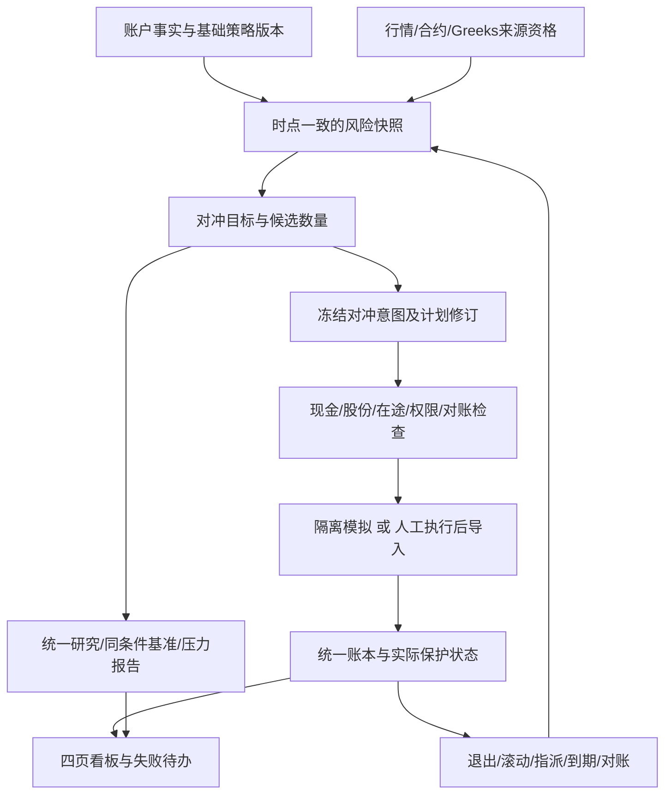

# LyraX v1.9：股票组合对冲实施计划

**2026-10-14当前验收：** 源码c0a9dcee；804项全量无跳过（3118.10秒）、旧V1/V15/V18入口32/32/34、核心53/模型11/资格12 CLI及恢复通过，329冻结输入复核一致，原82379退出0。16方法目录/只读CLI、空账户4浏览器检查和普通wheel升级通过。7849的真实ETF、清洁环境与完整账户浏览器保留为历史证据；5项目录相关变更外资金/行情/策略/引擎模块哈希未变，当前普通wheel完整四页/重复导入/刷新7项也已通过；未再次在线下载。真实接入/自然周期和条件扩展仍独立列缺口。详见[PROGRESS](PROGRESS.md)。

**2026-10-12最新恢复指针：** 股票OPEN/CLOSE、报价/单位行动、组修订、迟到模拟、原生期权异常恢复、多期权共享现金和来源/权限关联均已有分批实现及证据。H-T28必要CLOSE缺Beta的独立完整组/账本/恢复1项已通过；逐笔供应商Greek资格36项相关回归及12CLI/恢复通过，模型资格及最终H5同源码验收仍待。下方早期阶段记录按历史保留，当前源码/句柄/验证结果以docs/PROGRESS.md顶部为准；真实来源/券商/OF/HX门槛保持。

2026-10-11原生操作阶段门禁：当前组内option激活/OPEN/退出冻结/CLOSE及基础模拟、daily/CLI已强制本次阶段请求并保存原证据；native格式月度保护Put成功激活/完整备份恢复包含于最终60相关回归。阶段计划生成、归档独立重算/精确重跑核验、最终源码原生/CLI/浏览器及其他H3/H5仍待，不作为整计划完成。Goal工具usageLimited，详见PROGRESS恢复记录。

2026-10-11阶段检查进展：当前组/账本/资源与显式来源报价的全部部分成交数量端点检查已实现，复用既有QuantLib有限情景；现金/备兑/费用/未结算/报价数量验证及4实际CLI/source通过，详见PROGRESS。执行组剩余修订亦已阶段交付。当前结果不授予阶段执行资格，原生计划生成/激活/daily、行动/权限联动及全交割分支仍须完成，H5未验收。

日期：2026-10-12（Asia/Shanghai）。状态：**用户新增需求已纳入v1.9；H0/H1基础与H2股票条件候选已部分实现，完整链路尚未验收。** 上游：[v1.9主计划](lyraX-v1.9.md)；依据：[股票对冲调研](V19-HEDGING-RESEARCH.md)；复用：[期权计划](V19-OPTIONS-PLAN.md)。新增H0–H5核心及HX条件扩展，保留原P0–P5、O0–O6及真实接入/前向门槛。

最新实施：共享daily/原计划预测保护覆盖已接入；标准生命周期批次/解决按财务前缀保留中间异常，备份重算财务字段，运行状态只读可见。78+2相关回归和3实际daily CLI通过，详见PROGRESS。此为事实审计与保护切片门禁，尚非完整逐阶段压力/估值资格；组修订/滚动、异常核实恢复、合格期权估值贯通基础计划及最终H5仍待。

后续估值实施：显式合格期权报价已贯通基础股票计划/修订/模拟、月度绑定/daily及CLI/计划页，并核对共同收盘时点；78相关回归、5实际CLI和READY备份恢复通过。保费只由实际账本扣一次，修订不默认继承旧估值，迟到凭据不改变成交所属时点。完整中间状态压力/执行组修订/异常核实恢复及H5仍待；此条覆盖上条“估值贯通待做”的历史状态，不削减计划范围。

后续核实实施：标准凭据真实财务异常的不可变核实/恢复、冲销更正链、同前缀对账/证据归档、备份及共享门禁已阶段交付，87相关回归和10实际CLI通过，详见PROGRESS。原异常不删除；真实权限/估值/压力仍独立。提前指派/净交割异常的原生故障恢复样例、组修订/逐阶段完整资格及H5仍待；本条覆盖上述标准核实待做状态。

**R2.1复核：** 已按[设计审查](V19-HEDGING-REVIEW.md)补齐10项计划缺口，独立验收扩展为28组。修订覆盖工程适配、时点、筹资后敞口、风险退出、交割失败、并发版本、保护分配及比较口径；本轮仍未改业务代码，设计修正须在H批实现并验证。

## 1. 交付目标和范围

让用户回答：现在持仓主要承担什么风险、需要降低多少、有哪些工具可用、数量和成本是多少、哪些风险仍然保留，以及成交后实际保护是否生效。对冲是统一账户上的风险管理层，基础股票、ETF和期权共用资金、股份与事件账本；它不能建立另一份余额。

默认工程范围：美国股票/股票ETF、USD、日线风险估计，月末常规调整；每工作区单账户，展示Asia/Shanghai。股票标的由配置或实际持仓提供，SPY等仅为工程样例，不假定用户持仓、资金、偏好或权限。个股纳入时须补资产类型/交易所/历史身份及公司行动资格，不能因为已有ETF下载器就宣称个股全部接入。

| 能力 | 本版承诺 | 状态/条件 |
|---|---|---|
| 全目录与对照 | 调研中的主要股票对冲方法、风险及支持等级 | 文档和16方法产品目录已实现；CLI只读、空账户页面/刷新及SQL零记录已验证，新增最终门禁待终态 |
| 风险分析 | 当前持仓市场Beta、金额敞口、Delta金额、集中度、压力与数据覆盖 | H1核心，待做 |
| 静态保护 | 同标的保护Put、Collar按持股数量/保护预算制定方案 | H2核心，复用A8；账户退出/生命周期先补齐 |
| 代理保护 | 股票篮子对指数/行业ETF的Beta估计、Long Put数量、残余风险及跨标的退出约束 | H2核心；研究/合成示例须交付，真实使用按数据/权限独立验收 |
| 风险预算对照 | 显式减仓持现金；可用-1倍日目标反向ETF的有资金来源研究 | H2/H3核心；反向产品必须逐日监测，真实可执行资格独立，不使用杠杆倍数产品作为默认 |
| 统一计划/执行复盘 | 对冲意图绑定现有计划、资源与实际事实，演示完整开仓/退出/部分成交/到期；四页显示保护缺口 | H4核心，依赖O3/O4完整账户任务；真实交易仍人工执行 |
| 股票/ETF卖空、期货、配对/因子中性、动态Delta等 | 目录、公式/契约设计与独立条件批次 | HX1–HX4，未实现；本次调研授权不等于开通借券/保证金或自动交易 |

“静态”指在明确观察窗口中持有冻结方案；仍有到期/风险管理。增加保护常规在月末，风险减仓/退出可以由明确管理规则触发；自动补回风险、日内Delta再平衡不隐含启用。目标是正确计算与可追溯，不以对冲后每个时期都盈利、回撤一定下降或达到某个收益率为验收。

## 2. 现有能力复用与需补接口

| 现有位置 | 复用方式 | 必须补的内容 |
|---|---|---|
| `data/`、数据用途/来源资格 | 历史收益与原价快照、质量、版本 | 证券类型/历史身份；对冲基准映射；收益与交易价格用途分开 |
| `strategies/` | 基础策略目标和版本 | 作为风险输入；不把对冲混成负ETF目标权重 |
| `options/selection.py`、`pricing.py`、`stress.py` | 冻结合约、PIT报价、理论Greeks和情景 | 组合敞口→保护股数/目标Beta→候选合约张数；模型字段/单位归一 |
| `options/activation.py`、`management.py`、`lifecycle.py` | 激活、只读退出、部分成交及持仓状态 | 先完成O组退出执行；对冲父意图及逐腿依赖、实际保护状态 |
| `portfolio/`、`execution/` | 唯一账户、资源、对账及任务恢复 | 同一股份不能重复覆盖；基础策略减仓与对冲腿冲突要联动阻断 |
| `research/`、bt/ffn、LEAN | 同条件比较、归因与冻结输入 | 对冲/未对冲/相同资金减仓三组比较、残余风险和保护空档 |
| `ui/` | 四页和共享服务 | 对冲前后敞口、成本、来源状态及待办；刷新不产生计划/成交 |

拟新增 `src/personal_quant/hedging/`：`exposure.py`、`spec.py`、`sizing.py`、`service.py`、`reports.py`，负责风险与编排，禁止重写回测/撮合/通用绩效引擎。ETF及反向ETF纯多头研究复用bt；含期权/借券/期货的单次实验使用已隔离的LEAN，并将比较组放在同一引擎。QuantLib只作理论计算，不能替代报价。

候选CLI：`hedge-exposure`、`hedge-preview`、`hedge-plan`、`hedge-report`、`hedge-demo`。这些名字是待实现设计，当前README不能称其可运行。复用配置、预检/显式提交、任务锁及发布机制；新增持久字段如需迁移，必须先备份、显式迁移并验证v4/v5恢复，不让UI自动升级。

**H3引擎前置工作：** 当前`options/monthly_replay.py`只接受同一标的/模板、每腿一张、标的价格固定100的合成路径；`options/simulation.py`也检查100股/100价格。H3必须先通过适配层支持多标的、非恒定原价、任意受限整数张数、每日独立期权报价、持仓持续跨月及三组控制。不得删除旧检查后直接沿用旧资格，或将单张结果线性放大当成实际引擎成交。先做“两只股票+一个不同ETF Put、两张合约、非恒定价格”的离线端到端样本，再接真实数据。冻结新适配源码/输入版本，旧A8机械回归继续独立通过。

## 3. 冻结契约

| 对象 | 必备字段/约束 |
|---|---|
| SecurityIdentity | 稳定ID、instrument_type、ticker历史、交易所/日历/时区、币种、单位、生效时间、拆股/退市/调整条款及来源资格 |
| ExposureSnapshot | exposure_id、account_id/environment、账本序号、as_of、实际持仓/在途资源、价格与收益快照、基准、估计窗口、Beta/Delta单位、覆盖率、缺项、源码/模型/参数hash；历史风险研究和当前账户明确区分 |
| HedgeSpec | hedge_spec_id/version、被保护持仓ID、目标模式、基准/工具白名单、窗口、目标Beta或保护比例、费用/保费/名义额/总风险上限、流动性、触发/退出/到期/滚动规则、现金利息假设 |
| HedgeCandidate | 候选工具/确切合约版本、股数/整张数、参考价及available_at、成本、估计前后敞口、基差/压力结果、现金与交割要求、整数尾差、阻断原因；不可用候选也保留理由 |
| HedgeIntent | 稳定hedge_id、base_strategy_version或MANUAL_HOLDINGS、ExposureSnapshot、Spec及候选hash、决策与实际生成时间、有效期、修订/替代关系、目标持仓范围；不可因新价格悄悄覆盖旧版本 |
| ExecutionGroup | 复用原plan_id/option_plan_id及实际event_id；逐腿OPEN/CLOSE、依赖、现金/股份/保护腿占用、在途/部分完成；父对象只引用，不再独立预留一遍 |
| HedgeReport | 对冲和基准共同区间/初始资本/资金流、费用、总权益桥接、风险指标、保护空档、偏离原因、全部输入/模型/源码版本；理论/合成/真实行情/真实账户分别标识 |

追加契约：ExposureSnapshot记录`knowledge_cutoff`、统一收益日期集合/方法、各估值时点/最大偏差、Greek来源/单位/模型输入、已成交与在途分支。HedgeSpec记录`scope`（账户整体或明确持仓子集）、筹资方法、预算归属、残余Beta容差、保护期限及明确退出类型。HedgeIntent记录账户账本序号、资源版本、基础策略绑定版本、父意图版本、来源资格/参数hash和适用交易窗口。ExecutionGroup记录每个可达中间状态的现金、覆盖与压力检查。

增加`ProtectionAllocation`作为事实与覆盖目标的引用表：稳定证券ID、明确股数切片（非税务批次）、实际期权持仓/有效期限、角色和父意图。它不新增现金/股份预留；同一Collar内Put保护与Call覆盖可以引用相同100股，跨意图不能各宣称新增100股被保护。同合约已有实际张数、多个计划的关联张数和账户净张数必须桥接；未关联事实也纳入账户总风险，不能因无父意图而漏算。

稳定意图键由账户、保护目标、Spec版本、决策时点和触发类型确定；输入修订使用同意图新revision。同一账户/保护范围/决策周期另有跨Spec版本的有效占用约束，不能改版本或参数绕过旧计划。自己预留与关联部分成交不新建另一个意图。预览固定输入后在锁外计算；提交在现有锁顺序内重新读取并比较上述全部依据，原子完成修订、依赖及资源更新。只有账本序号相同不足以判定未变：另一计划激活、人工在途、资格撤销均须导致重新预检。数据库与文件发布沿用现有暂存/哈希/恢复协议，崩溃后不能留下两个有效父意图或丢失占用。

## 4. 风险计算与数量规则

### 4.1 先明确度量对象

- 股数、期权张数、市值、合约名义额、保证金和权利金分别保存，统一货币后才可相加。
- 对股票，`V_i = signed_shares_i × verified_raw_price_i`；当前现金为零市场Beta的显式工程假设。基础股票金额、全部账户权益E、净/总名义敞口分别展示。
- 估计单标的 `beta_i = Cov(r_i, r_b) / Var(r_b)`，收益同窗口、同日历、同口径；基准零方差、缺失、历史不足、已失效证券或估计质量不足明确BLOCKED，不以零Beta代填。
- 组合Beta金额 `B_stock = Σ V_i × beta_i`，账户Beta为 `B / E`；E非正或未完整估值则不给该比例。市值权重不能换成股数权重。
- 当前持仓权重应用到过去收益，只称“截至当前持仓的风险估计”；过去实盘表现必须按当时持仓/外部资金流重建，入金不能变成市场回报。

工程示例使用126个共同收益（至少127个合格收盘价格），63/252只作预先声明的稳定性对照，不能在最终评估集选最优。收益含分红的价格口径仅用于风险估计；成交张数、行权单位不能由复权股数产生。样本区间、R²/相关性、标准误或区间估计、基准版本/质量一起保存；推断质量门槛配置化。

首版统一使用日简单总收益、带截距OLS斜率及同一组完整交易日期；先按价格逐日验证再计算收益，不把跨缺失日变化当成一日收益，不分别为各标的删行后拼凑“组合Beta”。展示样本数、样本内R²和估计标准误（注明统计假设，不作置信保证）。保存代理基准选择及数据版本，禁止用最终区间挑选相关性最高的工具。风险覆盖同时报告估值覆盖和模型覆盖；允许输出已知部分，缺项不能算0，也不能以极小净敞口作分母显示虚高覆盖率。

### 4.2 目标Beta与代理工具

设当前合计市场敏感金额为B，用户目标为 `B_target = target_beta × E`。股票/ETF代理的理想有符号数量为：

首版`target_beta`统一指账户整体Beta，E包含全账户资产与负债；scope限定允许调整/保护的持仓，不悄悄改变分母。局部持仓的风险单列，不能与账户目标混用。

`q_h = (B_target - B) / (P_h × beta_h)`。

此式仅是“基础持仓不变、从已有现金支付、忽略交易摩擦”的理想初值。真实候选必须计算所有筹资/基础调仓/对冲腿完成后的`B_post`、`E_post`及`B_post/E_post`，净保费与持仓市值按同一估值口径桥接，佣金/价差等不能漏扣或重复扣。卖基础股票筹资改变B；未结算卖款不得先用。例：100000全仓Beta1股票，卖x并用同额买Beta-1工具，目标0.5且忽略费用，应有`100000-2x=50000`，所以x=25000；按未减仓前B直接买50000会过度降低敞口。现有可用现金不足且未批准筹资修订时保持不可行。

基础策略先给出目标，统一预算层决定其与保护共同可用资本；预览可展示全部依赖完成后的估计，实际保护数量只基于已取得或有合格交割安排的持仓。不得保护尚未成交的基础买入并显示为已覆盖。费用/整张/预算造成偏差时报告可达目标及容差，不承诺一定精确命中。`abs(beta_h)`过小、符号不适用或估计不稳定时阻断该工具的Beta数量计算；同标的股数保护不因无关市场Beta缺失而一律阻断。

q_h是新增交易数量，不是交易后目标持仓。负数量先区分卖出已有且未被占用的股份和新增空头；合法减持可走现有SELL路径，只有预计净持仓变负的部分需要HX1，否则标UNSUPPORTED_SHORT，不能直接交给只做多执行器。反向ETF需使用核验的产品属性及估计风险，不能仅以名称推定 `beta_h=-1`，也不能无限按固定初始数量保持目标Beta。

期货研究数量为 `n = (B_target - B) / (F × multiplier × beta_f)`；具体合约价格与乘数必须有版本，使用期货对基准的估计，不能恒定假定相关性为1。最小方差金额比 `Cov(r_p,r_h)/Var(r_h)` 与目标Beta法分别标方法ID，不混用价格变化/收益率或分母。

### 4.3 保护股数与期权Delta模式分开

- `share_protection`：同标的按 `floor(可分配保护股数 / deliverable_shares)` 和预算确定张数，明确未覆盖零碎股。保护Put/Collar同一股份的角色可在同组内关联，但同一份股份不能被两个卖Call计划各覆盖一次。
- 上述张数是目标总覆盖；新增张数需扣除相同范围/有效期限已有的已分配保护以及已承诺未完成开仓，不能每月再买一次总量。在途只扣可重复承诺额度，实际覆盖统计仍只认成交。到期、关闭、更正后按事实更新分配；不同时有效的合约不能叠加为持续覆盖。
- `beta_target`：期权对市场的一阶金额约为 `signed_contracts × quote_multiplier × delta × S × beta_underlying`。将现有期权先计入B，求新增张数；缺Delta/模型/IV/股息等输入时返回MODEL_INPUT_REQUIRED，不用理论默认数冒充供应商值。
- 标准合约的报价格式须在适配层归一：每股Delta与每合约Delta不能重复乘100，Delta金额与权利金市值也不能混加。
- 当前`options/pricing.py`的Delta已乘输入的乘数与张数；适配时必须标明`per_share/per_contract/position_total`和张数、方向，仅归一一次。供应商Greek和模型Greek分别记录；模型值需要完整同一时点输入和显式模型资格，不能回填成实际报价。风险输入还需涵盖账户既有全部期权，而非只计算本次新增腿。
- 一张Put的到期保护股数不等于当前Delta中和股数。`share_protection`和`beta_target`分别比较，不为了实现某一指标暗中切换目标。
- 候选整数张数只在明确上限附近确定性枚举；在保费、现金、交割、总名义额及超额对冲上限内选择最接近目标的解，同分按较低成本/稳定合约ID。无可行解返回NO_FEASIBLE_HEDGE，不突破预算或借款凑数。
- Delta方法只作局部敏感度；压力测试至少包含上涨、下跌、IV变化、时间流逝及相关性变化。对股票篮子的指数Put不得宣称存在同标的保护Put的确定到期底线。

### 4.4 第一组工程规格

复用O组选约规则：月末冻结、目标45自然日、30–60日区间、保护Put的95%和覆盖Call的105% moneyness、到期前7自然日进入退出管理；它们仅为固定测试参数，不新增参数搜索。实际风险/预算/保费上限必须显式配置。

加入风险层不能绕过现有开仓/退出条件：未持有可交割SPY股份时，不用其他股票的Beta作为SPY Call覆盖；跨标的Long Put需要明确到期前退出及退出失败处理。标准股票的拆股、期权调整、除息与提前指派影响必须进入版本核验；遇到未支持调整，保留凭据并阻断新可执行建议。

### 4.5 决策、执行和管理时点

- 月末信号在各输入已到达后的`decision_at`产生；只使用`available_at <= knowledge_cutoff <= decision_at`的数据。前向还要求实际采集时间不晚于决策；历史重建的推定可用时间单独标注。
- 历史决策回放同时约束事件的生效时点和当时已知账本序号/记录时间；后来补录、冲销的旧日期事实可更新“重述账户”视图，但不能改写“当时所知”风险、信号和计划，两种视图分别标识。
- 决策时冻结合约、数量上限与预算，执行日的报价只能验证/成交，不能倒回月末重新选择。默认历史研究采用下一合格交易日约定收盘附近的bid/ask及费用，确切会话/时区/报价时点/容许偏差必须版本化；收盘后才收到的成交日快照仅支持标明延迟的历史模拟。真实人工计划须在当时有合格参考报价；缺提交截止前报价不能用该日收盘价生成可执行计划。
- 原价参考、组合估值、Greek和可成交报价分开；同一组合跨股票/期权的时点差超过配置上限则风险不完整。股票和具体期权的交易时段、提前收市分别核验，不假设统一16:00；LEAN的MOC机械成交也不证明券商接受对应期权订单类型。
- 到期管理在上一合格收盘即可用已知合约日历安排。现有“收市前20分钟”只读检查如用于执行，必须取得当时允许时效内的报价；日线数据不足时保留阻断，不能从晚到收盘价伪造提前决策。半日、夏令时、假期及错过截止各有独立分支。

## 5. 完整链路与职责

1. `exposure`只读账户/不可变快照，短事务冻结账本及资源依据、锁外计算；风险估计只能使用当时已可获取的数据，提交时按第3节再次核对。
2. 基础策略与对冲层明确预算所有权：统一账户可有基础持仓和保护腿，但不得由两个active_strategy同时争用全账户。manual持仓模式只认实际非零持仓。
3. 完成候选比较后冻结意图。若现金不足，显示不可行或提出独立、可审阅的基础减仓修订；不能假设卖出款已到账，也不自动买入反向ETF凑覆盖率。
4. 先关闭会失去覆盖的短Call，再出售对应股票或保护腿；担保释放必须关联确切实际成交/交割，预计释放只用于条件预算。双重预留、部分成交与late事实继续由O组统一服务处理。
5. 风险减仓与到期退出可在月中由独立管理触发，记录触发证据和版本；不因每次风险报告变化就每日重新建仓。`CLOSE`或减少张数不等于账户风险降低：卖掉保护Put可能增加下跌敞口。`RISK_REDUCTION`须校验整个组合、在途分支和压力损失；`EXPIRY_MANAGEMENT`可为避免交割而撤掉保护，但须显示保护缺口和已冻结的后续减仓/人工处理规则，不能谎称风险已降低。主动撤销保护用独立`PROTECTION_WITHDRAWAL`意图，不借风险减仓入口绕过授权。外部入出金关闭旧意图未提交部分，新增资金等下次合格月末；现有义务管理继续遵循资源和风险检查。
6. 基础股票卖出、拆股或期权指派改变保护对象时，立即重新评估实际保护/超额保护；取消本地意图不等于券商撤单，人工在途占用不能提前释放。
7. 滚动作为旧腿退出→取得成交/结算证据→按有效新意图开新腿的显式状态转换。显示保护空档；没有数据不补造历史保护。首批静态规格不默认自动滚动：新月末遇到同范围有效保护默认KEEP，不重开同份保护；到期窗口退出后默认等下个合格月末，报告真实空档。增减保护范围或替换合约必须有明确规则/新修订；若选择连续滚动须同时满足O5/B3门槛。现有A8机械每月平开样例不自动授予H滚动权限。
8. 日常任务先处理事实/生命周期、估值/对账，再产风险报告和合法决策；晚到期权数据只更新可追溯处理时间，不宣称曾在执行前取得。

跨标的Put未成功退出且缺交割股份时记录交割风险及EXERCISE_PENDING/RECONCILIATION_REQUIRED，不模拟无凭据的自动放弃行权或股票卖空。实际券商产生的异常事实仍按凭据保留并阻断下一计划。

**失败与在途的前置门槛：** 代理Put进入real人工计划前，须有明确券商行权处理/截止及退出失败处置凭据，且处置不依赖未授权的卖空或凭空取得股份；缺任一项只交付研究/演示并标`DELIVERY_FALLBACK_UNQUALIFIED`。异常交割事实超出现有长仓账本能力时完整保存待核实凭据，并将权益/对账标为不完整，不能丢掉空头义务而展示完整资产。仅写“提前退出”不能使该门禁通过。

执行依赖必须验证所有允许的中间状态：包括仅部分基础减仓、Put成交但Call未成交、短Call已成交但保护腿失败、在途数量区间等；实际保护按已成交事实统计，在途潜在风险单列保守边界，不将全部计划假设同时成交。不能证明边界合格时阻断新增风险。减少既有义务的管理检查与新开仓检查分开，缺历史Beta不应阻止有有效报价/资源的必要短腿回补；但缺可成交报价不能伪造成交。模拟原子失败可整批回滚，已发生的真实部分成交必须保留/导入，不能因后续一腿失败而抹除。

## 6. 数据、回测与展示

- 同标的研究：价格、股份与期权合约调整必须匹配；单股票/ETF缺价时权益和风险均标不完整，不能把风险记为零。
- 代理/配对研究：需要同期历史股票身份、上市/退市、拆分/分红和当时可用的行业/因子分类；不能只从今天存活股票中选历史“最佳对冲”。单市场前提下也要处理不同交易时段及报价延迟。
- 单一组合实验使用同引擎、同初始权益、共同评估窗口、同基础策略信号和外部资金流。对照至少有：不对冲、明确减仓持现金、选定对冲结构。付保费不能获得额外虚构资本；若须减仓筹资，差异计入结果。
- 历史研究按假设成本；账户按实际费用。报告拆出基础资产、对冲腿、权利金/时间价值解释、佣金价差/借券/融资/换月等适用成本；分解项必须桥接总盈亏，不能把权利金和期权损益重复相加。
- 主要指标：共同区间累计/年化/最大回撤、下跌阶段损失、方差缩减 `1-Var(r_hedged)/Var(r_base)`、残余Beta、跟踪偏差、成本、现金占用及覆盖空档；方差为0或样本不足时显示无解。方差缩减可为负，必须保留。
- 反向ETF使用实际产品日收益和公司行动；逐日风险报告可告警，交易仍按已冻结的月度/显式减仓规则。多日偏离用事实展示，不能把真实产品设成指数收益的常数倍。
- 账户页展示实际保护和未覆盖/超额保护；研究页展示三组对照及成本；计划页展示股数/张数、Delta与名义额、依赖和具体阻断；运行页展示行情/Greeks/借券等数据覆盖、对账及失败记录。所有页面标时间/币种/数据类型与支持等级。

比较协议在看到结果前冻结：不对冲组沿基础策略运行，不因对冲合约到期而强制卖出基础股票；Beta模式的减仓组采用事前同一Beta目标的确定性减仓规则（只做多可达范围内），股数保护模式则使用事前显式配置的固定减仓比例，不能事后按表现挑选。两者同决策/执行窗口，零外部加款，无法达到则如实说明。对冲组筹资改变基础仓位的影响单列。三组共同初始权益、估值/资金流和费用模型，实际交易次数可不同并分别计费；不能为了“同条件”强行让控制组付期权费或制造无意义买卖。

风险效果按相同可用日期的净费用收益计算；输入日期不全时报告覆盖与排除原因，禁止按结果删亏损日。下跌阶段由事前指定的未对冲基准阈值/窗口定义，不按对冲表现选区间。现金流剔除沿已有研究协议；无法可靠剔除时不计算精确方差缩减/实现Beta。已实现滚动Beta与持仓模型Beta分开展示。Greek近似归因只作解释，保留未解释残差并与实际损益桥接；权利金流出是现金换资产，不能再全额扣一次作为损失。

支持等级以“工具×操作×数据×环境”保存，研究/开仓/退出/行权/恢复分别列状态及资格失效原因。缺来源阻断真实执行，缺某项风险模型只降级相关指标；真实条件等待不能伪装通过，也不阻塞已具备条件的H工程演示。

## 7. 实施顺序与验收

| 批次 | 明确交付 | 前置条件与验收 | 当前状态 |
|---|---|---|---|
| H0 契约/基线 | 对冲目录、支持矩阵、Security/Exposure/HedgeSpec/Intent及ProtectionAllocation契约、资源版本和旧基线 | HR01–HR10设计项落实；状态/时点/单位/操作资格及基准协议冻结，不能开启负权重交易 | c0a9当前804全量、53/11/12 CLI及目录UI/安装升级通过；当前普通wheel完整账户浏览器7项通过；7849清洁环境/真实ETF为历史，差异及范围见最终审计；真实接入/自然观察另验 |
| H1 风险快照 | 共同收益窗口、市场Beta/Delta金额、集中度/残余风险、CLI/快照 | 手算、PIT、无未来数据、入金不变收益、零方差/缺价阻断 | c0a9当前804全量、53/11/12 CLI及目录UI/安装升级通过；当前普通wheel完整账户浏览器7项通过；7849清洁环境/真实ETF为历史，差异及范围见最终审计；真实接入/自然观察另验 |
| H2 对冲方案 | share_protection/beta_target、保护Put/Collar/代理Put、减仓及-1倍产品对照、整数数量和预算 | 同股份不重复覆盖、跨标的交割限制、明确无可行解 | c0a9当前804全量、53/11/12 CLI及目录UI/安装升级通过；当前普通wheel完整账户浏览器7项通过；7849清洁环境/真实ETF为历史，差异及范围见最终审计；真实接入/自然观察另验 |
| H3 研究报告 | 先扩展LEAN真实时序/多标的/张数适配，再做三组比较、成本/风险分解及压力 | 非恒定路径和旧A8回归、筹资公平性、分红/费用无重复、样本分区 | 合成机械研究/账户/多主标的/末期与异常路径及当前802回归通过；真实历史/自然前向未验，条件扩展另列 |
| H4 统一任务/看板 | 父意图、共用预留、基础策略冲突、开仓/退出/部分成交/到期和daily、四页 | 依赖O3/O4完整退出/生命周期；重复/并发/重启不重复写账 | c0a9当前804全量、53/11/12 CLI及目录UI/安装升级通过；当前普通wheel完整账户浏览器7项通过；7849清洁环境/真实ETF为历史，差异及范围见最终审计；真实接入/自然观察另验 |
| H5 集成验收 | 固定样本、实际可用数据、清洁安装、全量、CLI/浏览器、备份恢复及交付矩阵 | P5/O6/H5使用同一最终源码；真实接入/前向独立有据 | c0a9当前804全量、53/11/12 CLI及目录UI/安装升级通过；当前普通wheel完整账户浏览器7项通过；7849清洁环境/真实ETF为历史，差异及范围见最终审计；真实接入/自然观察另验 |

单Agent顺序：收尾O3/O4退出和生命周期的共用契约→H0/H1→H2/H3→O/H统一任务与H4→P5/O6/H5；可穿插完成不依赖外部数据的只读风险计算。不能重新开发已有A8或因新增规划把原P/O未完成项删掉。

H3引擎适配是明确开发工作，不隐含在“复用LEAN”一句中；H0后按该工作量重新估算。H5交付逐项列工程/真实历史/自然前向状态，外部受阻交付当前成果但不宣称整个Goal已完成。配置说明、实际CLI/浏览器及备份恢复全部覆盖新父意图、覆盖分配和资源版本；本次不再增加策略数量或优化搜索。

### 条件扩展HX

| 批次 | 范围 | 开启门槛与独立义务 |
|---|---|---|
| HX1 | 指数/行业ETF卖空、股票多空、配对、因子中性 | 明确启用股票空头；PIT借券可得性/费率/召回、保证金/分红补偿、持仓及账单证据；LEAN验证和统一账本新事件/迁移。没有借券历史只能标假设情景，不能称可交易历史 |
| HX2 | 股指/微型股指期货对冲 | 合约/日历/逐日结算/保证金/换月数据及账户权限；独立盯市和最终结算去重；保证金模型以实际券商条件为准 |
| HX3 | Put价差保护、明确滚动的保护/Collar、进阶尾部保护 | 复用O4及O5对应批次，整组压力/短腿义务/生命周期通过；不新增平行实现 |
| HX4 | 动态Delta/Gamma、VIX工具、更广泛跨资产/多币种 | 足够频率数据、Greek时点、独立产品模型/成本/汇率和账户证据；日线不能证明盘中对冲；实时自动执行仍属于V2 |

上述均已纳入路线，当前未实现。没有用户资料时照常完成H核心和目录；若用户指定某一HX策略作为必做，再将该批具体接口/验收加入核心，不凭“目录已列出”宣称支持。

## 8. 必须通过的独立算例

| 编号 | 场景 | 独立预期 |
|---|---|---|
| H-T01 | 100股×100、Beta0.5；100股×200、Beta1.5 | 股票市值30000、Beta金额35000、Beta7/6；不是按股数平均得到1 |
| H-T02 | E=100000、当前Beta1.2、目标0.3、代理价500/Beta1且无代理持仓；另验已有代理100股 | 前者理想数量-180股、残余Beta0.3，无卖空资格阻断；后者新增-80可减持，新增-120会形成20股空头，不能把所有负交易量都当卖空 |
| H-T03 | 市场Beta金额需减少10000；Put的S100、Delta-0.5、乘数100、基础Beta1 | 一阶需买2张；100股持仓的share_protection只能对应1张；不能混称同一种保护或自动超额实物交割 |
| H-T04 | 100股@100、买K95 Put付2/股，忽略费用且持有到期 | S80时合计到期权益9500、相对10200初始资产损失700；S120时12000，盈利1800；不再额外加入行权内在价值 |
| H-T05 | 100股@100、买95 Put付2、卖105 Call收1 | 净初始资产10100；到期S80权益9500/损失600，S120权益10500/盈利400；股数只记一次 |
| H-T06 | 相同金额多头Beta1.5、空头Beta0.8 | 净金额为0，但市场Beta金额非零；看板不得标“完全对冲” |
| H-T07 | 指数100→90→100，理想-1倍日收益样例初始100 | 反向序列100→110→97.777…；指数累计0不意味着反向累计0，标合成且不冒充实际基金 |
| H-T08 | 修改决策后行情、OI、因子或新增未上市合约 | 已归档Exposure/Intent/过去信号不变；历史版本修订另建快照 |
| H-T09 | 126收益仅126价格；基准不动；缺股票估值；Beta很不稳定 | 分别报告不足127价格/零方差/估值不完整/质量门槛，不输出伪精确对冲量 |
| H-T10 | 同100股被两个Call计划占用；基础策略要卖覆盖股份 | 后一计划阻断；先核实关闭短Call/在途事实再卖，不能双重覆盖 |
| H-T11 | 股票篮子无SPY但买SPY Put；提出跨标的Collar | 长Put有退出/实物交割门禁；卖SPY Call不能用篮子Beta当股份覆盖 |
| H-T12 | 半数腿成交、退出缺价、跨期滚动第二腿失败、资金变动/重启 | 保留实际敞口、担保和保护空档，不把目标对冲当成已实现；重复任务/导入不增账 |
| H-T13 | 价格不变时入金；同资本支付保费；现金不足 | 入金不产生投资盈利；对冲实验无额外资金；预算不足返回NO_FEASIBLE_HEDGE |
| H-T14 | 股票拆股/合约调整、股息应收到账、期权指派 | 单位版本一致，资产/现金变化一次；不支持条款留凭据且阻断相关建议 |
| H-T15 | Beta反转/相关性下降、短期上涨、IV回落 | 可以出现负对冲效果和机会成本，结果如实展示；不以“对冲必然有效”为测试断言 |
| H-T16 | 备份迁移、两个入口同时提交同意图、源码/模型改变 | 仅一个有效修订/资源占用；恢复所有输入及引用；旧研究可追溯、新源码不能冒认旧资格 |
| H-T17 | 100000全仓Beta1，卖股票并同额买Beta-1工具，目标0.5，无费 | 股票75000、反向25000、B=50000；不是卖50000再买50000；依赖结算完成前不购买 |
| H-T18 | 月末收盘后信号、次日才到报价；半日截止前无报价 | 执行报价不参与原信号/选约；历史延迟标签正确，缺事前报价不生成已可执行记录 |
| H-T19 | 100股S100+一张Put（Delta-0.5），仅卖Put | Delta股数由50升到100；不能因CLOSE称风险下降；独立到期管理仍记录保护空档 |
| H-T20 | 代理Put价内、退出失败且无股份/合格处置 | 开仓前真实门禁不通过；若已有实际异常凭据则保留、权益不完整，不伪造空头成交或消除义务 |
| H-T21 | 预览后另一计划占款，但没有新增成交、账本序号不变 | 资源版本变化令提交失效；换Spec不能规避；两个入口竞争只允许一份占用 |
| H-T22 | 100股已有一张已成交保护Put，再申请100%保护；同组Collar | 新增数量0/KEEP；实际保护不记200%；Collar两种角色仍只占相应100股，退出/更正释放引用可重建 |
| H-T23 | 各资产缺不同日期；两张Put的模型Delta已是-100股 | 共同有效日期不足返回模型缺项，不拼接不同样本Beta；S100、Beta1时金额-10000，不再乘200 |
| H-T24 | 月末已有未到退出窗口的45日保护，后于月中退出 | 下个月末先KEEP；不暗中滚动；退出到下一合格新建之间显示无保护，期限/资金规则不可绕过 |
| H-T25 | 至少127日合格预热后，两只股票、不同ETF Put两张、标的价格100→90→110 | 引擎与统一账本逐日现金/持仓/权益桥接，数量来自实际成交；保留旧固定100回归，新输入不能沿用旧资格 |
| H-T26 | 对冲腿到期，但基础策略仍要求持股；Greek归因不完全 | 控制组不因到期虚构平仓/手续费；权利金不重复算亏损，残差+各项等于总盈亏 |
| H-T27 | 股票80000/Beta1.25、现金20000；买保护减B50000，保费在现金预算内、按同期市值估值，仅摩擦100 | 初始E100000/B100000；交易后E99900/B50000/Beta约0.5005005，保费转为资产不再扣一次；展示目标偏差/容差 |
| H-T28 | 市场Beta缺失但有同标的持股/合约及有效退出报价 | Beta目标模式阻断，股数保护按自身检查；必要义务关闭不被无关模型缺失卡住；来源/报价/资源缺失仍独立阻断 |

HX另验借券消失/召回、分红补偿、股票空头拆股、期货每日盯市和到期重复结算、保证金不足及停牌。未完成HX测试不得开放对应账户权限。

## 9. 用户资料与交付边界

实施H0/H1和合成研究不需要真实资金或账户。真实使用时需：明确市场/持仓及基准、希望保护股数还是目标Beta、工具白名单、费用和风险预算、持有/退出期限；合格股票原价/公司行动、期权历史与当前报价/Greeks、券商权限和脱敏成交/独立快照。卖空/期货另需HX所列资料。参数未知时只给研究/阻断状态，不继承示例资金。

最终交付必须逐方法列出：目录、理论、合成回放、真实数据研究、paper前向、real人工计划六个层级的状态和证据；P5/O6/H5工程完成不替代F/OF实际接入及自然观察。自动交易不因本规划启动。此次文档更新不改GOAL、代码、依赖、数据库或真实账户；下一次开发按上述顺序继续。

### 2026-10-12补充实施状态

自然到期同资本比较、独立股票对冲草案与当前阶段显式激活已实现，证据见PROGRESS。独立股票用途直接引用父意图，不造月度信号；原计划/账本负责唯一预留及实际事实。最终90相关回归/9CLI及下一交易日模拟1项通过；不是P5/O6/H5最终全量。

股票CLOSE及反向产品持续管理、候选/单位变更明确重规划、迟到阶段风险与处理知识截止、多期权主标的、提前指派/异常恢复和完整证券/行动/权限资格继续保留；实际来源、凭据及自然前向条件不能以这些合成证据替代。

### 2026-10-12增量证据：股票关闭、代理控制和期权OPEN迟到

- 预声明独立股票反向CLOSE已经贯通草案、原OPEN依赖/结算、当前风险激活、模拟与恢复；64相关回归、重复关闭拒绝2项、跨父新增风险窗口退出1项及18公开CLI通过。对应67a08127历史源码；价格变化/任意剩余修订仍待。
- SPY/IEF篮子与GLD Put公平控制已经独立核对，控制组不额外加入GLD股票；两期不同包数实际LEAN与公开CLI通过。仅单一期权标的，多期权标的尚待。
- 组内期权OPEN显式原成交/处理双时钟已实现，实际11条CLI通过，指纹2b2d96af；相关回归第三轮仍在运行。先前临时空间不足失败保留，不能宣称最终全量通过。
- 下一项组内期权CLOSE冻结退出ID/双时钟和异常回滚，再推进价格/单位行动修订、多个期权标的及完整资格关联，最后统一P5/O6/H5。原真实来源、券商资料和自然前向条件仍独立受阻。

组内期权迟到OPEN/CLOSE和缓存审计最新b6106a7f源码13专项及20公开CLI通过，完整恢复/回滚/重跑及时间/原退出ID重哈希拒绝已验。同源码最终40相关回归已无跳过通过（338.33秒），全部句柄已结束。上述股票/期权价格、单位变更与多期权标的/资格和最终H5待项保留。

### 2026-10-12 股票报价与部分成交修订增量

公开hedge-stock-reprice已实现；原生OPEN/CLOSE确切剩余、原成交切片、反向关闭依赖、单次原关闭义务和固定关闭窗口通过42项专项。根组与原请求严格核对，禁止修订专用隐藏标识绕过阶段门禁；前向引用不得晚于决策时点。当前公开CLI及扩大相关回归仍进行，单位行动/候选改变、原生异常恢复、多期权标的、资格联动及最终H5仍待。

原生部分指派异常恢复增量：Call/Put原生LEAN事件独立核对后，中断回滚/重启重跑/后续行权/审查/恢复两项通过；最新CSV入口共用审计50项及公开17CLI通过，a985f7ca源码。中间风险不会因最终净交割平仓被隐去。仍需多标的原生研究、单位行动/候选变更及来源关联和H5统一验收；真实条件另列。
