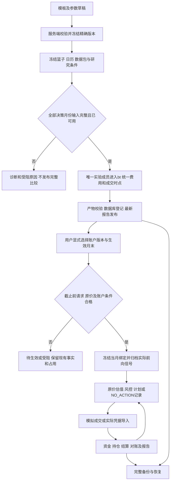

# lyraX v1.5：R1 链路复核记录

日期：2026-10-09（Asia/Shanghai）。对象：[v1.5计划](lyraX-v1.5.md)。结论：**主链路可行，初稿存在12项需要收敛的设计缺口，已修订到R1；实现及运行验收尚未开始。**

本轮对照当前配置、策略、归档、回测、计划、日常任务、UI、SQLite迁移和备份代码做静态复核。下表的“现有行为”是源码可见事实；“风险”指把该实现直接扩展到v1.5后的问题，不代表已运行新功能并复现了12个V1故障。所有条目的状态均为：**设计约定已补齐，运行验证待实施**。

## 1. 完整链路

研究结果进入账户前必须经过用户显式绑定，历史信号不会沿箭头直接变成前向信号。纸面跟踪仍需要合格原价；目前的Yahoo研究口径只满足研究分支。未来数据尚未到达时，前向分支等待实际时点。

## 2. 发现及修订

优先级“高”表示开工前必须冻结约定并安排回归；“中”表示应随对应批次实现，不是可忽略的建议。

| ID / 优先级 | 风险触发及影响 | 当前代码依据 / 初稿缺口 | R1处理位置 |
|---|---|---|---|
| R01 高 | 同时比较momentum 63日和126日，以模板名作字典键会覆盖曲线、交易或基准 | `backtest.py`按策略名称索引signals、bt名称和metrics；初稿没有实验成员身份 | §4.2使用唯一member_id，区分模板、规格、内容和实验成员 |
| R02 高 | 已能回测却不能生成份额计划；直接去掉快照相等检查又会误用未验证价格 | `plans.py`要求首次信号与价格metadata同快照；`quotes.py`仅允许经核验原价，Yahoo研究价不满足 | §6.1a引入按用途的DataBundle，归档权重与执行报价独立验证，缺来源明确受阻 |
| R03 高 | 因子某月缺失被跳过，回测实际上变成“继续持有”；或将阻断时零权重解释为清仓 | `ScheduledWeights`只取READY；`monthly.py`受阻时仍有零权重；初稿没有整段月份的状态政策 | §7.1区分READY全现金/受阻，完整比较检查全部月份；尾部日历及成交边界明确 |
| R04 高 | 新策略无法通过旧Config；新增Signal字段使旧记录解码失败；旧lookback覆盖新规格 | Config只接受fixed/trend，CLI/UI/daily直接`Signal(**payload)`，计划还比旧规则字段 | §4.2共享ResolvedStrategyContext及版本化codec；旧哈希/归档身份保留 |
| R05 高 | 最新导入时间让过期财报“变新”；旧季度后发修订覆盖新季度；自填接收时间伪造前向资格 | 初稿有available_at但未定义跨报告期选择、recorded_at来源和两类新鲜度 | §6.2先过滤可用记录再选报告期/修订，系统写接收时间，分开财报年龄与因子估值日 |
| R06 高 | 月末后切换策略却回填到当月；绑定与信号生成竞态产生两个版本或误释放旧占用 | 初稿只有“下个合格月末”，没有截止及提交时版本复核 | §4.3定义冻结截止、binding_seq、事务复核；受阻不悄悄沿用/顺延 |
| R07 高 | 账户本月没跑，却被其他策略的READY信号掩盖；空账户有效零目标被反复认定漏跑 | `daily._tracking_gaps`按月份/mode查询任意归档；初稿缺无订单决策事实 | §4.3/8.3按当月绑定过滤，NO_ACTION记录归属，不制造空订单 |
| R08 中 | 策略预算被重复缩放；策略上限与账户上限冲突；反转基础权重取错默认值 | bt已有费用预留，plan已有cash_buffer/max_weight；初稿未明确与新预算/weight_cap的关系 | §5划分预算、费用预留和账户缓冲，绑定预检，明确base_weights，表单隔离旧参数 |
| R09 高 | 两个页面重复跑同一实验；重跑覆盖首次失败；PID复用导致误判存活 | 当前tasks是UPSERT摘要；初稿“同一提交键/PID检查”未规定跨会话及执行历史 | §4.4/8.1增加attempt历史、数据库约束、执行权、worker/PID启动身份与明确重试 |
| R10 高 | 文件发布后数据库未提交，页面误报成功；备份漏因子/原价，恢复后计划找不到依据 | 文件与SQLite无共同原子事务；backup当前快照引用扫描字段有限 | §8.1a规定三步发布、恢复判定、统一短时发布锁和全部类型引用校验 |
| R11 中 | P2需要冻结版本/实验持久化，但初稿把数据库迁移全部留到P3，模块实施互相等待 | 初稿P0/P2/P3批次依赖未明确区分临时库和实际账户库 | §4.4/10在P0冻结构并测临时迁移，P2隔离研究库，P3升级实际目录 |
| R12 中 | 基本面CSV通过却被说成真实选股可用；历史已观察区间或既有V1测试被冒充新验证 | 初稿虽有限制，但发布和页面资格必须贯穿每条入口 | §1/6/11保留核心工程与真实基本面独立结论，研究/前向/份额资格在每步校验 |

源码定位：[回测](../src/personal_quant/research/backtest.py)、[配置](../src/personal_quant/config.py)、[信号](../src/personal_quant/strategies/monthly.py)、[归档](../src/personal_quant/strategies/archive.py)、[计划](../src/personal_quant/execution/plans.py)、[报价](../src/personal_quant/data/quotes.py)、[日常任务](../src/personal_quant/execution/daily.py)、[任务记录](../src/personal_quant/portfolio/ledger.py)、[备份](../src/personal_quant/portfolio/backup.py)。

## 3. 实施时优先验证的端到端场景

1. **同模板双版本**：同一快照、63/126日动量、固定基准，得到三个独立成员；同名展示不混淆运行和结果，改显示名不改变计算规格。
2. **中途数据阻断**：前几个月已买入，下一月因子缺失；比较报告为INCOMPLETE，不生成清仓、不把隐含继续持有作为完整策略业绩。
3. **跨来源数量**：用复权快照生成权重，用已核验原价和公司行动估值/计划；数量可手算，未知单位或未来报价阻断，信号决策不被原价更新改写。
4. **财报两个时钟**：新季度已发布，之后旧季度修订；选择新季度。旧财报再次导入不能更新真实接收时间或重置报告年龄。
5. **版本切换**：截止前登记版本B，后台运行与另一个页面尝试版本C；仅一个序号有效，旧部分成交仍属于A。本月旧版本的归档不能证明新绑定已生成信号。
6. **有效全现金与漏跑**：READY零权重在有持仓时产生卖出，在空账户时记录NO_ACTION；DATA_BLOCKED不触发两者。三种情况在运行状态页可区分。
7. **任务崩溃**：分别在“任务已写、进程未启”“目录已发布、数据库未登记”“数据库成功、latest未更新”中断，再启动后不重复执行已提交结果，也不误报成功。
8. **完整恢复**：计算期间做备份，恢复只有已发布的完整引用；因子/原价任一文件缺失时拒绝成功恢复。重新启动后版本、月度结果、账户事实及预留一致。

这些是待实现的验收场景，本轮没有运行对应业务测试。手算例子只验证规划中的权重算术。

## 4. 改进收益与剩余边界

保持一个bt适配器和一个账户账本。把策略身份、数据用途、状态含义和发布顺序先定清楚，可以减少模板增多之后各入口行为不一致的问题。先在CLI跑通一个新模板的完整链路，再扩展同类模板和表单，比一次把六个页面入口铺开更容易定位问题。

仍需外部输入的部分：真实基本面历史来源和权限、可用于实际证券单位的原价/行动凭据、真实账户风险与结算配置。套利/做空仍为独立扩展，当前没有收到扩大范围的选择。不能用文档复核代替依赖兼容、bt行为、SQLite迁移或真实来源验收。

R1增加了任务历史、两类价格衔接及崩溃恢复验证，估计由初稿7–13个开发日调整为9–17个开发日；实施P0后再校准。没有新增主框架或后台服务。

## 5. 本轮检查记录

- 读取计划和上述业务入口，追踪关键身份、时点、价格与存储引用。
- 修订主计划R1及进度/决策记录；应用源码、配置、测试、依赖锁和GOAL保持原样。
- 执行文档本地链接/结构、R01–R12覆盖、独立权重算术及基线文件哈希核对；实际结果记录到agents.md和docs/PROGRESS.md。
- 未运行新策略或业务回归，不引用历史180项作为v1.5验收证据。

实际结果：本轮实际检查：PASS_R1_DESIGN_REVIEW；6份文档、34个本地链接、12项复核覆盖及独立权重算术通过，77个业务/配置/测试/锁/GOAL基线文件哈希未变。
