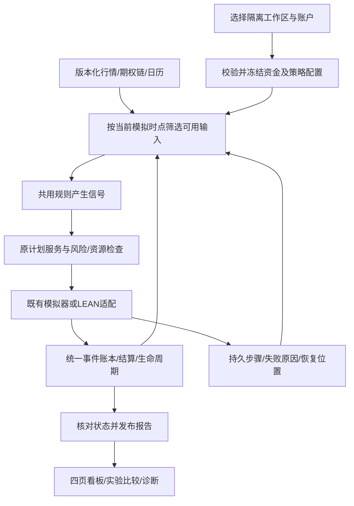

# LyraX v1.95：模拟工作台、可靠性修复与策略扩展计划

更新：2026-10-17，Asia/Shanghai。**状态：v1.95本地模拟范围S0–S7编码及验收完成，版本1.95.0。** 真实账号暂缓；真实期权来源、证券原价资格及自然前向仍未验证，本地完成不等于原Goal所有外部条件完成。

本版汇总上一轮项目审查的全部建议，并补充链路、恢复、数据展示和交付方面的改进。用户已选择先使用模拟账户，随后明确要求完成本版编码。当前程序版本为 `1.95.0`；冻结源码3a057618…，实际验证终态以PROGRESS为准。

依据：[原始目标](../GOAL.md)、[当前进度](PROGRESS.md)、[v1.9支持矩阵](V19-SUPPORT-MATRIX.md)、[模拟账户操作](V19-SIMULATION-USAGE.md)、[本轮问题证据](../reports/project-review-20261014/ui-findings.json)。`reports/` 中的证据为本地产物，不提交Git；新环境通过复现脚本重新产生证据。

## 1. 本版目标与范围

让个人用户在中文界面或统一CLI中，完成“建立独立模拟工作区 → 配置资金与规则 → 按交易日运行 → 查看计划/成交/结算 → 比较研究结果 → 中断后恢复”，不再依靠开发者手工复制数据库和报告。

### 1.1 完成口径

| 范围 | v1.95安排 | 完成依据 |
|---|---|---|
| 本地核心 | S0–S5：修复、模拟工作台、数据状态、研究操作、工程维护 | 独立算例、公开CLI、实际浏览器、安装和恢复 |
| 本地策略扩展 | S6：买跨式/宽跨式、信用价差、月度滚动与Wheel的模拟闭环 | 每个模板完成规则、成熟引擎、统一账本、生命周期及恢复验收 |
| 最终交付 | S7：同一最终源码与依赖下交叉核对 | 核心和S6逐项通过，发布包可在新目录复现 |
| 实际行情前向观察 | 条件分支：使用合格真实行情、模拟资金和实际时钟 | 实际采集/信号/处理时间与观察记录；单独报告状态 |
| 真实账户及后续功能池 | 本版暂缓，见第12节 | 将来明确输入和范围后另立批次 |

**v1.95本地范围包含S0–S7。S6未完成时，只能报告核心完成，不能称整版本完成。** 若实施中需要缩减S6，先给出具体范围与原因，由用户调整计划；不得自行把未完成项改成“已完成”或移入后续版本。

原v1.9的真实期权来源、实际账户凭据和自然前向要求继续保留。本版本地模拟验收不等于原Goal全部验收，也不把缺外部输入当作本地开发的前置阻塞。

### 1.2 沿用的约定

- Linux/WSL、独立Conda、Python 3.11；中文界面，展示时区Asia/Shanghai。
- 美国ETF及其标准期权、USD、日线/月度决策；每工作区单账户。多个实验通过独立工作区隔离。
- ETF抽象研究复用bt/ffn；含期权的混合组合研究复用已有LEAN适配；理论价格和压力复用QuantLib。一次组合运行只使用一个主引擎，不拼接不同引擎净值。
- CLI、UI、定时任务调用共享服务；账户以现有SQLite事件账本为唯一事实来源，研究结果不直接覆盖账户余额。
- 历史合成回放使用demo及明确虚拟时钟；paper使用真实系统时钟和合格来源。模拟资金、模拟成交与真实行情的类型分别标记。
- 不放宽既有来源、证券单位、公司行动、资金、预留和对账检查。Yahoo拆股调整Close仍不能直接充当证券原价。
- 运行本地模拟无需真实账号。模拟用到的资金、费用和约束以“模拟假设”登记，不生成虚假的券商权限或来源证明。
- V2券商自动下单、付费数据购买、云端服务及多币种不属于本轮实施。

## 2. 当前基线：哪些直接复用

当前业务源码指纹：`c0a9dcee6e78ad8b4ae4a103abc8cb07eabd7d65ff6e087bd87bb85a495b07be`。当时规划审查未改源码；已有804项无跳过记录，耗时3118.10秒，见[全量验证清单](../reports/v19-validation/catalog-final-20261014/verification.json)。这是已有基线，不是v1.95验收结果。

| 已有能力 | 本版复用与增量 |
|---|---|
| 数据版本、四种用途、质量与来源核验 | 增加按任务解释的状态面板、工作区初始化与用途预检 |
| ETF策略工作台、多策略bt、后台任务 | 增加统一实验入口和复用模板，不重写回测引擎 |
| A8期权选约、理论情景、LEAN机械研究 | 接入可配置、可逐日推进的模拟操作，并扩展指定策略 |
| 统一事件、计划、预留、生命周期与对账 | 加强跨界面状态、运行恢复和新模板端点验证 |
| 股票对冲、Beta/Delta、覆盖分配和阶段检查 | 提供中文操作与风险解释，不重复实现风险库 |
| 研究归档、分段/成本、滚动表现及贡献 | 补实验筛选、可比性解释与图形展示 |
| paper独立汇总、doctor、本地待办 | 补可操作入口、模拟回放目录和状态关联 |
| 完整备份、迁移、清理预览与恢复 | 纳入新工作区/实验引用，验证更换路径和故障恢复 |

当前演示是合成历史SPY保护Put、仅持股与现金三组，13个测试事件；公开复现脚本尚不自动准备用户看板工作区。现有模拟成交入口还包含固定fixture校验，不能直接推断任意资金、股票篮子或多张数都已支持。

## 3. 问题与建议清单

“已复现”仅用于有独立证据的问题；其余是已观察的使用限制或待实施改进，不声称已经发现相应资金错误。

| 编号 | 性质/优先级 | 发现或建议 | 落点 |
|---|---|---|---|
| R195-01 | 已复现/P0 | 账本从100增至150后，首页仍显示旧报告100且未提示落后 | S0：报告与账本/时点关联 |
| R195-02 | 已复现/P0 | 账户→研究→账户后，所选账户和模拟时钟恢复默认值 | S0：共享页面上下文 |
| U195-01 | 使用限制/P1 | 研究、模拟账户和看板工作区需人工衔接 | S1–S2：工作区与运行入口 |
| U195-02 | 使用限制/P1 | 已有期权报告时仍显示笼统“尚无行情”；缺少子系统解释 | S3：数据及能力状态 |
| U195-03 | 使用限制/P1 | 固定样本日期、JSON及不同配置资金容易混淆 | S1/S3：配置预检和中文表单 |
| U195-04 | 新增改进/P1 | 无报告时“新账户为零”措辞需区分空账本与已有事实 | S0/S3：空、未知、不完整分开显示 |
| O195-01 | 使用限制/P1 | 启动依赖工作目录，本机路径与LEAN源码资源影响迁移 | S1/S5：启动器与引擎资源包 |
| O195-02 | 新增改进/P1 | 模拟运行需统一推进、暂停、恢复和重复请求语义 | S2：持久任务与事件提交边界 |
| O195-03 | 新增改进/P1 | 报告、账户、计划和数据版本要能互相定位 | S2/S3：运行时间线与依据详情 |
| M195-01 | 维护缺口/P1 | Git main仍无提交基线，缺可回退发布身份 | S5：发布清单、源码归档及提交准备 |
| M195-02 | 维护改进/P1 | 全量测试约52分钟，部分原生测试含本机路径及skip条件 | S5：分层、路径独立、发布严格检查 |
| M195-03 | 维护改进/P1 | 历史agents/README/计划中存在多个不同时间的状态描述 | S5：当前摘要与历史归档分离 |
| M195-04 | 新增改进/P2 | CLI较集中，UI按版本文件增长，载荷契约需易定位 | S5：按触及模块渐进整理与类型约束 |
| M195-05 | 新增改进/P2 | 新增工作区、缓存和实验需考虑容量与备份引用 | S5：可追溯清理和恢复演练 |
| X195-01 | 扩展/P1 | 连续模拟工作台 | S1–S3 |
| X195-02 | 扩展/P2 | 价格/IV/时间压力图、保护成本和Greeks解释 | S4 |
| X195-03 | 扩展/P2 | 统一模拟实验管理和公平比较 | S4 |
| X195-04 | 扩展/P2 | 买跨式/宽跨式、信用价差 | S6-A/B |
| X195-05 | 扩展/P2 | 滚动保护/备兑/Collar、Wheel | S6-C |
| X195-06 | 新增改进/P2 | 生命周期日历、失败解释、可导出诊断包 | S3/S5 |

上一轮提出的修复、流程一键化、数据状态、参数配置、安装启动、版本/测试、连续模拟、风险可视化、新策略和实验管理，均在上表有对应项。

## 4. 完整链路与接口约定



### 4.1 工作区与运行身份

- 工作区清单记录schema_version、workspace_id、环境、account_id、币种、相对运行目录及创建时间；配置与目录不可跨环境混用。
- 运行规格记录experiment_id、run_id、策略/规则版本、配置哈希、输入快照、日历、代码/依赖/引擎版本、初始模拟资金和执行假设。attempt_id表示尝试，不改变业务意图身份。
- 恢复与另开实验分开：恢复继续原账户状态；复制实验创建新身份和独立账本，不复制旧成交后再次注入初始资金。
- 初始模拟入金使用稳定事件ID，一次性写入；重复初始化返回既有结果。覆盖、清空、改初始资金必须建立新实验或显式事件，不能静默重置余额。
- 路径解析统一以工作区为基准；保留runtime/demo等环境边界。相同工作区的别名应识别为同一锁资源，实际写入使用可写路径，不因大小写resolve落入只读路径。

### 4.2 模拟时钟与决策可见性

- 分开保存数据所属时点、available_at、采集时间、虚拟模拟时钟及实际处理时间。demo可以使用冻结历史数据，但必须标“历史重建/合成回放”。
- “前进一天”按交易日历推进；在信号、计划和成交边界只传递当时可用数据。不能先算完整历史成交，再把结果逐日展示成事前决策。
- 看板的查看日期不推进运行时钟、不生成信号、不写资金事件；研究页面可以显示完整历史，但须展示研究截止时间。
- 同一运行时钟只能向前推进。查看过去不回滚账本；重置或修改历史配置须创建新实验。
- 同一日的所有阶段成功后才提交日检查点；现金预留、成交及对应步骤记录原子提交。文件产物先写临时目录，核验后发布；保留“已记账、报告待发布”等可恢复状态。

### 4.3 唯一事实与资源

- 沿用现有计划ID、执行组、账本版本、预留和部分成交；调度层只编排，不另建现金/持仓计算器。
- 研究初始化资金不作为已有模拟账户的额外入金。已有持股保护场景必须区分研究构造持股和账户已持股份，避免重复买入。
- 不以当前事件序号拼成新的成交ID绕过去重。重试原操作使用原业务键；输入冲突需报错。
- 新增数据库字段时先形成迁移规格、备份及兼容测试。新检查点字段优先扩展现有任务记录，不能为每个功能复制状态库。

## 5. S0：修复展示正确性并冻结验收样例

### 5.1 报告新鲜度

目标文件：[账户页面](../src/personal_quant/ui/app.py)、[账户报告](../src/personal_quant/portfolio/report.py)、[CLI导入与报告](../src/personal_quant/cli.py)、[页面测试](../tests/test_ui.py)。

- 共用报告状态服务，区分CURRENT、HISTORICAL、AHEAD_OF_VIEW、LEDGER_CHANGED、INCOMPLETE、UNVERIFIED和CORRUPT；UI提供中文含义。
- 校验环境、账户、报告版本、所选估值时点及当前相关账本依据。文件哈希正确仅证明内容未变，不证明报告仍然最新。
- 账本变化时判断是否影响报告时点的有效事件前缀。晚到/冲销且影响历史的事件使旧报告落后；报告时点之后发生的正常事件不应被误称为历史数据损坏。
- 当前资产栏不能把落后的报告当作现状；保留历史值、原时点和状态，提供明确“重建当前报告”。刷新只读，不为了消除警告自动发布。
- 报告领先查看时点时显示不匹配，不能将未来估值作为过去资产。没有报告但有账务事实时显示“待生成/估值未知”；真实空账本才显示已知的零。
- 读取时使用一致的账本依据，预留和计划变化不能被只检查金融事件序号的缓存遗漏；旧未验证报告保留历史标记。

**验收：** 同时点入金100、发布报告、再入金50，账本为150时页面明确提示旧报告100待更新；重建后显示150/净投入150/盈亏0。覆盖迟到冲销、报告晚于查看日期、历史不受未来事件影响、无报告但有持仓及损坏归档。

### 5.2 页面共享上下文

- 单一上下文保存workspace_id、环境、账户、查看时点和所选实验；采用不会随控件卸载而丢失的session_state字段，页面控件只同步该状态。
- 切换工作区明确重建上下文并清空旧导入预检/选择，不串用其他账户的文件、计划或预检序号。
- demo默认日期从工作区规格/已发布样本推导，避免写死2024日期；重启从工作区状态恢复合法默认值。无合法值时提示用户选择。
- 浏览器会话隔离，运行时钟持久状态与用户查看日期分开，多标签不能相互隐式推进任务。

**验收：** 非默认账户和日期经过四页往返保持；启动新会话采用当前工作区默认值；两个工作区不共享账户、预检和时钟。沿用本轮[复现脚本](../reports/project-review-20261014/reproduce-ui.py)提炼正式回归。

## 6. S1–S2：工作区入口与连续模拟

### 6.1 S1：创建、启动与配置

- 提供demo工作区向导：选择ETF/期权实验模板、资金、区间、费用、交易单位、规则、风险参数、输入快照和输出目录。
- 先预检能力和依赖，再建立工作区、空账户、显式模拟入金和配置快照。不得从研究配置的10000推断用户选择的模拟资金100000；页面读取各自实际运行清单。
- 资金不足、未知参数、NaN/无穷、非法日期、错误单位、合约未上市/已过期、超出模板能力明确拒绝。
- 固定样本和自定义实验分开。固定fixture入口保留回归用途；自定义模拟通过已有通用LEAN适配增量开发，按实际数量和价格校验，不删除fixture断言假装已支持。
- 一个启动入口负责定位工作区、配置、Conda Python、端口和引擎；从项目根或其他目录启动结果一致。端口占用给出可操作原因，不终止未知进程。
- 新工作区可通过正式入口创建、运行和发布看板，无需开发者手工SQL、复制报告或手写账户导入脚本。

### 6.2 S2：推进、暂停、继续、重跑

- 复用DailyRunner步骤记录、进程身份、操作锁和现有模拟器；新增编排服务统一ETF和期权入口，但保留各自引擎。
- LEAN连续模拟先采用确定性前缀重放：仅加载当前模拟时点可用的冻结输入，核对引擎输出中的已入账事件前缀，再原子提交新增事件及检查点。不假定可直接恢复LEAN进程内存，也不预先使用整段未来行情计算成交。前缀不一致时保留证据并阻断，不能覆盖账本；如引入随机情景则冻结种子。先验证正确性，再按输入/引擎哈希缓存构建产物和已核验前缀。
- 状态至少包括CREATED、RUNNING、PAUSED、WAITING_FOR_DATA、BLOCKED、FAILED、COMPLETED；展示当前交易日、阶段、最后成功检查点和下一操作。
- 暂停在安全提交边界生效；终止进程也可恢复。取消任务不会撤销已记账成交、释放未确认的资源或删掉历史。
- 缺成交日报价、单位变动、结算未完成、未解决差异时暂停相应操作，保留原因。不能自动跳到有利的日期成交。
- 对日末、提前收市、月末、到期、T+1结算、除息/分红及缺数据路径使用固定小样本。未支持行动明确阻断。
- 模拟账户自检账本重放与恒等式；验收用独立手算快照。模拟流程不要求真实券商账单，也不能把系统自检标成券商对账。
- batch运行限制任务数量/时间/磁盘，逐步提交，失败可继续；同工作区同业务操作并发只允许一个提交。

### 6.3 拟议公开入口

以下保留最初接口语义草案；当前已实施的准确参数和有预算的batch入口见[V195-USAGE](V195-USAGE.md)，不直接复制草案执行：

```text
lyra workspace init    --workspace <目录> --spec <模拟规格>
lyra workspace status  --workspace <目录>
lyra ui                --workspace <目录>
lyra simulation start  --workspace <目录> --experiment <ID>
lyra simulation step   --workspace <目录> --run-id <ID> --through <交易日>
lyra simulation pause  --workspace <目录> --run-id <ID>
lyra simulation resume --workspace <目录> --run-id <ID>
lyra experiment list/clone/compare/export --workspace <目录> ...
```

新CLI对旧CLI保持兼容，所有写操作预检、环境明确且可幂等。最终文档只将实际执行通过的命令标为“已验证”。

**阶段验收：** 空目录完整启动；100000模拟资金只入账一次；ETF和至少一条保护Put变化行情路径各运行完整周期；同输入从头运行与中断恢复得到相同信号、事件、现金和持仓；重复推进新增事件0；任意资金/数量的支持范围经过测试并在界面明确。

## 7. S3：中文操作、数据状态和运行解释

沿用四页及现有业务服务，不另建前端框架。

| 页面 | 必须改进的体验 |
|---|---|
| 账户总览 | 当前/历史报告状态、总资产/投入/盈亏、现金/应收应付/担保/预留分开，股票与期权持仓均可见 |
| 策略研究 | 可用模板与支持等级、实验配置/进度、相同口径比较、理论情景与历史模拟分区 |
| 调仓计划 | 共享账户/日期；目标、建议、实际、剩余数量对照；检查失败给出具体输入和下一动作 |
| 运行状态 | 数据子系统、日历、依赖、任务恢复、到期/结算事项、备份状态和错误详情 |

- 数据状态按ETF信号、执行、估值、期权链/Greeks、日历分别展示。某个子系统未使用时显示“不需要”；缺少必需输入才阻断相应动作。
- 一次显示来源类型、价格口径、截至/可用/采集时间和资格。数据过期与某份报告仍可查看是不同状态。
- 常用期权选约、费用、数量、风险预算和退出规则提供中文表单、单位说明与完整配置预览；高级JSON保留，未知字段拒绝。
- 策略目录区分“仅介绍/情景/合成研究/模拟执行/真实来源已验/自然观察”。状态由证据产生，不由模板名称或一个全局布尔值推断。
- 任务界面异步提交并轮询已有任务；重绘不重跑引擎。失败展示原因、受影响步骤和恢复动作，详细JSON放入展开区。
- 增加只读生命周期日历：决策、计划适用、合约最后交易/到期、已知行权截止、结算、已知分红；未知字段显示未知，不估造事件。
- 每条计划和成交可追溯signal_id、数据快照、规则、账户依据及run_id。解释“为何买/不买”“为何剩余未执行”，支持导出同一份证据。
- 可在手机窄屏查看关键金额和状态；重点验证可操作、中文可读和表格导出，不以界面美化延长验收。

**阶段验收：** 当前合成期权演示不再被笼统描述为完全无数据；四页实际浏览器完成创建/配置/运行/暂停恢复/重复点击/刷新/导出；页面切换不丢上下文、不新增事实；失败能定位到具体步骤和字段。

## 8. S4：实验管理、风险可视化和比较

### 8.1 统一实验目录

- 对接已有research_experiments、attempts、不可变报告和独立工作区汇总，统一索引ETF与期权实验，不重复保存金融事实。
- 按策略、数据类型、区间、状态、规则版本筛选；支持复制规格、批注、导出和失败恢复。修改冻结规格形成新实验，旧结果不覆盖。
- 跨工作区只读；demo回放不强行进入仅接受paper的既有汇总接口。分别展示demo实验与paper账户，合计金额和比较收益使用不同入口。
- 对比前核验区间、初始资本、币种、数据、时点、成本、现金收益、引擎及版本。口径不同列出差异，允许并排查看但拒绝宣称公平排名。
- 固定“同股数+其余现金”和“满仓标的”是不同基准；可提供两种明确基准，但不能复用同一条曲线冒充另一种。
- 参数实验先登记目的、规则、开发区间和最终评估区间，限制少量预定候选；不增加自动追逐最高历史收益的搜索器。

### 8.2 组合压力和Greeks

- 复用options/stress、QuantLib及hedging接口，加入“价格×IV”热力图和期限切换；同时展示每腿与组合的Delta/Gamma/Vega/Theta、模型单位、乘数及完整性。
- 支持保护Put、Collar、仅持股与现金在一致资金和情景下比较，显示权利金支出、担保占用与有限网格最差结果。
- 行权方式、利率、连续/离散分红、IV及到期日显式配置；连续和离散分红不可重复。模型不支持的组合返回明确原因。
- 压力终点不越过尚无履约路径的近月到期日；远月保留时间价值。到期Greeks缺失不填0；有限网格最差亏损不标成理论最大亏损。
- 对实际报价与理论模型使用不同数据标签；压力图不会生成计划、模拟成交或提升来源资格。
- 缓存仅绑定不可变完整输入和模型版本；缺数据、来源变化、时点或参数变化必须重新核验。

### 8.3 收益与费用解释

- 复用已有贡献/费用数据，展示标的变化、期权盈亏、佣金、买卖价差、现金收益和残差。已通过成交价体现的价差不能再扣一次。
- Greeks近似解释单独标“模型近似”，显示离散变化和高阶残差，不冒充实际逐笔盈利来源。
- 净投入、投资盈亏、策略无资金流收益与XIRR分开；新增入金不能改善策略收益。无有效XIRR仍显示原因。
- 同时显示观察长度、交易次数、现金比例、换手、费用和回撤；短样本年化不能掩盖样本长度。

**阶段验收：** 已有理论数值与图形抽样点一致；常价/费用/入金独立样例不失真；错误比较被拒绝并给出差异；导出包可还原规格、数据引用和曲线；图表不写账。

## 9. S5：维护、性能、安装与恢复

### 9.1 测试分层与可复现基线

- 标注快速纯逻辑、资金/时间不变量、CLI/数据库集成、实际浏览器、LEAN原生、在线来源等测试组；先记录耗时，再减少重复构建和重复环境准备。
- 日常修改跑相关组；资金/数据/交易修改覆盖关联回归；发布运行完整集。原生依赖缺失在快速组显示“该组未执行”，在发布门禁必须失败，不能靠skip宣布全量成功。
- 引擎编译缓存绑定C#源码、项目文件、依赖、LEAN/SDK版本；每次不同业务输入仍独立运行。不得用旧成交输出代替新模板/新路径验证。
- 去掉测试中的固定仓库绝对路径，支持临时目录、空格路径及新安装位置；检查数据库锁、两个进程重复提交和恢复边界。
- 增加本轮两个复现、未来数据扰动、常价入金、拆股/分红不重复、过期报价、部分成交和反复恢复等独立断言。既有同类测试直接复用。

### 9.2 安装、引擎资源与发布身份

- 明确基础Python看板和包含LEAN的完整模拟两种安装能力；完整模拟必须找到与版本匹配的C#适配源码、构建产物和SDK。
- 采用带清单的伴随引擎资源包或经过验证的源码安装方案，并由启动器检查，不再让普通wheel看似具备未随包交付的引擎资源。
- 清洁Conda安装使用现有哈希锁；依赖升级有实际理由再做。核验许可证和资源分发范围，不把私人账单、密钥或无授权数据打进包。
- 发布清单绑定源码、依赖锁、策略、引擎、配置及验证结果；准备显式提交清单和标签说明。遵循当前“不提交/不推送”约定，Git动作另需用户授权；此前使用源码指纹/归档维持可复现基线。
- 远端CI是选定托管平台后的条件接入；本地提供相同验证入口，线上访问故障与本地工程失败分别报告。

### 9.3 迁移、备份、容量与故障

- 复用现有备份/迁移服务，将工作区清单、模拟检查点、实验引用及UI所需配置纳入清单。迁移前核验备份，重复执行安全；恢复到新目录后再运行。
- 验证恢复后的事件/现金/持仓/预留/计划/检查点和报告身份；旧只读报告能打开，但不能假装符合新增运行资格。
- 用故障注入覆盖写事件前后、检查点提交前后、报告发布中断、磁盘不足、锁竞争、进程被终止及坏哈希；失败不能留下可见的半份成功报告。
- 增加空间和产物清单，保留当前运行、计划引用、已发布报告及有效备份；删除先预览，用户选择后执行。不可按文件年龄删掉被历史实验引用的数据快照。
- 状态页展示真实最后一次备份/恢复验证时间和调度触发记录；服务模板存在不等于已安装。模拟历史快进与实际系统调度分开。
- 诊断包按白名单导出版本、错误、输入哈希、状态和已脱敏配置；默认不带原始账单、密钥或完整数据库。

### 9.4 渐进整理与文档

- 按S0–S6实际触及的职责拆分CLI处理和版本UI文件，保留兼容入口；共享schema、错误码和状态转换表，不做大范围风格重写。
- 优先测量页面耗时；不可变研究报告可缓存，实时账本/资格/预留检查按版本失效。禁止页面刷新反复运行LEAN或完整历史扫描。
- agents.md保留当前任务、规则、恢复顺序和证据入口；历史过程移到单独归档并保持链接。PROGRESS只写当前阶段、已验命令、阻塞和下一动作。
- README按当前安装与运行路径组织；历史180/231/257/804证据各标日期与源码，不在顶部混用为当前版本验收。
- 提供“首次模拟”“日常使用”“失败恢复”“增加策略”“升级迁移”五条短操作路径，全部命令在新目录实跑。

## 10. S6：新增期权策略的模拟闭环

本节是v1.95本地计划的一部分，按A→B→C顺序推进。现有A8是回归基线，新增模板不得通过仅扩充catalog就标为支持模拟。

### 10.1 S6-A：买跨式与买宽跨式

- 同标的、共同到期；跨式相同行权价，宽跨式Put行权价低于Call。选约距离/期限、报价新鲜度、规则版本和退出条件显式冻结，不用全样本未来收益挑合约。
- 双腿权利金、每腿费用、合约乘数、整张数量、资金不足和部分成交分别处理；超预算不默默少买某条腿形成不同策略。
- 完成无价值到期、单腿实值、提前退出、缺报价及恢复场景。长Put行权导致未覆盖股票交付等路径，需明确模拟处置政策；不能假设所有到期都现金结算或永不行权。

### 10.2 S6-B：牛Put信用价差与熊Call信用价差

- 同标的/到期/乘数和交割物，按规则冻结行权价与腿方向。明确净信用、价差宽度、理论终值风险和费用；收到权利金同时存在负债，不能直接确认为盈利。
- 采用已验证的分步策略优先建立保护腿，并在每个部分成交端点检查现金、覆盖和剩余义务。需要原子组合成交却尚未验证时保持阻断。
- 终值有限风险不能代替中间资金需求：短腿提前指派、长腿尚未处置、除息附近及到期边界需逐条验证；禁止先释放担保再补行权事实。
- 沿用现有异常事件、待核实、阶段检查和关闭逻辑，完成独立中间/最终余额与持仓核对。

### 10.3 S6-C：滚动保护、备兑、Collar与Wheel

- 仅按月度规则及显式退出条件推进，不增加盘中自动调仓。策略状态和账户事实分别持久化，不能因为计划已FILLED就认定期权已到期关闭。
- 滚动采用“冻结退出 → 平旧/履约 → 处理结算和覆盖 → 复核资金/新报价 → 开新”的可恢复步骤；失败保留旧事实和当前暴露，不保证总能完成滚动。
- 新期权选择只看该次决策时点可用链；延迟成交不重选更有利合约或补造事前决定。现金缓冲、权利金预算和覆盖股数每周期重新核验。
- Wheel定义：可用现金 → 现金担保Put → 到期/关闭或指派接股 → 已有足额股份的备兑Call → 到期/关闭或指派卖股 → 回到现金。无交割/结算事实不能跳状态。
- 入出金、拆股、零碎持仓、部分指派与手续费会改变下一阶段资格；未知公司行动暂停，不能为继续循环虚构整百股或借款。
- 规则参数在观察结果前登记；模拟至少覆盖两个连续周期、未指派、被指派、资金不足、退出失败和中途恢复。合成路径只证明机械与资金处理正确。

### 10.4 每个模板的准入清单

必须同时交付：规则/参数规格 → 数据可用性与合约约束 → 选约 → 计划/预留 → 原生成交 → 部分成交/行权/指派/结算 → 账户重放/独立对账 → 报告/恢复 → 支持矩阵。

实施各模板前，固定以下规则表：决策/适用时点、允许期限区间、到期选择及并列排序、行权价选择、数量比、权利金/现金预算、报价质量限制、退出与滚动触发、到期行权政策、部分成交处置和资金不足行为。工程样例参数标为模拟假设，规则版本在首次观察回测结果前登记；不得看完最终评估结果再改变规则并沿用原身份。

各项绑定具体模板及当前引擎源码；不从另一个模板的通过证据推断资格。模拟验收可以使用合成链和模拟约束；真实来源、真实账户和自然前向仍分别标“未验证”。

## 11. 实施顺序、验收与进度

### 11.1 批次依赖

| 阶段 | 前置 | 主要产物 | 退出条件 | 当前状态 |
|---|---|---|---|---|
| S0 | 当前基线/两个复现 | 报告状态、共享上下文、回归 | 两处复现及历史/缺报告边界 | 完成；report_state/ui组及完整回归通过 |
| S1 | S0、工作区契约 | 创建/启动/配置入口 | 新目录初始化与冻结 | 完成；独立wheel仓库外12条公开CLI通过 |
| S2 | S1、模拟时钟/提交契约 | 推进/暂停/恢复 | 连续/恢复/重复、预算及账本一致 | 完成；完整回归及实际安全暂停→恢复通过 |
| S3 | S0–S2 | 四页、数据状态、生命周期日历 | 实际操作和异常提示 | 完成；当前源码14项Chromium及日历/数据状态回归通过 |
| S4 | S2、研究归档 | 实验、比较、压力可视化 | 数值公平、导出还原 | 完成；comparison/risk/experiments组和浏览器风险/下载通过 |
| S5 | S7前完成 | 路径、安装、备份、发布准备 | 清洁环境、异目录恢复、严格门禁 | 完成；完整恢复、资源/工具路径及故障回归通过，归档清单见V195-RELEASE |
| S6-A/B/C | S2/S4及各模板资金契约 | 新期权模板、滚动、Wheel | 原生/资金/生命周期/恢复 | 完成；12模板、滚动、Wheel、部分指派等全量回归通过，不以目录代替资格 |
| S7 | S0–S6 | 最终验收及交付 | 下方清单全部满足 | 完成；当前3a05源码完整1045项、核心151项无跳过，440输入未变；安装/真实ETF/浏览器/恢复同源码通过 |

单Agent逐模块实施，先完成可用核心再推进新策略。每批限定文件、目标和验收；S1后依据实际耗时重新估计剩余工作，不把工程估计当完成承诺。模型/API/工具费用无统计权限时记“未获取”。

### 11.2 S7最终清单

- [x] 两处已复现问题修复；无报告、报告超前/落后、历史修订与多页上下文覆盖。
- [x] 无密钥、空目录可以创建并运行模拟工作区，资金/账户/数据标签完整。
- [x] ETF和含期权组合各自通过同规则、同输入的连续/中断恢复对照。
- [x] 信号只使用决策时点可用数据；修改未来数据不改变此前信号和计划。
- [x] 入金不算盈利，费用/价差/分红不重复，拆股/合约单位/担保/结算核对通过。
- [x] 重复初始化、点击、推进、导入与恢复不产生重复事件或资源释放。
- [x] 四页实际浏览器操作通过；页面刷新不运行研究或写入事实。
- [x] 实验比较检查口径，风险图标明理论/合成及缺失值，导出可还原。
- [x] S6所有列明模板完成选择、执行、生命周期、账本和恢复，不以目录替代。
- [x] 新工作区/迁移/备份/恢复/路径变更及故障注入通过，旧CLI兼容。
- [x] 最终源码、Python/C#适配、依赖锁、输入与验证证据一致；完整回归无意外跳过。
- [x] 清洁安装验证基础和完整模拟两种能力，README所有已验证命令实际执行。
- [x] 交付列明实际实现、未覆盖场景、来源与自然观察状态；不以模拟替代真实证据。

测试数量不是固定目标；804仅为旧基线。最终报告记录实际数量、命令、返回码、源码指纹和范围；本版文档修改阶段不重复运行全量金融测试。

### 11.3 实施后的交付文件

计划产物：`V195-USAGE.md`、`V195-ACCEPTANCE.md`、`V195-DELIVERY.md`、更新后的支持矩阵/配置/维护说明，以及`reports/v195-validation/`中的可追溯证据。上述操作、验收、交付与支持矩阵已更新；完整门禁为release-195-isolated-fixed，核心为core-195-journal-fixed。最终源码、普通wheel、证据归档与哈希清单见V195-RELEASE。

**恢复时的第一项具体动作：** 先读PROGRESS及DELIVERY；本地计划已完成。新增需求或启用真实来源/账户/自然前向需按第12节另定范围，不重复旧开发。

## 12. 后续功能池与外部条件

以下建议也保留在本计划中，便于后续选择；它们不计入第1节定义的v1.95本地完成范围。

| 方向 | 价值 | 启动条件/边界 |
|---|---|---|
| 实际行情paper长期观察 | 验证采集、调度、月末及履约运行 | 合格行情/单位/使用条件，实际时间持续记录；无需真实资金账户，模拟规则明确 |
| 实际期权数据适配 | 将合成研究推进到真实报价研究 | 确定供应商、权限、字段/历史覆盖、使用权和费用；不自动购买 |
| B2/B4/B5复杂期权 | 蝶/鹰、跨期、PMCC、非对称数量组合 | B1及生命周期通过后，分别冻结模型、资本和报价同步要求 |
| Put价差组合保护 | 为现有股票篮子增加明确保护规格 | 基础价差通过后，再验证篮子映射、覆盖预算及中间风险 |
| 股票卖空/配对、期货 | 扩大对冲工具范围 | 借券/保证金/召回或逐日盯市/换月及账本适配；独立批次 |
| 动态Delta/Gamma、0DTE | 高频风险研究 | 新的数据频率、同步报价、执行与模型证据；日线结果不能替代 |
| 远端CI、外部通知、云备份 | 自动验证与运行提醒 | 明确平台、账户和发送/上传授权；本地验证与待办先可用 |
| 真实账户、券商只读及V2下单 | 接入实际账户工作流 | 用户重新指定账户/API及范围；软件计划不包含真实下单授权 |

扩展池不持续增大S0–S7的验收范围。新需求记录依赖和优先级后单独决定，避免因追求“所有策略”而无限延长本版。

## 13. 初始规划记录（历史）

- 已核对当前源码入口、v1.9支持边界、804测试记录和已有模拟说明；历史记忆检索未返回额外匹配，以当前仓库和本轮复现为准。
- R195-01/02来自隔离AppTest复现，证据见文首引用；资金账本在该样例中正确。其他项按使用限制、维护或扩展记录。
- 本轮只新增计划并更新README、agents、PROGRESS入口；业务代码、测试、配置、锁、引擎及GOAL保持不变。
- 文档验收：检查链接、阶段/建议映射、范围与完成口径，并核对受保护文件哈希；实际结果写入PROGRESS。本轮不运行新策略、不修改账户或重跑804项全量。
