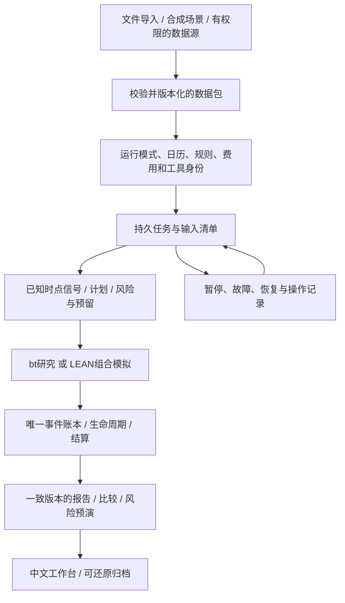

# LyraX v2.0：可靠运行、通用模拟与期权研究升级计划

更新：2026-10-17，Asia/Shanghai。**状态：v2.0本地P0–P8编码及验收完成。** 当前2.0.0，完整1110项逐阶段覆盖、无跳过/xfail，安装、浏览器、在线/离线及备份恢复同业务源码验证通过。证据见[交付说明](V20-DELIVERY.md)和[PROGRESS](PROGRESS.md)。E1/E2/E3及券商自动交易仍独立未验证。

本计划中的“v2.0”是新的工程版本名称。原[GOAL](../GOAL.md)第12节的券商自动交易仍需用户明确启动，本次规划不代表自动下单授权。用户暂缓真实账户的决定继续有效。

## 1. 目标、范围和完成口径

把现有可运行的ETF/期权模拟工作台升级为输入可追溯、任务可恢复、场景可配置、研究可比较的个人研究工具。优先修复本轮实测问题；账户正确性、时点与可复现性继续作为验收标准，不以收益为完成条件。

| 范围 | v2.0安排 | 完成条件 |
|---|---|---|
| 本地必交 | P0–P8：修复、运行契约、通用数据/场景、界面、研究、资金分配预演、新策略、维护与交付 | 下文全部本地验收通过；不依赖真实证券账户 |
| 外部条件分支 | E1真实期权源、E2实际时间paper观察、E3同账户多策略执行 | 各自明确输入/资格后启动，独立记录验证状态 |
| 后续功能池 | 跨期/对角、非标准合约、卖空/期货、多市场等 | 单独立项，不混入本版本地完成判断 |
| 券商自动交易 | 原GOAL的V2分支 | 用户明确指定券商、权限并授权开发后启动 |

本地必交包含**铁鹰与铁蝶两个新增同到期四腿模板的完整模拟闭环**，以及已有滚动/Wheel的操作入口。多策略在本版必交范围内做到**只读资金分配预演**；同账户自动推进多个策略列E3，不能把预演标成已执行。

继续使用单机Python、pandas/NumPy、bt/ffn、LEAN、QuantLib、SQLite、Parquet和Streamlit。一段ETF研究复用bt，一段含期权的组合运行复用LEAN；不拼接不同引擎净值，不引入第二套账本、微服务或复杂撮合引擎。模型不参与日常信号、账务和风险计算。

## 2. 当前基线与新增证据

- v1.95业务源码：`3a057618cbe19480abeddba7f3292db263800833cf4e49a91da25f1cbb6ac18d`；当前wheel为`e776195007a493ecc22b8fe09136efe8989446016d98e4713194fa58858ef335`。
- 已有完整1045项、核心151项无跳过，14项实际浏览器、独立Conda普通wheel及备份恢复证据。这些属于v1.95历史验收，不能替代未来v2.0验证。
- 本轮开始时497个交付文件与原manifest一致。规划文档随后更新；原发布归档保持原样。业务/测试/锁/配置/GOAL均未修改。
- 上一轮审查：[问题及建议](../reports/project-review-20261017/review.md)、[复现结果](../reports/project-review-20261017/findings.json)。本轮新增：[输入绑定](../reports/v20-planning/input-binding.json)、[子进程环境](../reports/v20-planning/worker-environment.json)。reports为本地产物，新机器需通过正式回归重建。
- 真实ETF研究已有实际Yahoo接入，最近交付报告截至2026-10-15；期权向导仍为合成数据。当前没有真实期权来源/使用权、证券原价资格、真实账单或自然前向验收。

### 2.1 已确认的问题

| 编号/优先级 | 证据等级与问题 | 影响及修复目标 | 主要位置 |
|---|---|---|---|
| R20-01 / P1 | 已实跑：batch用市场日历，ETF执行用冻结样本日历；上限4日实际产生5个检查点 | 批次和执行共同引用冻结日历，预算按实际新增检查点计算 | [batch](../src/personal_quant/workspace/batch.py)、[worker](../src/personal_quant/workspace/worker.py) |
| R20-02 / P1 | 已复现：一份损坏job.json使列表和新提交同时JSONDecodeError | 逐记录校验与隔离展示；未知在途任务仍阻断相关写入，允许只读诊断和显式恢复 | [jobs](../src/personal_quant/workspace/jobs.py)、[工作台](../src/personal_quant/ui/v195.py) |
| R20-03 / P2 | 已复现：有效外部SDK路径已配置，发布入口仍因仓库.tools/dotnet不存在而退出2 | 门禁、安装、执行共用工具解析和内容核验 | [发布门禁](../scripts/check_v195.py)、[测试工具路径](../tests/native_tools.py) |
| R20-04 / P1 | 故障注入：Popen已调用，写job.json失败后没有可枚举任务；使用mock，未声称实测杀进程 | 提交意图先持久化、子进程认领和启动握手；失败可查，禁止不明任务重复执行 | [jobs](../src/personal_quant/workspace/jobs.py) |
| R20-05 / P1 | 本轮已实跑：ETF运行一天后更新同系列快照，原run_id继续完成；两天实际引用不同快照，比较policy仍声明初始快照 | 冻结回放绑定完整数据包；比较逐日核对实际依据，拒绝未声明的混合输入 | [worker](../src/personal_quant/workspace/worker.py)、[比较](../src/personal_quant/workspace/experiments.py)、[数据选择](../src/personal_quant/data/selection.py) |
| R20-06 / P2 | 本轮已实跑：父进程-I，工作区子进程仍加载继承PYTHONPATH中的无害sitecustomize标记文件 | 共享子进程环境策略；同一解释器/导入来源可核验，安装与开发模式明确 | [服务](../src/personal_quant/workspace/service.py)、jobs、batch；参考[研究服务](../src/personal_quant/research/service.py) |
| R20-07 / P3 | 文档核对：V195-USAGE仍称最终验证进行中 | 统一当前版本/规划状态；历史证据保留日期与源码 | [操作说明](V195-USAGE.md)、README、agents、PROGRESS |

R20-05样例仅改2024-07-02价格0.1%，运行未新增成交、仍只有一次模拟入金；证明输入身份和比较声明不一致，未据此声称已出现资金损失。R20-06仅在临时目录生成标记文件，未运行引擎或接触真实账户。

### 2.2 其他改进和待验证边界

| 编号 | 性质 | 内容与处理 |
|---|---|---|
| A20-01 | 待定向验证 | 比较/导出/状态在并发导入时是否读取同一账本版本；用并发样例核验，确认后修复或记录无需修改，不先宣布资金错误 |
| A20-02 | 待定向验证 | 父进程先退出、原生子进程仍在运行的清理边界；只识别并处理本次拥有的进程组，不按进程名/端口杀进程 |
| M20-01 | 维护 | 全量约5小时45分、核心约16分钟；增加真正快速组和逐阶段耗时分析，保留发布完整性 |
| M20-02 | 维护 | 旧单进程pytest退出-11根因未定；保留最小重现、运行环境和崩溃日志，现有分进程成功不作为根因结论 |
| M20-03 | 维护 | 子进程错误经worker包装为SIMULATION_FAILED，预算暂停原因散落在嵌套结果；统一结构化原因、阶段和恢复动作 |
| M20-04 | 使用 | 备份依赖cwd、完整备份/比较/工具核验可能阻塞界面；共享workspace入口，耗时操作进入持久任务 |
| M20-05 | 使用 | ETF初始化固定样本，期权配置固定2024两个月及恒100价格；新增通用冻结输入入口，原样例继续作回归 |
| M20-06 | 维护 | 任务列表读取全部历史文件；增加分页/索引与受引用产物保留策略，不能按年龄盲删 |
| M20-07 | 交付 | 无Git HEAD；发布归档虽完整，构建/汇总过程需变成仓库内统一命令；准备提交清单，Git动作仍另需授权 |
| M20-08 | 界面 | 状态、模板能力、错误及运行控制分布在多个版本模块；按职责渐进抽取，保持旧CLI兼容 |

## 3. 完整链路与必须冻结的契约

### 3.1 冻结回放与持续观察

- `run_mode=frozen_replay`：开始时冻结signal/execution/valuation/factor/option-chain快照、日历及所有输入哈希，后续不跟随latest。更新数据只能新建实验，可引用parent_run_id和变更原因。
- `run_mode=forward_paper`：每次真实到达的数据形成追加的日输入清单，记录观察/可用/处理时间；已有信号与事实不改写。当天需要的数据不完整则等待，不通过后来取得的价格补造当时决定。
- 两种模式分别记录账户模式、行情来源、价格口径、合成/模型来源、历史重建或自然前向。真实标的价衍生的模型期权报价仍属于模型场景。
- 现有demo/paper/real隔离继续保留。P0–P8只操作模拟工作区；E2具备数据条件后才开启实际时间paper，不把demo虚拟时钟搬到paper。
- 工程演示允许注入时钟用于测试；正式前向入口禁止任意回填系统时间。原始时区和UTC保留，中文展示Asia/Shanghai。

### 3.2 最小载荷

| 产物 | v2.0新增/统一字段与规则 |
|---|---|
| 数据包 | input_bundle_id、逐用途snapshot_id、schema_version、calendar_hash、来源/单位/时点资格、corporate_action_version、内容清单；不可由series/latest替代确切身份 |
| 运行清单 | run_id、parent_run_id、run_mode、workspace/account_id、source/environment/tool hashes、策略规格与成本版本、输入包或前向序列根、开始/结束及估值政策 |
| 日检查点 | session、实际处理时间、input_bundle_id、账本序号/事件前缀哈希、报告ID、资源检查结果、已提交步骤；输入变化不能重用旧步骤成功 |
| 任务 | job_id、稳定request_id、action、目标运行、参数哈希、请求时间、状态、owner身份、阶段/心跳、deadline、结果/错误码、日志引用 |
| 错误/恢复 | code、phase、retryability、last_committed_checkpoint、必要输入、允许操作；自由日志与脱敏导出分开，不根据字符串猜是否重试 |
| 比较 | 实际输入清单、观测时点、初始资本/外部流、成交/费用/估值/现金收益/引擎口径、完整性；先给差异，再允许符合条件的比较 |

日历至少区分交易会话、合约最后交易/行权截止和结算日期。不能把XNYS日历自动当作所有合约/结算的事实；缺少来源时标假设或未知。

### 3.3 账本、并发及旧数据

- 事件账本保持唯一事实来源。新增任务、预算和研究分配不能写成入金、成交或收益。
- 单工作区写入互斥；SQLite事务和现有publication/simulation/daily锁顺序先形成调用图。任务登记事务不跨越引擎执行，不在持有新锁时反向调用旧锁链。
- 比较/导出绑定同一只读账本版本及引用清单；并发变化时重试或明确失败，不发布混合时点结果。已完成报告可只读查看，不以文件存在代替资格核验。
- 当前账本schema为5；新表需要显式迁移时采用下一版本6，迁移前完整备份、事务回滚、重复升级及新目录恢复均须验证。
- 对旧ETF运行逐日读取实际data步骤/检查点：完整且一致才补登记旧输入身份；混用或证据不足标为`LEGACY_INPUTS_UNVERIFIED`，保留事实和历史报告，阻断严格比较/继续，要求另建实验。不得从当前latest反推历史。
- 原生资格、源码环境绑定随适配变化重新生成；不自动提升旧来源或模板资格。历史档案不作为下载后自动执行的代码。

## 4. P0：先修正确性与恢复问题

**范围：** R20-01至R20-06，及A20-01/02的定向验证；复用本轮复现提炼正式回归，不扩展策略。

1. ETF批次引用其实际冻结日历，预算只数新增检查点；已完成、空批次、重跑、假日、截断和结算单独验证。期权按冻结交易/结算清单推进，不能借“结算宽限”跨过缺报价日。
2. 任务先持久化`SUBMITTED`意图，子进程持唯一令牌认领后进入`RUNNING`。写元数据/启动/握手任一失败都能枚举并核对；同request_id同参数返回已有任务，冲突参数报错。金融事件仍由原服务幂等提交。
3. 状态区分`SUBMITTED/RUNNING/INTERRUPTED/FAILED/SUCCEEDED`与运行的`PAUSED/WAITING/BLOCKED/COMPLETED`。子进程结束不等于整个模拟完成；暂停不自动释放仍在途的资源。
4. 损坏任务显示独立异常项，正常历史仍可查看；未知owner/凭据先核对，禁止“忽略坏文件后直接重新交易”。保留原文件，不覆盖成成功记录。
5. 共享解释器启动器：清除PYTHONPATH/PYTHONHOME影响，显式Python路径、工作目录与依赖环境；普通wheel与明确开发源码模式分别验证。不要盲目给所有开发命令加-I而使源码无法导入。
6. 工具优先级固定为显式参数→专用环境变量→仓库默认，并统一验证LEAN/SDK/适配内容；不通过静默回退另一套工具化解版本错误。
7. ETF恢复和比较在完整P1契约前先补保守检查：输入变化明确阻断原运行，避免旧比较继续错标快照。

**验收：** 五项实际复现及启动窗口故障注入转为正式通过；真实进程测试覆盖启动前后被终止、receipt写失败、双进程提交和PID复用；不杀未知进程、不增加重复资金/成交。A20两项须给出复现结论及必要回归，不能无限留“待调查”。

## 5. P1：运行与输入版本贯通

**范围：** 第3节契约、旧schema迁移、ETF/期权输入身份和公平比较。

- 冻结signal/execution/valuation分离的实际快照；策略回看区间、估值日历、公司行动版本及成本模型均入清单。
- 每个步骤只读清单指定的输入；数据更新、角色重绑、历史修订、source/依赖改变分别产生可理解的阻断原因。
- 比较同时检查归档清单与逐检查点实际引用；数据包不同可以并排查看并说明差异，不能显示同口径排名。
- 前向序列的追加/迟到/修订接口完成本地测试，但实际前向验收在E2；不得将测试注入时钟当自然时间证据。
- 克隆支持显式选择配置与输入包，不复制账务事实；继承哪些参数/费用/来源在创建前预览。

**验收：** 开始后修改latest、重绑用途或修订未来输入均不能悄悄改变冻结实验；不同日输入混用被发现；恢复与连续运行的信号、事实、现金/持仓和报告一致；旧混用实验仍可查、不能被自动“修正”为新历史。

## 6. P2：通用数据导入和场景包

复用现有DataStore、OptionDataStore、数据映射/资格服务；当前已有标准CSV、合约/报价校验和来源资格，本阶段增加的是工作区级衔接与自定义输入，不重写这些底层功能。

### 6.1 通用入口

- 创建工作区时选择固定样例、已存在冻结数据包或标准导入；ETF不再只能生成固定fixture，期权不再只能使用固定两个月。
- 提供导入预览、字段/时区映射、缺失与冲突说明、提交回执和撤销未提交预览；不删除已被运行引用的快照。
- 供应商适配接口统一分页、有限重试/退避、增量游标、重叠修订、错误分类及原始凭据引用。先以记录回放/故障样例验证协议；E1选择供应商后才宣称在线接通。
- 报价与标的时间错位、缺买卖价/数量、零成交量、陈旧合约、历史回填时间、单位/公司行动未知均沿用现有检查，不能为了通过导入填成可成交数据。
- 期权链必须包含当时可见的候选合约范围和所选合约依据；只有最终选中的合约文件不等于完整选约样本。

### 6.2 可复现合成场景

- schema化参数：时间范围、初始价、路径节点/随机种子、IV路径、买卖价差/可用报价、合约条款、分红/拆股/结算假设和故障场景。
- 优先提供确定性小路径：横盘、上涨、下跌、跳空、IV变化、报价中断、到期边界、部分履约及结算等待；随机扩展固定种子和生成器版本。
- 合成报价可复用QuantLib生成，但明确标注模型与参数，不声称可成交。标准机械样例与模型定价样例分开；两者都不能取得真实来源资格。
- 多腿报价有共同观测时点、行权价排序、tick/乘数、期限和有效期约束。跨腿矛盾的合成报价默认拒绝；专门故障样例必须显式标识，不能进入可执行计划。
- 场景参数先冻结，再观察结果；未来路径只供回放读取相应前缀，不能提前进入选约/信号。生成规模、磁盘和执行预算配置化。

**验收：** 至少三个月的非恒价完整回放，跨月/节假日/提前收市/到期/结算场景；同种子同输入同哈希，改未来路径不改过去信号；缺报价和资金不足明确暂停；固定v1.95样例结果仍可复现。

## 7. P3：中文工作台和恢复操作

- 配置页串联“工作区→输入预览→策略规则→资金/费用→冻结→运行”，可直接选择已验证工具，不要求普通操作手工拼绝对路径及run_id。
- 为持续持股滚动与Wheel提供完整表单：退出/开新条件、现金缓冲、覆盖、费用、合约政策和最大周期；展示当前阶段、实际凭据及下一阶段的阻断原因。
- 运行页显示提交/运行/完成时间、处理日、最新检查点、各阶段耗时、预算剩余与建议动作；暂停、继续、失败重试采用稳定请求身份，重复点击不重复任务。
- 维护任务、比较和导出异步执行，刷新只读取持久状态。日志按任务下载，有容量上限及脱敏规则；脱敏包同时保留允许公开的预算暂停原因。
- 四页共享工作区/账户/查看时间/实验上下文；切换时清理该工作区专属表单、诊断、预览和确认状态，不串用旧设置。
- 为缺失、未知、历史、模型、合成、真实来源、等待、阻断和失败提供统一中文说明。展示“后续如何处理”，不能用统一绿色“成功”代替实际运行状态。
- 策略能力按当前模板+源码+输入/资格生成。高级JSON继续保留，不作为普通流程必填入口。

**验收：** 实际浏览器从新目录建立ETF、期权和Wheel实验；配置→暂停→重启→恢复→导出，四页往返/手机窄屏/重复点击/坏任务记录均可操作；页面查看不新增事实，两个工作区状态不串用。

## 8. P4：期权研究协议与收益解释

- 把现有ETF分段/成本验证方式延伸到期权。冻结研究问题、候选参数、开发/评估区间、可见数据、基准、成本、现金收益和退出政策；保持少量预定实验上限。
- 每个窗口明确预热、首次决策/成交、窗口结束仍有持仓时的估值或平仓政策。强制平仓和持仓估值不能在同一排名中混用；窗口合并必须处理边界交易和初始资金，不能简单拼接净值。
- 分别报告佣金、已计入成交价的价差、持股/期权损益、现金收益及残差；不重复扣价差，不用Greeks近似解释替代账本收益。
- 真实报价研究、合成路径压力、理论终值损益保持各自标签。已有热力图/Greeks/同资本比较继续复用，新增的是多周期/区间/成本实验和资格约束。
- 对报价稀疏、期限不连续、合约候选缺失及非常规单位给出有效覆盖率和不能评估的原因，不只展示成功交易。
- 外部资金流存在时，账户资金回报与策略表现分别展示；继续使用已有XIRR及ffn能力，缺少可靠时点评估时不宣称精确TWR。

**验收：** 同资金/同数据/同期间的候选和基准比较；改费用只影响约定费用及后续合法资金约束；短样本年化有标签；失败/未完成/数据不全的实验不能进入公平排名；未使用最终评估结果反复选参数。

## 9. P5：多策略资金分配预演

本阶段是只读规划扩展，明确输出`PREVIEW_ONLY`；不生成成交、公共可执行计划或真实资金事件。

- 接收同一账户的同一时点快照、策略目标与风险预算，报告建议预算、总现金需要、股份覆盖、期权担保、费用预留及冲突。
- 策略间不重复使用同一现金或100股覆盖；不能把未成交卖出款、待结算款和已经预留的现金再次分配。
- 入金按账户事实记录一次；对子策略分配属于内部归属，不算新入金或利润。账户总额与策略分配加未分配额可核对。
- 单次运行预演绑定账本/计划/预留版本，状态变化即失效；不同来源、时间或币种不能合并成一个账户结论。
- 展示规则解释和冲突修正建议，不自动挑选回测赢家、不自动执行策略间调拨。

**验收：** 两个策略同时要求同一现金/股份时被识别，部分成交/结算后预演重新计算，重复预演零金融写入；人工小样本能核对总额。需要实际多策略执行时进入E3。

## 10. P6：铁鹰、铁蝶的四腿模拟闭环

本地必交两个模板，不把已有catalog名称视为已支持。仅标准同标的、同到期、相同乘数/交割物的四腿组合，日线/月度决策；精确行权价选择、距离、费用、期限和预算在实现前写规则版本。

| 模板 | 最小定义 | 必须处理的中间状态 |
|---|---|---|
| 铁鹰 iron_condor | Put保护腿+Put短腿+Call短腿+Call保护腿，行权价依次递增，包数及方向显式冻结 | 双保护腿建成后才开相应短腿；一侧指派、缺腿、部分成交、退出失败 |
| 铁蝶 iron_butterfly | 两侧保护腿，Put/Call短腿共用中间行权价；翼宽规则冻结 | 中间价附近到期、单边/部分指派、腿间退出和结算不同步 |

- 不默认原子组合成交。复用成熟引擎逐腿执行与公共计划/预留，每个实际成交端点核对资金和暴露；保护未建立不能形成无依据短腿义务。
- 终值有限损益不能代替中间履约资金。资本不足明确阻断，不能依靠未证实的券商组合保证金或借款继续。
- 对齐完整链与腿间时点；开仓权利金计现金同时确认负债，不能立即记成盈利。合约量、腿比例、价差和手续费用独立算例核对。
- 提前退出默认按冻结政策处理；真实报价缺失时不假定成交。自然到期/行权/指派按当前已验证引擎模型与合约政策形成凭据，缺少股份交付或资金条件时保留异常，不能虚构现金结算。
- 每个新模板独立完成规则→选约→资格→计划/预留→原生成交→部分成交/履约→结算→统一账本→报告/恢复。新适配改变旧模板行为时重验对应资格。
- 只使用公开扩展接口，不修改LEAN核心或自写撮合/交割引擎；复杂盘口和实际指派概率不在本阶段支持范围。

**验收：** 每模板独立覆盖价内/价外/边界、保护腿失败、每种关键部分成交端点、部分指派、现金/股份不足、缺报价、结算等待、两周期、重启及备份恢复；现金和持仓手算预期通过后才开放向导“模拟执行”。若能力受阻，不自行将本必交项降成仅目录或情景。

## 11. P7：维护、性能与交付工具

### 11.1 可恢复任务与资源预算

- 共享进程创建、owner校验、错误传递和恢复协议，覆盖模拟、研究、备份/恢复、比较/导出；适配现有task表与工作流，避免平行维护第二套财务状态机。
- 为排队、输入/源码/工具预检、引擎执行、发布分别记耗时，明确总预算与阶段预算；覆盖当前时间限制只计子任务的边界。
- 达到预算在安全边界停止自有任务；需要终止进程时核实组归属，保留已提交事实和未完成证据。不能因超时直接判账户操作未发生。
- 元数据查询分页并可重建索引；孤立文件先列入诊断。清理预览显示被哪个运行/计划/报告/恢复记录引用，实际删除前再核对。

### 11.2 验证和性能

- 提供fast、integration、native、ui、release层次，先从当前逐测试日志统计耗时与依赖；fast只跑纯逻辑/必要小样本，建议同机器目标3分钟内，目标未达应公开实际耗时。
- 不用降低资金断言、跳过原生组或减少发布节点换速度。发布重新收集全部测试，逐setup/call/teardown核对，无跳过/xfail。
- 优先优化重复源码/工具扫描和不变输入加载；缓存绑定完整内容与环境，写入/绑定/恢复等信任边界重新校验，不用仅mtime代替哈希。
- 保留旧-11失败资料，生成可定位到测试节点的日志、Python/原生版本、退出码和必要崩溃信息；支持超时失败终态。不能把拆进程通过写成已修复未知底层原因。
- 同机报告优化前后阶段耗时、峰值空间及差异；WSL挂载盘与Linux原生盘分别说明，不给未经测量的速度承诺。

### 11.3 安装、备份与版本

- 普通wheel、源码安装、示例数据包、LEAN/SDK资源身份明确；仓库外、空格路径、无.tools但显式外部工具、只读site-packages均验证。
- 提供仓库内可重建的发布入口，生成源码/wheel/验证证据及SHA256清单；任何文件修改形成新发布清单，旧v1.95归档不覆盖。
- `workspace backup/verify/restore`一类统一入口定位配置，避免用户先cd；沿用已有SQLite完整备份格式/引用核验。大任务异步，结果可恢复。
- 准备Git首提交和标签审阅清单，排除实际行情、账单、密钥、运行目录、SDK和浏览器；本计划不自动commit/tag/push。
- 本地调度先提供安装预检、dry-run、状态识别和停用/恢复说明；实际安装及自然观察证据归E2。外部通知/云端上传需要明确平台和授权。

## 12. P8：最终验收及交付

### 12.1 阶段依赖

| 阶段 | 前置 | 主要出口 | 当前状态 |
|---|---|---|---|
| P0 修复与复现 | v1.95基线与本轮证据 | R20-01至06、A20边界结论及回归 | 完成 |
| P1 输入/任务/迁移契约 | P0 | 冻结模式、日清单、可追溯比较与升级 | 完成 |
| P2 数据包/场景 | P1 | 通用导入、三月以上场景和质量检查 | 完成 |
| P3 中文工作台 | P1/P2 | 滚动/Wheel及持久任务操作 | 完成 |
| P4 期权研究协议 | P1/P2 | 窗口/成本/基准/报告 | 完成 |
| P5 资金分配预演 | P1 | 只读预算与覆盖冲突核对 | 完成 |
| P6 新四腿模板 | P2/P4及生命周期契约 | 铁鹰/铁蝶独立完整模拟资格 | 完成 |
| P7 维护与性能 | 从P0持续，P8前完成 | 统一工具、备份、分层验证与发布入口 | 完成 |
| P8 验收交付 | P0–P7全部通过 | 同一最终源码的完整证据与文档 | 完成 |

单Agent按模块推进。P0结束记录修复量和真实耗时，P2结束根据原生路径成本更新剩余估计；不将本轮规划估计作为工期承诺，不自动升级模型/套餐或购买服务。模型/API/工具费用没有统计权限时标“未获取”，实际Goal累计用量与阶段API账单不混算。

### 12.2 必须满足的清单

- [x] 五项已实际复现的问题及R20-04启动窗口有独立预期的正式回归；A20结论明确。
- [x] 冻结实验不受latest/角色重绑影响，前向追加不覆盖既有依据，比较使用真实输入身份。
- [x] 子进程环境、工具目录和源码/依赖身份统一，无手工环境变量才能通过的隐藏门槛。
- [x] 通用数据包、非恒价多月场景、缺价/迟到/修订/公司行动边界可复现。
- [x] 常价入金不算收益，费用/价差/分红/拆股/担保/结算不重复，人工账本核对通过。
- [x] 启动、重复点击、提交失败、部分成交、被终止和报告发布中断都可恢复且不重复记账。
- [x] 四页实际浏览器及滚动/Wheel流程可用，刷新不执行研究/成交。
- [x] 期权研究区间、成本和基准公平；数据或口径不同明确拒绝公平排名。
- [x] 多策略预演只读且识别共享资金/股份冲突，未冒充多策略执行。
- [x] 铁鹰、铁蝶各自的选约、原生、资金、生命周期、报告及恢复全部通过。
- [x] schema5到6（如启用）的备份/迁移/回滚/重复/异目录恢复通过；旧CLI及只读档案兼容。
- [x] 同一最终源码、C#适配、依赖锁、清洁安装、完整测试、浏览器和发布清单一致；完整回归无跳过。
- [x] 所有操作文档标记为已验证的命令实际执行；来源/权限/自然观察未验部分明确保留。

交付`V20-USAGE.md`、`V20-ACCEPTANCE.md`、`V20-DELIVERY.md`、支持矩阵、迁移与恢复说明、发布清单及同版本证据。以上已交付实质内容，最终源码、普通wheel、详细验证包和SHA256清单位于reports/v20-validation/release-final。

当前版本已更新为2.0.0，已完成普通wheel构建及独立安装定向验证；依赖锁沿用已验证版本。完整同源门禁已通过；部分旧测试修正后的阶段续跑及原失败回执如实归档。不因核心完成提前宣布P6/P8完成，也不因外部条件未具备反复重跑已经未变的本地验证。

## 13. 条件分支及后续功能池

| 分支 | 功能 | 所需输入/退出标准 |
|---|---|---|
| E1 | 一个真实期权数据源的只读适配 | 指定供应商、凭据、使用权、历史与实时字段覆盖/配额/费用；实际下载并验证单位/时点/公司行动，只有公开文档或离线录制不算接通 |
| E2 | 合格真实数据的paper自然观察 | E1或已有合格ETF信号与原价输入、用户选择调度方式、实际运行机器；记录真实采集/任务/信号时间，至少经历所选规则需要的月末/到期/结算事件；缺周期就继续标未观察 |
| E3 | 同一模拟账户多策略执行 | P5之后明确归属、冲突优先级、资金/股份转用和收益分摊；共用一个组合引擎与账本，部分成交/重启不重复占用；单独完成执行验收后开放 |
| E4 | 跨期/对角、PMCC与普通蝶式等 | 近远月估值/行情同步、期限间资金、不同腿比例与履约路径分别验证；不由同到期四腿成功推断 |
| E5 | 其他期权产品与公司行动 | 现金结算指数、非100乘数、特殊交割等先定义合约/结算适配与资格；禁止复用当前标准美式假设 |
| E6 | 股票卖空/配对、期货、多市场/多币种 | 借券/保证金/召回、逐日盯市、交易日历、税费与FX账本独立需求 |
| E7 | 远端CI、通知、云备份、券商只读 | 明确托管平台/发送/上传权限；本地记录和诊断先可用，不自动外发账户材料 |
| 原GOAL-V2 | 券商模拟接入与自动交易 | 用户明确授权，选择官方/成熟适配器，验证订单幂等、部分成交、超时核实和重启恢复；真实资金自动下单仍需独立授权 |

暂不引入机器学习参数搜索、盘中Delta/Gamma或0DTE执行。未来新增范围先登记数据频率、执行与风险模型，不把日线试验当作相应能力。

## 14. 本轮规划结果与恢复入口

- 完成额外代码审查；新确认ETF输入版本混用/比较错标、子进程环境继承两项。原三项复现与启动窗口故障注入并入本计划。
- 新复现使用临时模拟账户，只有初始入金，未新增成交。输入绑定脚本初次因查询列名`outputs`写错而失败，改为现有`output`列后退出0；这是审查脚本错误，不列为产品缺陷。
- 验证规划中的本地链接、编号/阶段映射、受保护文件哈希和Git状态；具体结果见PROGRESS及`reports/v20-planning/verification.json`。
- **用户已授权编码，当前恢复动作：** 先读PROGRESS，核实最终门禁及当前验证句柄终态，继续未完成验收，不重做未改变的已验证步骤。

## 15. 最终验收归档

业务源码8397988c…，普通wheel版本2.0.0；完整1110节点/3330阶段、484受保护输入不变，九个完整进程阶段全部通过。原失败/取消整轮未升级为成功，源与测试作用域相同的完整阶段按原始日志/档案SHA核验复用，变更的隔离测试所处整个进程重跑，细节见V20-DELIVERY及验证包中的isolated-test-fix/reused-phases/原回执。schema仍5，没有启用6，条件式5→6验收不适用，旧迁移/回滚/重复和异目录恢复由完整回归覆盖。

真实ETF2853行截至2026-10-16，9CSV固定快照复现；模型期权三周期、铁鹰/铁蝶生命周期/公共计划/恢复、滚动/Wheel实际界面均通过。E1真实期权来源、E2自然前向、E3同账户多策略执行未验。模型/API/工具实际用量与费用未获取，未自动购买/安装调度/外发/Git动作。
